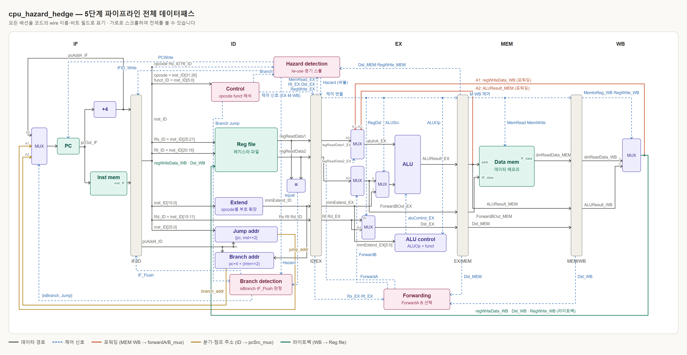
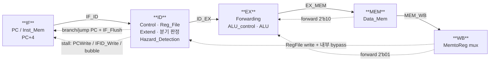
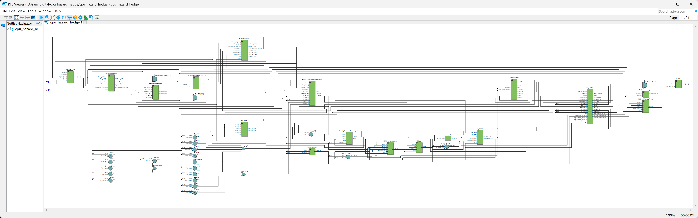
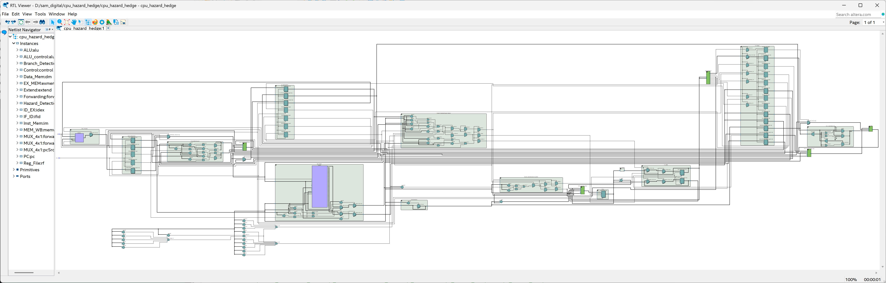
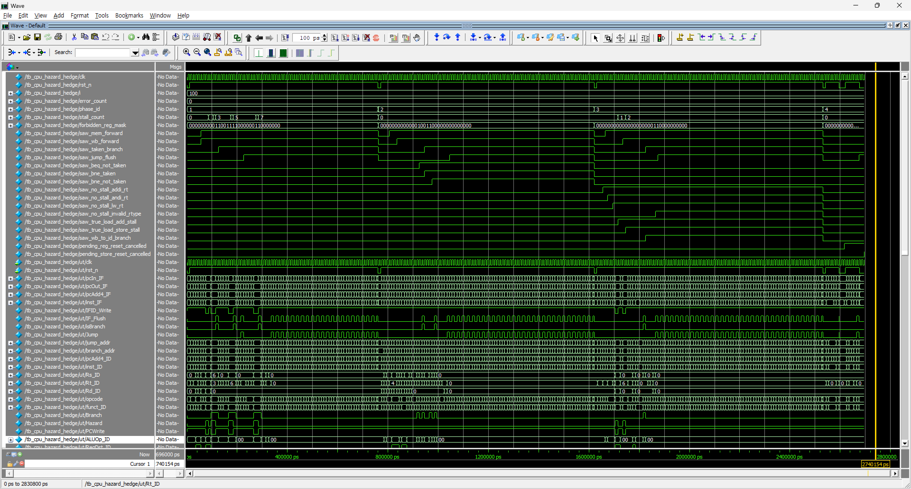
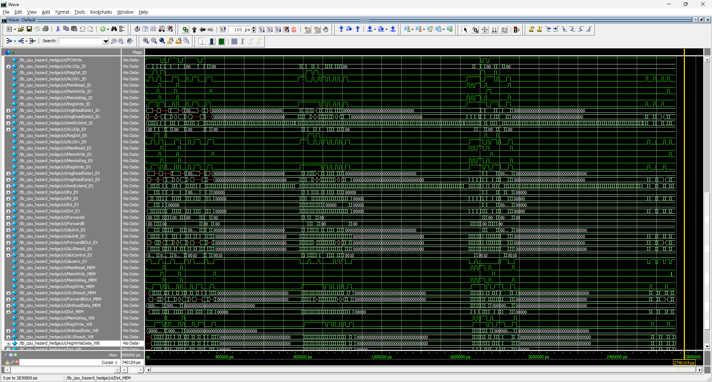
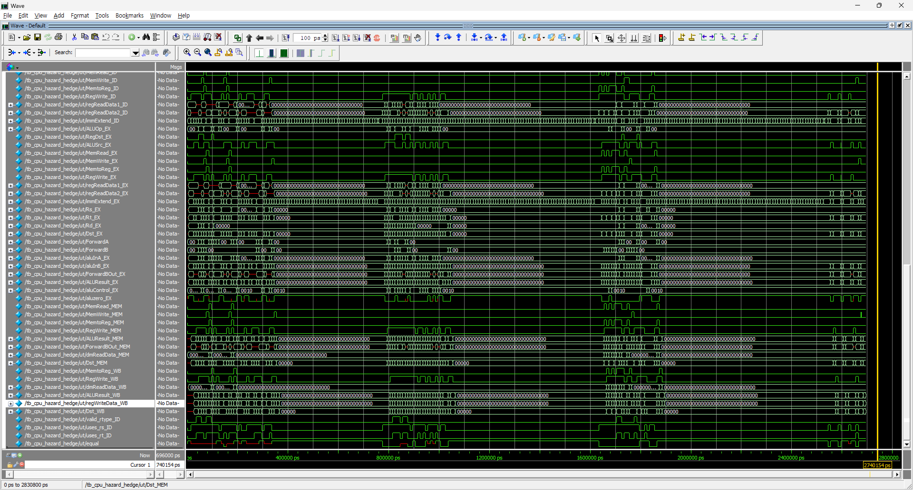

# 5-Stage Pipelined MIPS CPU (Hazard Handling)

앞선 [hazard 미처리 버전](../5-9-cpu)의 후속으로, **데이터·제어 hazard를 하드웨어에서 직접 처리**하는 5단계 파이프라인 CPU입니다. Forwarding, stall(bubble), flush를 모두 구현해 프로그램이 hazard를 신경 쓰지 않아도 정상 동작합니다.

- **ISA:** R-type(`add`/`sub`/`and`/`or`/`slt`), `addi`, `andi`, `lw`, `sw`, `beq`, `bne`, `j`
- **Hazard 처리:** Forwarding unit + Hazard detection unit + IF flush
- **분기 해결:** **ID 단계** (분기 페널티 1)
- **레지스터:** 32 × 32-bit, `r0` 하드와이어 0, WB→ID 내부 bypass 내장
- **구조:** 블록별 파일 분리 (파이프라인 레지스터도 각각 독립 모듈)

---

## 이전 버전과의 차이

| 항목 | 5-9-cpu (미처리) | **이 버전 (처리)** |
|---|---|---|
| RAW 의존 명령 간격 | **4칸 이상** 필요 | **제약 없음** (연속 의존 OK) |
| load-use | 프로그램이 회피 | **1 cycle stall** 자동 삽입 |
| 분기 해결 단계 | MEM | **ID** |
| 분기 페널티 | 3 (NOP 3개 수동 삽입) | **1** (자동 flush) |
| 지원 명령 | add/sub/and, lw/sw/beq, addi/andi | `or`/`slt`/`bne`/`j` 추가 |
| 코드 구조 | 단일 `cpu.v` + 공용 `D_FF` | 블록별 모듈 분리 |

측정 결과, 연속 의존(거리 1) 체인이 **stall 0회**로 정상 동작합니다.

```
addi r1, r0, 7
add  r2, r1, r0   ← 거리 1
add  r3, r2, r0   ← 거리 1
add  r4, r3, r0   ← 거리 1
→ r1=7 r2=7 r3=7 r4=7,  stall = 0
```

이전 버전에서는 거리 1~3이 모두 실패했던 경우입니다.

---

## Pipeline Overview



> 원본은 [`cpu_datapath_detailed.html`](cpu_datapath_detailed.html)입니다. 브라우저로 열면 벡터라 무한히 확대해서 볼 수 있습니다. 위 PNG는 그 렌더링 결과입니다.

전체 데이터패스입니다. 왼쪽부터 IF → ID → EX → MEM → WB 순으로 놓이고, 회색 세로 막대 4개가 파이프라인 레지스터(IF/ID, ID/EX, EX/MEM, MEM/WB)입니다. **배선 위의 이름은 `cpu_hazard_hedge.v`의 wire 이름과 그대로 일치**하므로 코드와 나란히 놓고 따라갈 수 있습니다. 같은 값이 레지스터를 건널 때마다 `_ID` → `_EX` → `_MEM` → `_WB`로 접미사가 바뀌는 것도 그림에서 그대로 보입니다.

선의 색이 곧 역할입니다.

| 색 | 경로 | 내용 |
|---|---|---|
| 진회색 실선 | 데이터 | 단계 간 주 데이터 흐름 |
| 파란 점선 | 제어 | Control·Hazard_Detection·Forwarding·Branch_Detection이 만드는 신호 |
| 주황 | forwarding | `ALUResult_MEM` / `regWriteData_WB` → EX의 `forwardA_mux`·`forwardB_mux` |
| 황토 | 분기·점프 주소 | ID에서 계산한 `branch_addr` / `jump_addr` → IF의 `pcSrc_mux` |
| 청록 | write-back | `regWriteData_WB` → `Reg_File` 쓰기 포트 |

앞으로만 흐르는 데이터패스에서 **뒤로 되돌아가는 경로 3개**가 이 설계의 핵심이고, 색을 따로 준 이유이기도 합니다.

1. **주황 (forwarding)** — MEM·WB에 있는 아직 레지스터에 안 써진 값을 EX 입력으로 우회시켜 RAW 의존 간격 제약을 없앱니다. MUX 입력 번호(`A0`/`A1`/`A2`)는 `MUX_4x1`의 포트 이름과 같아서, `ForwardA == 2'b10`이면 `A2`(MEM 결과)가 선택된다는 것을 그림에서 바로 확인할 수 있습니다.
2. **황토 (분기·점프)** — 이전 버전과 달리 이 선이 **MEM이 아니라 ID에서 출발**합니다. 분기 페널티가 3에서 1로 줄어든 이유가 이 한 가지입니다.
3. **청록 (write-back)** — WB 결과가 ID의 레지스터 파일 쓰기 포트로 돌아갑니다. `Reg_File` 내부의 WB→ID bypass와 짝을 이루는 경로입니다.

ID 단계에 블록이 몰려 있는 것도 분기를 앞당긴 결과입니다. `inst_ID` 버스에서 `opcode[31:26]`·`Rs[25:21]`·`Rt[20:16]`·`Rd[15:11]`·`funct[5:0]`·`imm[15:0]`이 각각 갈라져 나가고, 여기에 두 소스를 비교하는 `=` 비교기, `Branch_Detection`, `Hazard_Detection`이 전부 ID에 들어갑니다. 분기 판정에 필요한 값이 아직 EX/MEM에 있으면 forwarding으로는 못 풀기 때문에, 이 경우는 `Hazard_Detection`이 stall로 처리합니다 ([Flush](#3-flush-제어-hazard) 참고).

단계 흐름만 간단히 보면 다음과 같습니다.



이전 버전과 달리 **분기·점프가 ID에서 결정**되고, EX 입력에 **forwarding 경로**가, IF/ID에 **stall·flush 제어**가 추가되었습니다.

---

## Modules

| 파일 | 역할 |
|---|---|
| `cpu_hazard_hedge.v` | 최상위 — 5단계 데이터패스와 hazard 제어 연결 |
| `PC.v` | `PCWrite`로 갱신을 막을 수 있는 PC 레지스터 |
| `Inst_Mem.v` | 명령어 메모리 (100 word, 조합 읽기) |
| `IF_ID.v` / `ID_EX.v` / `EX_MEM.v` / `MEM_WB.v` | 파이프라인 레지스터 (각각 독립 모듈) |
| `Control.v` | opcode·funct → 주 제어 신호 |
| `Reg_File.v` | 32×32b, `r0` 하드와이어 0, **WB→ID 내부 bypass** |
| `Extend.v` | `andi`는 zero-extend, 나머지는 sign-extend |
| `Branch_Detection.v` | `beq`/`bne` 성립 판정, `IF_Flush` 생성 |
| `Hazard_Detection.v` | load-use·분기 의존 검출 → stall 신호 |
| `Forwarding.v` | EX 입력 forwarding 경로 선택 |
| `ALU_control.v` | `ALUOp` + funct → ALU 연산 코드 |
| `ALU.v` | AND/OR/ADD/SUB/SLT/NOR, `zero` 플래그 |
| `Data_Mem.v` | 데이터 메모리 (1000 word), byte→word 주소 변환 |
| `MUX_4x1.v` | PC source 선택과 forwarding에 공용 사용 |

---

## Instruction Formats (Reference)

MIPS 명령은 세 가지 형식으로 나뉩니다. **비트 필드 순서와 어셈블리 표기 순서가 다르다**는 점이 헷갈리기 쉬운 부분이라 함께 정리합니다.

### R-type — 레지스터끼리 연산

```
 31    26 25  21 20  16 15  11 10   6 5     0
┌────────┬──────┬──────┬──────┬──────┬────────┐
│ opcode │  rs  │  rt  │  rd  │shamt │ funct  │
│ 000000 │  5b  │  5b  │  5b  │  5b  │   6b   │
└────────┴──────┴──────┴──────┴──────┴────────┘
```

- 어셈블리: **`add rd, rs, rt`** → 목적지가 **먼저**, 비트 필드는 `rs`가 먼저
- opcode는 항상 `0x00`이고, 실제 연산은 `funct`가 결정

| 명령 | funct | 동작 |
|---|---|---|
| `add rd, rs, rt` | `0x20` | `rd = rs + rt` |
| `sub rd, rs, rt` | `0x22` | `rd = rs - rt` |
| `and rd, rs, rt` | `0x24` | `rd = rs & rt` |
| `or rd, rs, rt` | `0x25` | `rd = rs \| rt` |
| `slt rd, rs, rt` | `0x2A` | `rd = ($signed(rs) < $signed(rt)) ? 1 : 0` |

### I-type — 즉시값 / 메모리 / 분기

```
 31    26 25  21 20  16 15                   0
┌────────┬──────┬──────┬─────────────────────┐
│ opcode │  rs  │  rt  │      immediate      │
│   6b   │  5b  │  5b  │         16b         │
└────────┴──────┴──────┴─────────────────────┘
```

여기서 `rt`의 역할이 명령마다 다릅니다 — **목적지**일 수도, **소스**일 수도 있습니다. 이 구분이 곧 [거짓 stall 방지](#uses_rs_id--uses_rt_id--거짓-stall-방지)의 핵심입니다.

| 명령 | opcode | 어셈블리 표기 | 동작 | `rt` 역할 |
|---|---|---|---|---|
| `addi` | `0x08` | `addi rt, rs, imm` | `rt = rs + sign_ext(imm)` | **목적지** |
| `andi` | `0x0C` | `andi rt, rs, imm` | `rt = rs & zero_ext(imm)` | **목적지** |
| `lw` | `0x23` | `lw rt, offset(rs)` | `rt = MEM[rs + offset]` | **목적지** |
| `sw` | `0x2B` | `sw rt, offset(rs)` | `MEM[rs + offset] = rt` | **소스** (저장 데이터) |
| `beq` | `0x04` | `beq rs, rt, offset` | `if (rs == rt) PC = PC+4 + offset×4` | **소스** (비교값) |
| `bne` | `0x05` | `bne rs, rt, offset` | `if (rs != rt) PC = PC+4 + offset×4` | **소스** (비교값) |

**`lw`/`sw`의 `offset(rs)` 표기**가 특히 헷갈립니다. 괄호 안의 `rs`가 **base 주소 레지스터**이고, 괄호 앞의 숫자가 **byte 단위 offset**입니다.

```
sw  r4, 8(r0)      →  MEM[r0 + 8] = r4      →  base=r0, offset=8, 저장할 값=r4
lw  r5, 8(r0)      →  r5 = MEM[r0 + 8]      →  base=r0, offset=8, 목적지=r5
```

주소는 **byte 단위**이므로 word 인덱스로는 `offset/4`입니다. `Data_Mem`이 `addr >> 2`로 변환합니다 — `sw r4, 8(r0)`는 `memory[2]`에 씁니다.

**분기 offset**도 word 단위입니다. 하드웨어가 `(immExtend << 2) + pcAdd4`로 계산하므로, `beq rs, rt, +2`는 "분기 명령 다음 명령에서 2칸 더 뒤"로 점프합니다. 즉 **명령 2개를 건너뜁니다.**

### J-type — 절대 점프

```
 31    26 25                                 0
┌────────┬───────────────────────────────────┐
│ opcode │            target                 │
│ 000010 │              26b                  │
└────────┴───────────────────────────────────┘
```

- 어셈블리: **`j target`**
- `PC = {pcAdd4[31:28], target, 2'b00}` — target을 4배해서 하위 28비트를 채우고, 상위 4비트는 현재 PC 영역을 유지
- `j 20`은 word 인덱스 20(byte 주소 80)으로 점프합니다

---

## Hazard 처리 — 세 가지 메커니즘

### 1. Forwarding (데이터 hazard)

`Forwarding` 모듈이 EX 단계 피연산자를 뒤쪽 파이프라인 결과로 우회시킵니다.

```verilog
if      (RegWrite_MEM && Dst_MEM != 0 && Dst_MEM == Rs_EX) ForwardA = 2'b10; // MEM 우선
else if (RegWrite_WB  && Dst_WB  != 0 && Dst_WB  == Rs_EX) ForwardA = 2'b01; // 그다음 WB
```

| 선택값 | 소스 | 의미 |
|---|---|---|
| `2'b00` | `regReadData_EX` | forwarding 없음 (레지스터 파일 값) |
| `2'b01` | `regWriteData_WB` | WB 단계 결과 |
| `2'b10` | `ALUResult_MEM` | MEM 단계 결과 |

**MEM이 WB보다 우선**입니다. 같은 레지스터를 두 명령이 연속으로 쓴 경우 더 최신 값(MEM 쪽)을 써야 하기 때문입니다.

> `ForwardB`의 출력 `ForwardBOut_EX`는 ALU 입력뿐 아니라 **`sw`의 저장 데이터**로도 EX/MEM에 전달됩니다. 덕분에 store 데이터에 대한 forwarding도 함께 해결됩니다.

### 2. Stall (load-use hazard)

Forwarding으로 풀 수 없는 경우가 있습니다. `lw`의 결과는 MEM 단계가 끝나야 나오는데, 바로 다음 명령은 그 직전 EX에서 값이 필요합니다. 이때는 **1 사이클 멈추는** 수밖에 없습니다.

```verilog
if (MemRead_EX && (Rt_EX != 5'd0) &&
    ((uses_rs_ID && Rt_EX == Rs_ID) || (uses_rt_ID && Rt_EX == Rt_ID))) begin
    IFID_Write = 0;  // IF/ID 유지
    Hazard     = 1;  // ID/EX에 bubble
    PC_Write   = 0;  // PC 정지
end
```

세 신호가 함께 동작합니다.

- `PC_Write = 0` → PC 정지 (같은 명령 재fetch)
- `IFID_Write = 0` → IF/ID 값 유지 (ID 명령 보존)
- `Hazard = 1` → ID/EX **제어 신호만 0으로** 만들어 bubble 삽입

측정 결과 `lw` → `add` 의존에서 정확히 **1 사이클** stall 후 올바른 값이 전달됩니다.

#### `uses_rs_ID` / `uses_rt_ID` — 거짓 stall 방지

이 설계의 정교한 부분입니다. 단순히 "레지스터 번호가 같으면 stall"로 구현하면, **rt를 목적지로 쓰는 명령**에서 불필요한 stall이 생깁니다.

```verilog
assign uses_rt_ID = valid_rtype_ID          // R-type: rt는 소스
    || (opcode == 6'h2B)                    // sw:  저장 데이터로 rt 사용
    || (opcode == 6'h04) || (opcode == 6'h05); // beq/bne: 비교값
```

`addi`, `andi`, `lw`는 rt가 **목적지**이므로 소스로 치지 않습니다. 예를 들어 `lw r1, ...` 다음에 `addi r1, r0, 9`가 와도 r1을 읽는 게 아니라 덮어쓰는 것이므로 stall이 필요 없습니다. 테스트벤치가 이 케이스들을 명시적으로 검증합니다(`saw_no_stall_addi_rt` 등).

지원하지 않는 R-type(`valid_rtype_ID`가 거짓)도 소스를 쓰지 않는 것으로 처리해 거짓 stall을 막습니다.

### 3. Flush (제어 hazard)

분기와 점프를 **ID 단계에서 해결**하므로, 잘못 fetch된 명령은 **1개**뿐입니다.

```verilog
if (!Hazard) begin
    if (Jump) IF_Flush = 1;
    else if (Branch) begin
        if ((opcode == 6'h04 && equal) || (opcode == 6'h05 && !equal)) begin
            isBranch = 1;  IF_Flush = 1;
        end
    end
end
```

`IF_Flush`가 1이면 `IF_ID`가 다음 클럭에 0(NOP)으로 채워져 그림자 명령이 무효화됩니다.

PC 소스는 `MUX_4x1`이 `{isBranch, Jump}`로 선택합니다.

| sel | 선택 |
|---|---|
| `2'b00` | `pcAdd4` (순차) |
| `2'b01` | `jump_addr` |
| `2'b10` | `branch_addr` |
| `2'b11` | (발생하지 않음) |

`Branch_Detection`에서 `Jump`일 때는 `isBranch`가 0으로 유지되므로 두 신호가 동시에 1이 될 수 없습니다 — `2'b11` 조합은 **구조적으로 배제**됩니다.

#### 분기를 ID로 앞당긴 트레이드오프

이 설계의 가장 중요한 아키텍처 결정입니다. **분기를 어느 단계에서 판정하느냐**가 두 가지 비용을 정반대 방향으로 움직입니다.

**얻는 것 — 분기 페널티 감소**

분기 결과가 나올 때까지 IF는 계속 명령을 가져옵니다. 판정이 늦을수록 버려야 할 명령이 늘어납니다.

| 판정 단계 | 낭비되는 fetch | 이전 버전 대비 |
|---|---|---|
| MEM (5-9-cpu) | **3개** | 기준 |
| **ID (이 버전)** | **1개** | 2 사이클 절약 |

**치르는 것 — 피연산자가 아직 준비되지 않음**

ID는 IF 바로 다음 단계라, 분기 피연산자를 읽는 시점에 **앞선 명령들이 아직 결과를 못 낸** 경우가 많습니다.

- MEM에서 판정하면 피연산자가 EX를 거치므로 **EX forwarding**을 그대로 활용할 수 있습니다.
- ID에서 판정하면 EX·MEM에 있는 생산자의 값을 가져올 경로가 필요한데, **이 설계에는 ID forwarding이 없습니다.** 그래서 기다립니다(stall).

`Hazard_Detection`이 이를 처리합니다.

```verilog
else if (Branch) begin
    if (RegWrite_EX  && Dst_EX  != 0 && (Dst_EX  == Rs_ID || Dst_EX  == Rt_ID)) → stall
    else if (RegWrite_MEM && Dst_MEM != 0 && (Dst_MEM == Rs_ID || Dst_MEM == Rt_ID)) → stall
end
```

생산자가 WB에 도달하면 `Reg_File`의 내부 bypass가 값을 넘겨주므로 stall이 풀립니다.

**의존 거리별 비용 (측정값)**

| 생산자와의 거리 | 생산자 위치 | stall | 근거 |
|---|---|---|---|
| 1 (직전 명령) | EX → MEM | **2** | EX 의존 1 + MEM 의존 1 |
| 2 | MEM | **1** | MEM 의존만 |
| 3 이상 | WB 이후 | **0** | `Reg_File` bypass로 해소 |
| 의존 없음 | — | **0** | |

Phase 1의 7·13·23번(직전 명령 의존)이 각각 2회, Phase 3의 16번(3칸 거리)이 0회인 것이 이 표와 일치합니다.

**종합 — 손해는 아니다**

taken 분기 한 번의 총 손실을 비교하면:

| 상황 | 5-9-cpu (MEM 판정) | 이 버전 (ID 판정) |
|---|---|---|
| 의존 없는 분기 | 3 | **1** |
| 3칸 이상 떨어진 생산자 | 3 | **1** |
| 직전 명령에 의존 | 3 + (RAW 회피용 NOP 필요) | 1 + 2 = **3** |

**최악의 경우에도 이전 버전과 같고**(3사이클), 의존이 없으면 3분의 1로 줄어듭니다. 게다가 이전 버전은 분기 피연산자에 대해서도 4칸 거리 제약이 있어 NOP을 넣어야 했으므로, 실제로는 이 설계가 모든 경우에 유리합니다.

**더 줄이려면**

- **ID forwarding 추가** — EX/MEM 결과를 ID 비교기로 직접 우회시키면 stall을 0으로 만들 수 있습니다. 다만 `ALU 결과 → ID 비교기 → PC mux` 조합 경로가 생겨 임계 경로가 길어지므로, 동작 주파수와 맞바꾸는 선택입니다.
- **분기 예측** — 예측이 맞으면 페널티 자체가 사라집니다. 틀렸을 때만 flush 비용을 지불합니다.

지금 설계는 **"조합 경로를 짧게 유지하면서 페널티를 3에서 1로 줄이는"** 중간 지점을 택한 것입니다. `Reg_File`의 WB bypass가 거리 3 이상을 공짜로 처리해주므로, 컴파일러가 분기와 생산자를 조금만 떨어뜨려도 stall이 사라집니다.

---

## 설계 포인트

### Reg_File — posedge 통일과 WB→ID bypass

이 설계에서 가장 중요한 의사결정 중 하나입니다.

**원래 설계는 레지스터 파일 쓰기를 negedge에 두었습니다.** 교과서적인 기법으로, WB가 사이클 전반부(negedge)에 쓰고 ID가 후반부에 읽게 해서 같은 사이클 안에서 write-then-read를 성립시키는 방식입니다.

문제는 **타이밍**입니다.

- WB 데이터가 **반 사이클 안에** 레지스터 파일 입력까지 도달해야 합니다. `MEM_WB → MemtoReg mux → Reg_File` 경로에 주어지는 시간이 클럭 주기의 절반뿐이라, 주파수를 올릴수록 setup 마감이 급격히 빡빡해집니다.
- posedge와 negedge가 한 설계에 섞이면 STA에서 half-cycle path 제약을 따로 잡아야 하고, 클럭 트리 균형·hold 검증도 복잡해집니다.

그래서 **모든 순차 회로를 posedge로 통일**했습니다. 대신 교과서 기법이 사라지면서 새 문제가 생깁니다 — WB가 posedge에 쓰면 그 값은 **다음 사이클부터** 보이므로, 같은 사이클에 ID가 읽으면 옛 값을 읽습니다. 특히 이 CPU는 **분기 피연산자를 ID에서 읽으므로** 직접적인 문제가 됩니다.

**해결책이 내부 bypass입니다.** WB가 쓰려는 레지스터를 ID가 동시에 읽으면, 레지스터 배열 대신 쓰기 데이터를 조합적으로 곧바로 넘겨줍니다(write-first).

```verilog
assign bypass_read1 = RegWrite && !zero_write && (W_reg == R_reg1);
assign R_data1 = (R_reg1 == 0) ? 0                       // r0는 항상 0
               : (bypass_read1 ? W_data                   // WB 값 우선
                               : register[R_reg1]);       // 그 외 레지스터 배열
```

negedge 기법과 **동일한 효과**를 얻으면서 반 사이클 경로는 없앤 것입니다. 대신 `MEM_WB → mux → 비교기·mux → ID` 조합 경로가 생기므로, 비용이 사라진 게 아니라 **반 사이클 제약에서 온전한 한 사이클 경로로 옮겨간** 셈입니다. 합성 관점에서는 훨씬 다루기 쉬운 형태입니다.

부가 효과로, 분기가 WB 단계 생산자의 값을 즉시 볼 수 있어 분기 의존 stall이 2 사이클에서 끝납니다. bypass가 없었다면 3 사이클이 필요했을 것입니다.

- **`r0` 하드와이어:** 쓰기는 `zero_write`로 차단하고, 읽기는 주소가 0이면 무조건 0을 반환합니다. bypass보다 우선순위가 높아 `r0`에 대한 write-first가 발생하지 않습니다.

### 파이프라인 레지스터 — 제어만 리셋

```verilog
// 제어 레지스터: 리셋 + hazard bubble
always @(posedge clk or negedge rst_n)
    if (!rst_n)      /* 모두 0 */
    else if (Hazard) /* 모두 0 — bubble */
    else             /* 정상 전달 */

// 데이터 레지스터: 리셋 없음
always @(posedge clk) begin
    regReadData1_EX <= regReadData1_ID; ...
end
```

데이터 경로는 리셋하지 않고 제어 신호만 리셋합니다. 제어가 0이면 아키텍처 상태(레지스터·메모리)에 영향이 없으므로, 데이터가 X여도 안전합니다. **리셋 팬아웃과 면적을 줄이는 실무적 선택**이며, 코드 주석에도 그 의도가 적혀 있습니다.

같은 이유로 `Hazard` bubble도 제어 신호만 0으로 만듭니다.

### ALU_control의 funct 경로

```verilog
ALU_control alu_ctrl (.funct(immExtend_EX[5:0]), .ALUOp(ALUOp_EX), ...);
```

funct를 별도로 파이프라인에 싣지 않고 **확장된 immediate의 하위 6비트**에서 가져옵니다. R-type은 `Extend`가 `inst[15:0]`을 그대로 통과시키므로 하위 6비트가 곧 funct입니다. 신호 하나를 아끼는 방법이지만, 의존 관계가 드러나지 않아 읽을 때 주의가 필요합니다.

### 지원하지 않는 명령의 안전한 처리

`Control`의 `default`와 R-type `funct`의 `default`가 모든 제어 신호를 0으로 두어, 미지원 명령이 **부작용 없는 NOP**이 됩니다. `ALU_control`도 안전한 기본값(AND)을 갖습니다. 테스트벤치가 미지원 opcode(`6'h3F`)와 미지원 funct(`6'h00`)가 레지스터를 덮어쓰지 않는지 확인합니다.

---

## Testbench (`tb_cpu_hazard_hedge.sv`)

4개 phase로 나뉜 **자동 self-checking** 테스트벤치입니다. 명령어 인코딩 함수(`enc_r`/`enc_i`/`enc_j`)로 프로그램을 구성하고, 레지스터·메모리 기대값 검사에 더해 **상시 프로토콜 감시**와 **커버리지 확인**을 수행합니다.

| Phase | 검증 내용 |
|---|---|
| **1** | 종단간 hazard 시나리오 — forwarding(MEM/WB), 분기, 점프, stall 횟수(7) |
| **2** | ISA 디코드 — `and`/`or`/`sub`/부호 있는 `slt`, `andi` zero-extend, `beq`/`bne` 양방향, `r0` 쓰기 차단, 미지원 명령 무시 |
| **3** | hazard 정밀도 — 진짜 load-use stall(2회)과 **거짓 stall이 없는지**, forwarding 우선순위, WB→ID 분기 |
| **4A/4B** | 비동기 리셋이 진행 중인 **레지스터 쓰기·메모리 쓰기를 취소**하는지 |

### 상시 감시 (매 posedge)

- **wrong-path 차단** — `forbidden_reg_mask`로 표시한 레지스터에 flush된 명령이 WB하면 실패
- **stall 프로토콜** — `Hazard`일 때 PC와 IF/ID가 유지되고 ID/EX 제어가 bubble인지
- **flush 프로토콜** — `IF_Flush` 다음 사이클에 IF/ID 명령이 0인지
- **커버리지** — MEM/WB forwarding, taken/not-taken 분기, jump flush 등이 실제로 관측됐는지

기대 동작이 "일어났는지"까지 확인하므로, 조건이 발동하지 않아 검사가 통과되는 허점을 막습니다.

### 실행 결과 (검증됨)

```
================================================================
PASS: comprehensive CPU RTL verification completed.
Covered:
  - reset and in-flight side-effect cancellation
  - MEM/WB forwarding and forwarding priority
  - true and false load-use hazard cases
  - beq/bne taken and not-taken paths
  - branch/jump flush and wrong-path side-effect blocking
  - WB-to-ID register-file behavior
  - add/sub/and/or/signed-slt/addi/andi/lw/sw
  - zero register and unsupported instruction suppression
================================================================
```

### 측정한 hazard 비용

| 상황 | 비용 | 확인 |
|---|---|---|
| 연속 의존(거리 1) ALU 체인 | **0 stall** | forwarding으로 완전 해소 |
| `lw` → 다음 명령이 소비 | **1 stall** | load-use bubble |
| 분기 성립 (taken) | **1 cycle** | PC 흐름 `0 → 4 → 12`, 낭비 슬롯 1개 |
| 분기가 직전 ALU 결과에 의존 | **2 stall** | EX 의존 1 + MEM 의존 1, WB에서 bypass로 해소 |

---

## Test Programs (어셈블리 해독)

테스트벤치는 명령어를 16진수 인코딩으로 넣기 때문에 의도가 잘 드러나지 않습니다. 각 phase의 프로그램을 어셈블리로 옮기고 무엇을 검증하는지 정리합니다.

### Phase 1 — 종단간 hazard 시나리오

forwarding, load-use stall, 분기, 점프가 실제 프로그램 흐름에서 함께 동작하는지 확인합니다.

| # | 어셈블리 | 결과 | stall | 검증 의도 |
|---|---|---|---|---|
| 0 | `addi r1, r0, 5` | r1=5 | | |
| 1 | `addi r2, r0, 7` | r2=7 | | |
| 2 | `add r3, r1, r2` | r3=12 | 0 | **forwarding** — r1,r2가 아직 파이프라인에 있어도 stall 없음 |
| 3 | `sub r4, r3, r1` | r4=7 | 0 | **연속 의존** — 직전 결과 r3을 forwarding으로 즉시 사용 |
| 4 | `sw r4, 0(r0)` | mem[0]=7 | 0 | store 데이터도 forwarding |
| 5 | `lw r5, 0(r0)` | r5=7 | | |
| 6 | `add r6, r5, r1` | r6=12 | **1** | **load-use** — `lw` 결과는 forwarding 불가 → bubble |
| 7 | `beq r6, r3, +2` | taken | **2** | **분기 의존** — r6가 EX·MEM에 있는 동안 대기, WB에서 bypass로 해소 |
| 8–9 | `addi r7, r0, 111` / `addi r8, r0, 222` | **실행 안 됨** | | wrong-path 차단 (`forbidden_reg_mask`) |
| 10 | `addi r9, r0, 9` | r9=9 | | |
| 11 | `sw r6, 4(r0)` | mem[1]=12 | 0 | |
| 12 | `lw r10, 4(r0)` | r10=12 | | |
| 13 | `beq r10, r6, +2` | taken | **2** | **`lw` → 분기 의존** — 로드 값을 분기가 기다림 |
| 14–15 | `addi r15, r0, 333` / `addi r16, r0, 444` | **실행 안 됨** | | |
| 16 | `addi r11, r0, 11` | r11=11 | | |
| 17 | `j 20` | → word 20 | 0 | **점프 flush** (stall 아님, 그림자 1개만 무효화) |
| 18–19 | `addi r17, r0, 555` / `addi r18, r0, 666` | **실행 안 됨** | | jump 그림자 차단 |
| 20 | `addi r12, r0, 12` | r12=12 | | |
| 21–22 | `addi r20, r0, 19` / `addi r19, r0, 19` | r19=r20=19 | | |
| 23 | `beq r19, r20, +2` | taken | **2** | **분기 의존** — 직전 명령(22)이 생산한 r19를 기다림 |
| 24–25 | `addi r21, r0, 777` / `addi r22, r0, 888` | **실행 안 됨** | | |
| 26 | `addi r13, r0, 255` | r13=255 | | |
| 27 | `andi r14, r13, 0x000F` | r14=15 | 0 | zero-extend 마스킹 + forwarding |
| 28 | `sw r14, 8(r0)` | mem[2]=15 | 0 | |
| 29 | `j 29` | 자기 자신 | | 프로그램 정지(halt) |

**총 stall 7회** (TB 단언값과 일치). 내역은 load-use 1회 + 분기 의존 3건 × 2회입니다.

> 분기 의존이 2회씩인 이유: 생산자가 EX에 있을 때 1회, MEM으로 내려가서 1회 stall하고, WB에 도달하면 `Reg_File` 내부 bypass가 값을 넘겨주어 해소됩니다. 반면 ALU 연산끼리의 의존(2,3,27번)은 EX 단계 forwarding으로 **stall 없이** 처리됩니다 — 같은 RAW 의존이라도 **소비 위치가 ID(분기)냐 EX(연산)냐**에 따라 비용이 갈리는 것이 이 설계의 특징입니다.

### Phase 2 — ISA 디코드와 분기 방향

각 명령의 연산이 정확한지, 특수 케이스가 안전한지 확인합니다. **이 phase의 stall은 0회**입니다 — 모든 ALU 의존이 forwarding으로 해결되고, 분기(14·16·20·22번)가 쓰는 r3·r4는 2·3번에서 이미 생산되어 충분히 떨어져 있기 때문입니다. 즉 **연산 정확성에만 집중된 프로그램**입니다.

| # | 어셈블리 | 결과 | 검증 의도 |
|---|---|---|---|
| 0 | `addi r1, r0, 0xFFFF` | r1=`0xFFFFFFFF` | **sign-extend** (−1) |
| 1 | `andi r2, r1, 0x8001` | r2=`0x00008001` | **zero-extend** — sign이면 `0xFFFF8001`이 됨 |
| 2–3 | `addi r3, r0, 0x00F0` / `addi r4, r0, 0x0F0F` | | 피연산자 준비 |
| 4 | `and r5, r3, r4` | `0x00000000` | AND |
| 5 | `or r6, r3, r4` | `0x00000FFF` | OR |
| 6 | `sub r7, r4, r3` | `0x00000E1F` | SUB |
| 7 | `addi r8, r0, 0xFFFF` | r8=−1 | |
| 8 | `slt r9, r8, r0` | r9=1 | **부호 있는** 비교 (−1 < 0) |
| 9 | `slt r10, r0, r8` | r10=0 | 반대 방향 (0 < −1 거짓) |
| 10 | `addi r11, r0, 123` | r11=123 | |
| 11 | R-type funct `0x00` (미지원), rd=r11 | **r11 유지** | 미지원 명령이 덮어쓰지 않는지 |
| 12 | `addi r0, r0, 99` | **r0=0 유지** | `$zero` 쓰기 차단 |
| 13 | `addi r12, r0, 1` | r12=1 | r0가 여전히 0으로 읽히는지 |
| 14 | `beq r3, r4, +2` | not taken | **beq 미성립** 경로 |
| 15 | `addi r13, r0, 13` | r13=13 | 분기 안 했으니 실행돼야 함 |
| 16 | `bne r3, r4, +2` | taken | **bne 성립** 경로 |
| 17–18 | `addi r14, r0, 14` / `addi r15, r0, 15` | **실행 안 됨** | |
| 19 | `addi r16, r0, 16` | r16=16 | |
| 20 | `bne r3, r3, +2` | not taken | **bne 미성립** 경로 |
| 21 | `addi r17, r0, 17` | r17=17 | |
| 22 | `beq r3, r3, +2` | taken | |
| 23 | `sw r6, 12(r0)` | **실행 안 됨** | **wrong-path store** — mem[3]이 오염되지 않아야 함 |
| 24 | `addi r18, r0, 18` | **실행 안 됨** | |
| 25–26 | `addi r19, r0, 19` / `addi r20, r0, 20` | r19=19, r20=20 | |
| 27 | opcode `0x3F` (미지원), rt=r20 | **r20 유지** | 미지원 opcode 무시 |
| 28 | `j 28` | halt | |

23번이 특히 중요합니다 — 잘못된 경로의 **store가 실행되면 메모리가 오염**되므로, flush가 제대로 되는지 확인하는 강력한 검사입니다.

> **sentinel(카나리아) 값 기법:** `0xCAFEBABE`는 어떤 명령이 저장한 값이 아니라, 테스트벤치가 리셋을 해제하기 **전에** 계층 참조로 직접 심어둔 표식입니다.
>
> ```systemverilog
> // Wrong-path store target must remain unchanged.
> ut.dm.memory[3] = 32'hCAFE_BABE;
> ```
>
> 22번 `beq r3, r3, +2`가 성립하면 23·24번을 건너뛰므로, 23번 `sw r6, 12(r0)`은 fetch만 되고 flush되어야 합니다. 만약 flush가 실패해 실행되면 byte 주소 12(=word 3)에 r6 값(`0x00000FFF`)이 덮어써집니다. 따라서 마지막에 `check_mem(3, 32'hCAFE_BABE)`로 표식이 **그대로 남아 있는지** 확인하면, wrong-path store가 실제로 차단됐음을 알 수 있습니다.
>
> 눈에 잘 띄는 값을 미리 심어두고 "변하지 않았음"을 검사하는 방식이라, 0으로 초기화된 메모리를 검사할 때보다 실패를 명확히 잡아냅니다.

### Phase 3 — hazard 정밀도

**거짓 stall이 없는지**를 집중적으로 확인합니다. 미리 `dm[10]=42`, `dm[11]=77`을 넣어둡니다.

| # | 어셈블리 | 결과 | stall | 검증 의도 |
|---|---|---|---|---|
| 0–1 | `lw r1, 40(r0)` → `addi r1, r0, 9` | r1=9 | **0** | **거짓 stall 없음** — `addi`의 rt는 목적지 |
| 2–3 | `lw r2, 40(r0)` → `andi r2, r0, 7` | r2=0 | **0** | **거짓 stall 없음** — `andi`의 rt는 목적지 |
| 4–5 | `lw r3, 40(r0)` → `lw r3, 44(r0)` | r3=77 | **0** | **거짓 stall 없음** — `lw`의 rt는 목적지 |
| 6–7 | `lw r4, 40(r0)` → `add r5, r4, r0` | r5=42 | **1** (7번) | **진짜 load-use** — rs로 소비 → stall 필요 |
| 8–9 | `lw r6, 40(r0)` → `sw r6, 48(r0)` | mem[12]=42 | **1** (9번) | **진짜 load-use** — `sw`의 rt는 저장 데이터(소스) → stall 필요 |
| 10–12 | `addi r7, r0, 1` → `addi r7, r0, 2` → `add r8, r7, r0` | r8=2 | 0 | **forwarding 우선순위** — 두 생산자가 모두 r7이지만 **더 최신인 MEM(2)** 이 WB(1)를 이겨야 함 |
| 13–16 | `addi r9, r0, 0` → NOP ×2 → `beq r9, r0, +2` | taken | **0** | **WB→ID** — 생산자가 WB에 도달해 bypass로 해소, 분기 stall 불필요 |
| 17–18 | `addi r10, r0, 10` / `addi r11, r0, 11` | **실행 안 됨** | | wrong-path 차단 |
| 19 | `addi r12, r0, 12` | r12=12 | | |
| 20–21 | `lw r13, 40(r0)` → R-type funct `0x00` (미지원, rs=r13) | r13=42 | **0** | **거짓 stall 없음** — 미지원 명령은 소스를 안 쓰는 것으로 처리 |
| 22 | `j 22` | halt | | |

**총 stall 정확히 2회** — 7번과 9번의 진짜 load-use뿐입니다. 나머지 네 쌍(0–1, 2–3, 4–5, 20–21)은 모두 `lw` 직후에 같은 레지스터 번호가 등장하지만 **목적지로 쓰는 것**이므로 stall이 없어야 합니다. TB가 `stall_count != 2`이면 실패시키므로, 거짓 stall이 하나라도 생기면 즉시 잡힙니다.

13–16번의 분기가 stall 0인 점도 대비됩니다 — Phase 1의 분기들(2회 stall)과 달리 생산자가 3칸 앞서 있어 분기가 ID에 올 때 이미 WB에 도달하므로, `Reg_File` bypass만으로 해결됩니다.

### Phase 4 — 비동기 리셋의 부작용 취소

파이프라인에 **이미 진행 중인 쓰기**가 리셋으로 취소되는지 확인합니다.

**4A (레지스터 쓰기):** `addi r20, r0, 55` → NOP×3 → `addi r20, r0, 99`
r20이 55가 된 뒤, 99를 쓰려는 명령이 EX에 도달한 순간(`RegWrite_EX=1, Dst_EX=20, ALUResult_EX=99`) 리셋을 걸어 **r20이 55로 남는지** 확인합니다.

**4B (메모리 쓰기):** `addi r21, r0, 33` → NOP×2 → `sw r21, 52(r0)`
store가 MEM에 도달한 순간(`MemWrite_MEM=1, ALUResult_MEM=52`) 리셋을 걸어 **mem[13]이 원래 값 `0x12345678`로 남는지** 확인합니다.

제어 신호만 리셋하는 설계가 실제로 부작용을 막는지 직접 확인하는 검사입니다.

---

## Notes

- **명령어 메모리 초기화:** `Inst_Mem`에 `initial` 블록이나 `$readmemh`가 없어, 테스트벤치가 계층 참조로 직접 채웁니다. 독립 실행하려면 메모리 로드 수단이 필요합니다. `Data_Mem`도 마찬가지입니다.
- **iverilog 호환성:** 이 테스트벤치를 Icarus Verilog로 돌리면 `$isunknown()`이 concatenation에 대해 값이 모두 0이어도 1을 반환하는 시뮬레이터 버그 때문에 X 검사가 오탐합니다. 설계 문제가 아니며, 해당 검사를 `(^{...} === 1'bx)`로 바꾸면 전체 PASS합니다. (본 문서의 검증 결과는 이 우회를 적용해 얻은 것입니다.)

---

## Files

- `cpu_hazard_hedge.v` — 최상위 데이터패스
- `PC.v`, `Inst_Mem.v`, `Data_Mem.v`, `Reg_File.v` — 상태 저장 요소
- `IF_ID.v`, `ID_EX.v`, `EX_MEM.v`, `MEM_WB.v` — 파이프라인 레지스터
- `Control.v`, `ALU_control.v`, `ALU.v`, `Extend.v`, `MUX_4x1.v` — 제어·연산
- `Hazard_Detection.v`, `Forwarding.v`, `Branch_Detection.v` — hazard 처리
- `tb_cpu_hazard_hedge.sv` — 4-phase self-checking 테스트벤치
- `cpu_datapath_detailed.html` / `.png` — 전체 데이터패스 다이어그램

---

## Reference Images

- `cpu_datapath_detailed.png` — 전체 데이터패스 (위 [Pipeline Overview](#pipeline-overview) 참고)
- `cpu_hazard_hedge-netlist_schematic-1.png` ~ `-2.png` — 합성 네트리스트 schematic
- `tb_cpu_hazard_hedge-RTL_sim-1.png` ~ `-3.png` — TB RTL 시뮬레이션 파형

### Netlist Schematic





### RTL Simulation Waveforms






