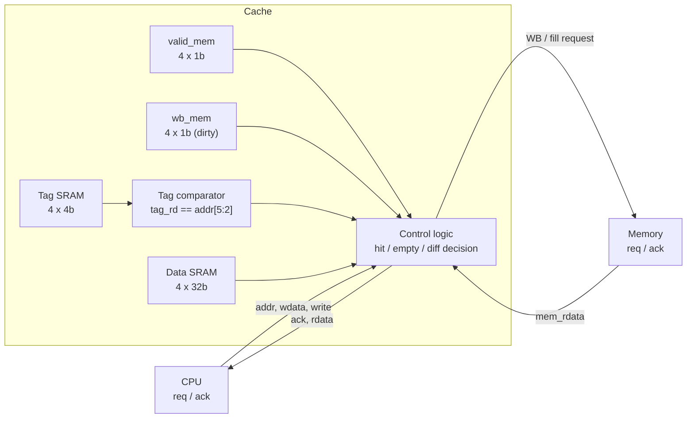
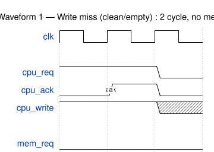
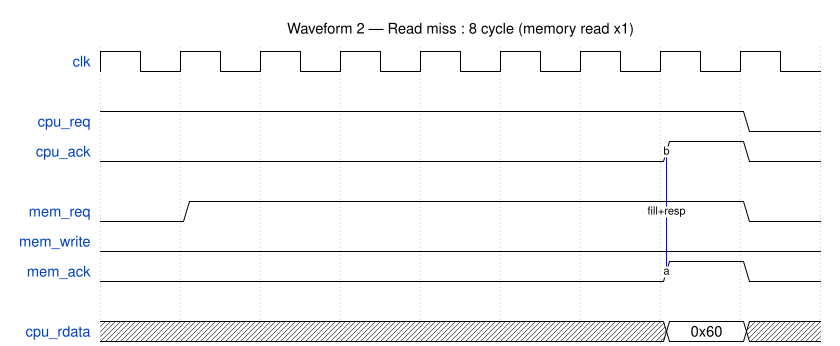
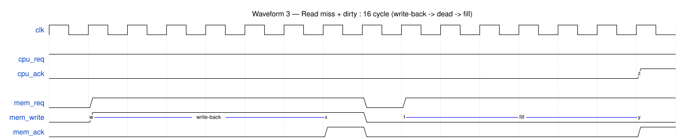
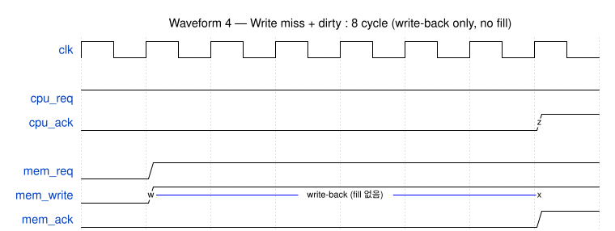

# Direct-Mapped Write-Back Cache

간단한 **direct-mapped, write-back** cache module입니다. CPU와 memory 사이에 위치하며, `req`/`ack` handshake로 variable latency를 처리합니다.

- **구성:** 4 line · direct-mapped · 1 word(32-bit) per line
- **Write policy:** write-back + write-allocate
- **Address:** 6-bit = `tag[5:2]` (4b) + `index[1:0]` (2b)
- **Storage:** tag / data는 `tpsram`(1-write, 1-read SRAM), valid / dirty는 내부 register

Block size가 1 word이므로 write miss 시 fetch 단계가 없다는 점이 이 설계의 특징입니다.

---

## Block Diagram



CPU request가 오면 `index[1:0]`로 4칸 중 한 line을 골라 tag/data/valid/dirty를 읽고, 한 cycle 뒤 판정 결과에 따라 응답하거나 memory에 access합니다.

---

## Ports

### CPU side

| Signal | Dir | Width | 설명 |
|---|---|---|---|
| `clk` | in | 1 | Clock |
| `rstn` | in | 1 | Asynchronous active-low reset |
| `i_cpu_req` | in | 1 | CPU request |
| `i_cpu_write` | in | 1 | 1 = write(store), 0 = read(load) |
| `o_cpu_ack` | out | 1 | Request 처리 완료 (0이면 CPU stall) |
| `i_cpu_addr` | in | 6 | Request address (`tag[5:2]` + `index[1:0]`) |
| `i_cpu_wdata` | in | 32 | Write data |
| `o_cpu_rdata` | out | 32 | Read data |

### Memory side

| Signal | Dir | Width | 설명 |
|---|---|---|---|
| `o_mem_req` | out | 1 | Memory request |
| `o_mem_write` | out | 1 | 1 = write-back, 0 = read(fill) |
| `i_mem_ack` | in | 1 | Memory 처리 완료 |
| `o_mem_addr` | out | 6 | Memory address |
| `o_mem_wdata` | out | 32 | Write-back data |
| `i_mem_rdata` | in | 32 | Memory에서 읽은 data |

---

## Cache Line State

각 line은 세 가지 state 정보를 가집니다.

| 항목 | Storage | 의미 |
|---|---|---|
| **tag** | `u_tag` (SRAM) | 이 line이 담고 있는 memory address의 상위 비트 |
| **valid** | `valid_mem` | 이 line에 valid한 data가 있는가 (reset 시 0) |
| **dirty** | `wb_mem` | 이 line이 memory와 달라졌는가 (write-back 필요 여부) |

### Dirty / Write-back 개념

Write-back policy에서는 CPU가 write를 해도 **cache에만 반영하고 memory는 나중에** 갱신합니다. 이 순간 cache 복사본과 memory 원본이 서로 달라지는데, 이 state를 **dirty**라고 하고 `wb_mem` 비트로 표시합니다.

```
clean (dirty=0) : cache 값 == memory 값  →  line을 그냥 버려도 됨
dirty (dirty=1) : cache 값 != memory 값  →  버리기 전 write-back 필수
```

Dirty한 line을 write-back 없이 evict하면 CPU가 고친 값이 유실되므로, 반드시 memory에 되돌려쓴 뒤 새 data로 교체합니다.

> 코드에서 `wb_rd`는 현재 access 중인 line의 dirty 비트를 tag/data와 같은 pipeline stage로 정렬해 꺼내온 값입니다.

### valid / dirty를 SRAM이 아닌 Register로 두는 이유

tag/data는 SRAM(`tpsram`)에 두면서 valid/dirty는 내부 register로 구현했습니다. Width가 작은 metadata는 register가 유리하기 때문입니다.

1. **Reset 초기화** — valid는 reset 시 전부 0이어야 합니다(cache가 비어있는 state). Register는 async reset(`negedge rstn`)이 걸리면 clock과 무관하게 **즉시** 전체가 0으로 clear되지만, SRAM은 cell 일괄 clear 기능이 없어 address를 순회하며 한 칸씩 0을 써넣는 clear FSM이 별도로 필요합니다. 이것이 사실상 가장 결정적인 이유입니다.
2. **유연한 Port** — dirty(`wb_mem`)는 한 always block에서 여러 조건으로 갱신되면서 동시에 `wb_rd`로 읽힙니다. Register array는 다중 read/write port를 자유롭게 만들 수 있지만, SRAM은 port 수가 물리적으로 고정(이 `tpsram`은 1R1W)입니다.
3. **Area** — SRAM의 density 이점은 비트 수가 클 때 얘기입니다. valid/dirty는 각 4비트뿐이라, sense amp·decoder 같은 SRAM 주변 회로 overhead를 감당할 이유가 없습니다.

> 참고로 SRAM에 두면 tag/data와 동시에 읽히므로 판정 timing은 저절로 정렬됩니다. 오히려 register로 둔 이 설계에서 `valid_rd`/`wb_rd` register를 추가해 SRAM 출력 timing을 맞추고 있습니다 — timing은 register를 쓰는 장점이 아니라 오히려 추가 비용입니다.

| Storage | 총 비트 | 구현 |
|---|---|---|
| data | 4 × 32 = 128b | SRAM |
| tag | 4 × 4 = 16b | SRAM |
| valid | 4 × 1 = 4b | **register** |
| dirty | 4 × 1 = 4b | **register** |

상용 cache에서도 valid/dirty는 flip-flop, tag/data는 SRAM으로 나누는 것이 표준적인 방식입니다.

---

## Hit / Miss 판정

SRAM read가 1 cycle 걸리므로, request 다음 cycle(`cc_re_d`)에 판정합니다.

```
hit   = valid && (tag_rd == addr[5:2])   // 원하는 data가 cache에 있음
empty = ~valid                           // 빈 line (cold miss)
diff  = valid && (tag_rd != addr[5:2])   // 다른 data가 자리 차지 (conflict miss)
miss  = empty | diff
```

판정 결과로부터 세 가지 control 신호가 나옵니다.

```
mem_no = hit | (~dirty & write)   // memory access 불필요
mem_wb = diff & dirty             // write-back 필요
mem_rd = miss & read              // memory fetch 필요
```

---

## Operation Scenarios

아래 cycle 수는 이 repository TB 기준입니다 (memory 왕복 1회 = 6 cycle).

| # | 상황 | Memory access | 소요 cycle | 동작 |
|---|---|---|---|---|
| 1 | **Read hit** | 없음 | 2 | `data_rd`를 즉시 CPU에 전달 |
| 2 | **Read miss (clean/empty)** | fill (read) 1회 | 8 | Memory에서 읽어 line 채우고, 같은 cycle에 CPU에도 전달 |
| 3 | **Read miss + dirty** | WB + fill 2회 | 16 | 기존 line write-back 후 새 data fetch |
| 4 | **Write hit** | 없음 | 2 | Cache data 덮어쓰고 dirty=1 |
| 5 | **Write miss (clean/empty)** | 없음 | 2 | fetch 없이 바로 덮어쓰고 dirty=1 (block=1 word) |
| 6 | **Write miss + dirty** | write-back 1회 | 8 | 기존 line write-back 후 새 값 기록, dirty=1 유지 (fill 없음) |

> 핵심 대비: Scenario 3(read miss + dirty, **16 cycle**)과 Scenario 6(write miss + dirty, **8 cycle**)의 차이. 둘 다 write-back은 하지만, write miss는 block이 1 word라 fill(fetch)을 생략하므로 memory 왕복이 한 번 적어 정확히 절반입니다.

**Read miss + dirty (Scenario 3):** `mem_wb`와 `mem_rd`가 동시에 뜨지만 `o_mem_write = wb_rd = 1`이라 write-back이 먼저 나갑니다. Write-back address는 `{tag_rd, index}`(evict되는 line의 원래 address)이고, 완료 후 dirty가 clear되면 자동으로 read fetch로 이어집니다.

**Write miss (Scenario 5):** 한 line이 1 word이므로 write-allocate의 fetch 단계가 필요 없습니다. 기존 line이 clean이면 그냥 tag+data를 덮어쓰고 dirty를 set합니다 (`mem_no`의 두 번째 조건).

**Write miss + dirty의 dirty 처리 (Scenario 6):** 이 경우 evict되는 옛 line의 dirty와 새로 쓰는 line의 dirty가 같은 비트(`wb_mem[index]`)를 공유하므로 처리 순서가 중요합니다.

1. 옛 line(예: 0x05)이 dirty이므로 그 data를 memory에 **write-back**합니다. 이로써 옛 line의 dirty는 해소됩니다.
2. Write-back이 끝나는 cycle에 `mem_we`가 뜨는데, 이 cache에서 write miss의 `o_cpu_ack = mem_we`이므로 **같은 cycle에 `cpu_we`도 함께 활성화**됩니다. CPU가 새 값(예: 0xD00)을 그 line에 바로 쓰기 때문입니다.
3. 이 순간 `wb_mem` 갱신 logic에서 `cpu_we`와 `mem_we` 조건이 동시에 참이 되는데, `cpu_we`가 **priority**(첫 번째 분기)라 `wb_mem[index] <= 1`이 적용됩니다.

```verilog
if      (cpu_we) wb_mem[cc_wa] <= 1;            // ← 우선, 새 line dirty=1
else if (mem_re) wb_mem[cc_wa] <= 0;
else if (mem_we) wb_mem[cc_wa] <= i_cpu_write;  // (도달 못 함, i_cpu_write=1이라 결과는 동일)
```

결과적으로 dirty 비트는 값 자체는 `1 → 1`로 유지되지만, 그 **의미가 "옛 line의 dirty"에서 "새 line의 dirty"로 넘어갑니다.** 새로 쓴 data(0xD00)는 아직 memory에 반영되지 않았으므로 이 line은 즉시 dirty가 되는 것이 맞습니다. `cpu_we` priority가 없더라도 `mem_we` 분기가 `i_cpu_write(=1)`로 set하므로 최종 값은 같지만, 두 조건이 겹치는 상황을 priority로 명확히 정리한 설계입니다.

### 왜 Block size 1 word면 write miss 시 fetch가 없는가

일반적으로 cache line은 여러 word로 구성되고, memory와는 block 단위로 data를 주고받습니다. 이때 write-allocate policy는 write miss가 나면 **먼저 block 전체를 fetch한 뒤** 해당 word를 덮어씁니다. CPU가 line 안의 word 하나만 쓰더라도, 같은 line의 나머지 word들은 온전한 값으로 채워져 있어야 나중에 그 word들을 읽을 때 올바른 값이 나오기 때문입니다.

```
block = 4 word 인 경우, word2에 write miss:

1. fetch : memory에서 block 전체를 읽어옴   [ 10 | 20 | 30 | 40 ]
2. write : word2만 덮어씀                   [ 10 | 20 | 99 | 40 ]
           → 나머지 word0,1,3이 보존됨
```

그런데 이 설계는 line이 **1 word**입니다. Line에 있는 word는 CPU가 쓰려는 바로 그 word 하나뿐이라, 보존해야 할 이웃 word가 애초에 없습니다.

```
block = 1 word 인 경우, write miss:

write : line에 바로 덮어씀   [ 99 ]
        → fetch 불필요 (지킬 이웃 word가 없음)
```

따라서 fetch를 생략하고 곧바로 cache에 쓰고 dirty만 set합니다.

> 단, 이는 **fetch(read)** 를 생략하는 것이지 write-back을 생략하는 것은 아닙니다. 밀려나는 line이 dirty였다면(Scenario 6) 그 옛날 값은 여전히 write-back으로 memory에 저장해야 합니다.

---

## `o_cpu_ack` — req/ack Handshake

`o_cpu_ack`는 "request 처리 완료" 신호로, variable latency를 처리하는 핵심입니다.

```verilog
assign o_cpu_ack = hit || mem_no || (mem_rd ? mem_re : mem_we);
```

- **hit / mem_no** → 즉시 완료 (1 cycle)
- **Memory access 필요** → Memory 응답(`i_mem_ack`)이 도착하는 cycle까지 `o_cpu_ack=0`으로 CPU를 stall시키다가, 완료 cycle에 1

CPU 쪽 실제 동작은 모두 `i_cpu_req & o_cpu_ack`로 gating되어, ack가 뜬 cycle에만 transaction이 성사됩니다.

> **Protocol 가정:** CPU는 `o_cpu_ack=1`을 볼 때까지 동일한 request(`i_cpu_req`, `i_cpu_addr`)를 유지해야 합니다. Cache는 그 사이 SRAM을 매 cycle 다시 읽으며 판정을 유지합니다.

---

## Design Notes

- **`i_cpu_write`로 read/write miss 통합:** Write-back 완료 후 dirty 갱신을 `wb_mem[cc_wa] <= i_cpu_write`로 처리합니다. read miss(=0)면 dirty를 clear하고, write miss(=1)면 곧 다시 쓸 것이므로 dirty를 유지 — 별도 분기 없이 한 줄로 두 경우를 처리합니다.
- **`mem_we_d` dead cycle:** Write-back 직후 1 cycle 동안 `o_mem_req`를 막습니다. Dirty clear가 `wb_rd`로 다시 읽혀 나오기까지 1 cycle이 걸리므로, 이 latency가 없으면 방금 write-back한 line을 stale한 `wb_rd=1` 때문에 한 번 더 write-back하려 시도합니다.
- **`wb_mem` priority:** `cpu_we`(dirty=1) > `mem_re`(fill 시 clear) > `mem_we`(write-back 후 `i_cpu_write`로 갱신).
- **Unused signals:** `cpu_en`, `cpu_re`, `mem_en`은 선언만 되고 사용되지 않습니다 (synthesis 시 제거됨).

---

## Testbench (`tb_cache.sv`)

Cache를 6가지 scenario로 검증하는 self-checking 환경입니다. CPU driver, DUT, memory model로 구성됩니다.

### Command Sequence

CPU는 `cmd[]` array의 request를 순서대로 발행합니다. 각 command는 `{write, addr[5:0], wdata[31:0]}` format입니다.

| # | Command | Address | index | Scenario |
|---|---|---|---|---|
| 0 | WRITE 0x400 | 0x04 | 0 | write miss (empty) |
| 1 | WRITE 0x500 | 0x05 | 1 | write miss (empty) |
| 2 | READ | 0x06 | 2 | read miss (empty) |
| 3 | READ | 0x07 | 3 | read miss (empty) |
| 4 | READ | 0x08 | 0 | **read miss + write-back** (index 0의 0x04 evict) |
| 5 | WRITE 0x501 | 0x05 | 1 | write hit |
| 6 | READ | 0x06 | 2 | read hit |
| 7 | WRITE 0xB00 | 0x0B | 3 | write miss (index 3의 0x07을 clean evict) |
| 8 | READ | 0x0C | 0 | read miss |
| 9 | WRITE 0xD00 | 0x0D | 1 | **write miss + write-back** (index 1의 0x05 evict) |

index는 address의 하위 2비트(`addr[1:0]`)입니다. 4번은 index 0에 dirty state로 남아있던 0x04를 evict하므로 write-back이 발생하고, 9번은 index 1의 dirty한 0x05를 evict합니다.

### CPU Driver

`req`/`ack` handshake를 구현합니다. `cpu_en = cpu_req & cpu_ack`가 뜬 cycle의 posedge에서 `cpu_ptr` 증가(다음 command로 이동)와 `cpu_req <= 0`이 **동시에** 일어납니다. 그 다음 cycle에는 `cpu_en=0`이 되어 `else if (cpu_ptr < 10)` 가지로 `cpu_req`가 다시 1로 회복되며, 이때 갱신된 `cpu_ptr`이 가리키는 새 command를 발행합니다. 결과적으로 매 transaction 사이 `cpu_req`가 1 cycle 내려갔다 올라오지만, 이는 별도 순차 동작이 아니라 한 edge에서 벌어진 갱신이 다음 cycle logic으로 회복되는 흐름입니다. ack가 올 때까지 같은 request를 유지하는 protocol을 따릅니다.

### Memory Model

- **초기화:** `mem[i] = i << 4` — 그래서 address `0x06`을 읽으면 `0x60`, `0x08`은 `0x80`이 나옵니다.
- **Latency:** `mem_req`를 7단 shift register(`mem_req_d`)에 통과시켜, request 후 **6 cycle 뒤** `mem_ack`를 1 cycle pulse로 발생시킵니다. 이 고정 latency가 위 표의 cycle 수를 결정합니다.

---

## Waveforms

각 waveform은 iverilog simulation 실측값을 WaveDrom으로 rendering한 것입니다. Memory latency 6 cycle 기준, cycle 0 = request 발행 시점. 괄호 안은 대응하는 Operation Scenario 번호입니다.

> Waveform SVG와 WaveDrom JSON source는 `waveforms/` 폴더에 있습니다. JSON은 [wavedrom.com](https://wavedrom.com/editor.html)에 붙여넣어 편집·재생성할 수 있습니다.

### Waveform 1 — Write miss (clean/empty) : cmd0 (Scenario 5), 2 cycle

Memory access 없이 detection cycle에 바로 ack. 가장 빠른 경로입니다.



### Waveform 2 — Read miss : cmd2 (Scenario 2), 8 cycle

Miss 판정 후 `mem_req`를 계속 유지하다가, `mem_ack`가 오는 cycle에 fill과 CPU 응답이 동시에 일어납니다.



### Waveform 3 — Read miss + write-back : cmd4 (Scenario 3), 16 cycle

Evict될 line이 dirty라 **write-back(6 cycle) → dead cycle → fill(6 cycle)** 순으로 memory를 두 번 왕복합니다. `mem_write`가 앞 구간은 1(write-back), 뒷 구간은 0(fill)으로 바뀌는 것이 포인트입니다.



중간의 dead cycle이 `mem_we_d`의 역할입니다 — write-back 완료 후 dirty clear가 반영되기까지 `mem_req`를 막아, 방금 내보낸 line을 중복 write-back하지 않게 합니다.

### Waveform 4 — Write miss + write-back : cmd9 (Scenario 6), 8 cycle

Waveform 3과 대비되는 핵심 waveform. Dirty line을 evict하므로 write-back은 하지만, **write miss라 fill을 생략**해 memory 왕복이 한 번뿐입니다. 그래서 16이 아닌 8 cycle입니다. `mem_write`가 끝까지 1로 유지되는 것(fill 구간이 없음)을 Waveform 3과 비교해 보세요.



Write-back 완료와 동시에 `o_cpu_ack`가 뜨고 CPU write가 완료됩니다. Waveform 3의 뒷부분(fill 6 cycle)이 통째로 사라진 것을 볼 수 있습니다.

---

## Possible Optimization — Write Buffer

> 아래는 현재 RTL에 **구현되어 있지 않은** 개선 제안입니다. 최악 latency 경로인 Scenario 3(read miss + dirty, 16 cycle)을 줄이는 방법입니다.

### 문제

현재 설계에서 read miss + dirty는 memory port가 하나뿐이라 write-back과 fill을 **직렬**로 처리합니다.

```
write-back (6 cycle) → dead cycle → fill (6 cycle) → CPU 응답    ≈ 16 cycle
```

Cache SRAM(`tpsram`)은 1R1W라 "evict line read + 새 line write"를 동시에 할 수 있지만, bottleneck은 cache가 아니라 **단일 memory interface**(`o_mem_req`/`o_mem_write` 하나뿐)입니다. 한 cycle에 memory read와 write를 동시에 request할 수단이 없습니다.

### 아이디어

Evict될 dirty line을 **write buffer**에 잠시 담아두고, CPU가 기다리는 **fill을 먼저** 처리합니다. Write-back은 buffer에서 background로 나중에 내보냅니다.

```
              ┌─────────────┐
evict dirty line →│ write buffer │→ (bus 여유 있을 때 background write-back)
              └─────────────┘
새 data fill  → cache (CPU는 여기서 바로 응답)
```

### 효과 (개념 Waveform)

CPU가 체감하는 latency가 fill(6 cycle)만 남아, Scenario 3이 일반 read miss와 같은 **8 cycle**로 줄어듭니다. Write-back 6 cycle이 CPU 응답 뒤로 숨겨집니다.

```
cyc        :  0  1  2  3  4  5  6  7  8 ...
cpu_req    :  1  1  1  1  1  1  1  1  0
cpu_ack    :  0  0  0  0  0  0  0 [1] 0      ← fill 끝나면 즉시 응답 (8 cycle)
mem_req    :  0  1  1  1  1  1  1  1  ?      ← fill을 먼저
mem_write  :  0  0  0  0  0  0  0  0  ?      ← read(fill)
mem_ack    :  0  0  0  0  0  0  0 [1] -
wbuf_valid :  0  1  1  1  1  1  1  1  1 ...  ← evict line 보관, 이후 background WB
```

| | 현재 (직렬) | Write buffer 적용 |
|---|---|---|
| read miss + dirty (CPU 체감) | 16 cycle | 8 cycle |
| write-back | CPU 대기에 포함 | Background로 숨김 |

### Trade-off

공짜는 아닙니다. Write buffer에 evict line이 대기 중일 때, **CPU가 그 address를 다시 access하면** 아직 memory에 없는 최신 값이 buffer에 있으므로, buffer도 함께 조회(또는 forwarding)해야 coherency가 유지됩니다. 이 hazard 처리 logic이 추가 비용입니다. 단순함을 우선한 현재 설계는 이 complexity를 피하는 대신 직렬 latency를 감수한 것입니다.

---

## Design Discussion — FSM으로 재작성한다면?

> 아래는 구조 관점의 논의입니다. 현재 RTL은 동작에 문제가 없으며, 이 섹션은 readability·유지보수·검증 trade-off를 정리한 것입니다.

### 현재 구조: State가 암묵적으로 분산됨

이 cache는 "FSM이 없다"기보다 **명시적 state register 없이 state가 여러 1비트 flag로 흩어져 있는** 형태입니다. 사실상 state 역할을 하는 신호들:

- `cc_re_d` — 지금이 판정(lookup) cycle인가
- `mem_we_d` — 방금 write-back이 끝났나 (dead cycle인가)
- `valid_rd`, `wb_rd` — Pipeline 정렬된 line state

Transaction의 진행 단계(LOOKUP → WRITE_BACK → FILL → RESP)가 한눈에 드러나지 않고, `mem_no`/`mem_wb`/`mem_rd`/`mem_we_d`의 조합을 머릿속으로 simulation해야 흐름을 알 수 있습니다.

### 명시적 FSM으로 얻는 것

```
IDLE → LOOKUP → (HIT           → RESP)
                (MISS + clean  → FILL → RESP)
                (MISS + dirty  → WRITE_BACK → WAIT → FILL → RESP)
```

- **흐름의 자기문서화:** "read miss + dirty면 write-back 먼저, 그다음 fill"이라는 순서가 state transition으로 드러납니다.
- **트릭 제거:** `mem_we_d`로 1 cycle을 죽이는 dead cycle이 `WRITE_BACK → WAIT → FILL` state transition으로 자연스럽게 표현됩니다. "왜 여기서 한 cycle을 막지?"가 state 이름만으로 해소됩니다.
- **검증·디버깅:** Waveform에서 `state` 신호 하나로 현재 동작을 파악할 수 있고, state/transition coverage가 명확해집니다.
- **안전한 확장:** Write buffer 삽입, 다중 outstanding request, L2 연결 등을 state 추가 형태로 넣을 수 있어 기존 combinational 조건의 상호작용을 다시 검토할 필요가 줄어듭니다.

### FSM의 단점 / 현재 방식의 장점

- **Latency:** 순진하게 IDLE→LOOKUP→RESP로 만들면 hit 경로가 느려질 수 있습니다. 현재는 hit을 2 cycle에 처리하는데, FSM화하면서 cycle이 늘 위험이 있습니다.
- **코드량:** 이 정도 direct-mapped cache에는 state enum + next-state + output logic의 overhead가 과할 수 있습니다.
- **현재 코드의 압축:** `i_cpu_write` 하나로 read/write miss를 통합하고 `wb_mem <= i_cpu_write`로 dirty 갱신을 한 줄에 처리한 부분은 잘 짜인 지점이며, FSM으로 풀면 오히려 여러 state로 흩어져 장황해질 수 있습니다.

### 종합: Hybrid (빠른 hit + miss FSM)

완전 FSM보다 **hit은 combinational path, miss는 명시적 FSM**으로 두는 hybrid가 이 cache에 가장 어울립니다.

- **hit / clean write miss** → 현재처럼 combinational path로 1 cycle (성능 유지)
- **miss / write-back / fill** → 명시적 FSM(`LOOKUP → WB → WAIT → FILL → RESP`)으로 순서와 dead cycle을 state로 표현

이러면 성능을 지키면서 miss 처리 흐름의 readability·검증성을 확보할 수 있고, 특히 `mem_we_d` dead cycle처럼 주석 없이는 의도를 알기 어려운 트릭이 state 이름으로 self-documenting 됩니다.

---

## Dependencies

- `tpsram` — 1-write / 1-read port SRAM model (`DEPTH`, `WIDTH` parameterized). Tag SRAM은 `4 x 4b`, data SRAM은 `4 x 32b`로 instantiate됩니다.
