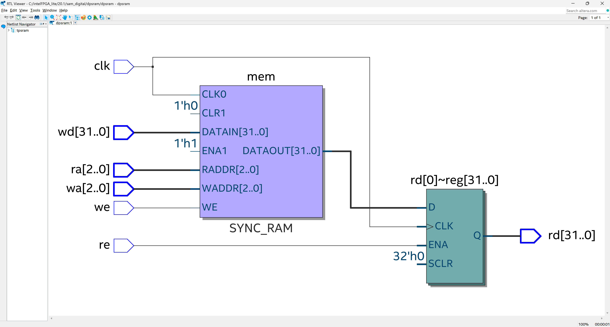
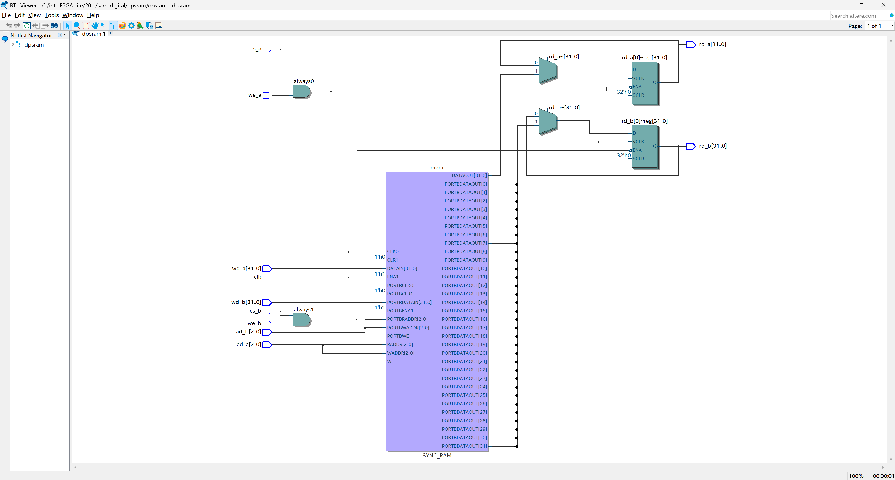
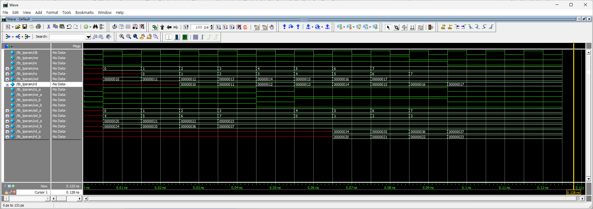

# Two-Port & Dual-Port SRAM (TPSRAM / DPSRAM)

동일한 memory array를 서로 다른 port 구성으로 구현한 두 SRAM model입니다. Parameter로 depth/width를 조절할 수 있는 behavioral RTL이며, synthesis 시 실제 SRAM macro로 대체되는 것을 가정합니다.

| Module | Port 구성 | 별칭 | 한 cycle에 가능한 동작 |
|---|---|---|---|
| `tpsram` | write 전용 1 + read 전용 1 | two-port / simple dual-port (1R1W) | 서로 다른 address에 read **1** + write **1** 동시 |
| `dpsram` | read/write 겸용 2 | dual-port / true dual-port (2RW) | Port마다 read **또는** write, 두 port 독립 |

공통점: 단일 clock synchronous, parameter `DEPTH=8` · `WIDTH=32` (기본), read는 **registered read**라 request 다음 cycle에 data가 나옵니다(1-cycle latency).

---

## TPSRAM (`tpsram.sv`)

Read port와 write port가 **물리적으로 분리**된 SRAM입니다. 두 port가 각자의 address를 가지므로, 한 cycle에 한 address를 읽으면서 다른 address에 쓸 수 있습니다.

### Ports

| Signal | Dir | Width | 설명 |
|---|---|---|---|
| `clk` | in | 1 | 공통 clock (주석의 `rclk`처럼 read clock 분리도 가능한 구조) |
| `we` | in | 1 | Write enable |
| `re` | in | 1 | Read enable |
| `wa` | in | `DEPTH_LOG` | Write address |
| `ra` | in | `DEPTH_LOG` | Read address |
| `wd` | in | `WIDTH` | Write data |
| `rd` | out | `WIDTH` | Read data (registered) |

### 동작

```verilog
always @(posedge clk) if (we) mem[wa] <= wd;   // 쓰기 포트
always @(posedge clk) if (re) rd     <= mem[ra];  // 읽기 포트 (registered read)
```

- Write와 read가 독립된 always block이라 **동시에** 일어날 수 있습니다 (1R1W).
- `rd`가 register라 `re`를 준 **다음 cycle**에 data가 나옵니다.
- **같은 address를 동시에 읽고 쓰면(`ra == wa`)** read-first(옛 data)가 됩니다. 두 assignment 모두 non-blocking이라 `rd`는 갱신 전 값을 sampling하기 때문입니다. (Simulation으로 확인: 새 값 write와 동시 read 시 `rd`는 이전 값, 새 값은 그 다음 read부터 반영)

> `cs`(chip select)가 따로 없고 `we`/`re`가 각 port의 enable 역할을 합니다.

`cache` module이 tag/data storage로 이 TPSRAM을 instantiate합니다 (tag `4x4b`, data `4x32b`).

---

## DPSRAM (`dpsram.sv`)

**두 port(A/B) 모두 read·write가 가능한** true dual-port SRAM입니다. 각 port는 매 cycle read **또는** write 중 하나를 하고, 두 port는 같은 memory array를 공유합니다.

### Ports

| Signal | Dir | Width | 설명 |
|---|---|---|---|
| `clk` | in | 1 | 공통 clock (주석의 `clk_b`처럼 port별 clock 분리도 가능한 구조) |
| `cs_a` / `cs_b` | in | 1 | Port A/B chip select (활성화) |
| `we_a` / `we_b` | in | 1 | Port A/B write enable |
| `ad_a` / `ad_b` | in | `DEPTH_LOG` | Port A/B address |
| `wd_a` / `wd_b` | in | `WIDTH` | Port A/B write data |
| `rd_a` / `rd_b` | out | `WIDTH` | Port A/B read data (registered) |

### 동작

```verilog
always @(posedge clk)
    if      (cs_a & we_a) mem[ad_a] <= wd_a;   // 포트 A 쓰기
    else if (cs_a)        rd_a      <= mem[ad_a];  // 포트 A 읽기

always @(posedge clk)
    if      (cs_b & we_b) mem[ad_b] <= wd_b;   // 포트 B 쓰기
    else if (cs_b)        rd_b      <= mem[ad_b];  // 포트 B 읽기
```

- 각 port는 `cs & we`면 write, `cs`만이면 read — **read와 write를 동시에 하지는 못합니다** (port당 한 동작).
- `cs=0`이면 그 port는 idle (동작·전력 소모 없음).
- 두 port가 **다른 address**를 access하면 완전히 독립적으로 동작합니다.
- **Conflict 주의:**
  - 두 port가 같은 address에 **동시 write** → 이 코드에선 port B block이 나중에 평가되어 B 값이 남습니다(정의된 동작이 아니라 코드 순서에 의존하므로, 실제 macro에선 금지 case).
  - 한 port가 쓰는 address를 다른 port가 **동시 read** → 읽는 쪽은 옛 값을 얻습니다(read-first).

---

## TPSRAM vs DPSRAM

| | TPSRAM (1R1W) | DPSRAM (2RW) |
|---|---|---|
| Port 수 | 2 (read 전용 + write 전용) | 2 (둘 다 read/write) |
| 한 cycle 최대 | read 1 + write 1 | (read/write) × 2, 조합 자유 |
| 같은 address 동시 write | 불가능 (write port 1개) | Conflict — 회피 필요 |
| 대표 용도 | FIFO buffer, video/audio streaming, clock domain bridging | 멀티코어 shared memory(MPSoC), graphic VRAM, network router/switch |

### 대표 용도 상세

**TPSRAM (1R1W)** — 한쪽에서 쓰고 다른 쪽에서 읽는, 방향이 고정된 streaming 흐름에 잘 맞습니다.
- **FIFO buffer:** Write pointer로 쓰고 read pointer로 읽는 선입선출 구조. 1W/1R pattern 그 자체입니다.
- **Video/audio streaming:** Pixel·audio sample을 실시간으로 한쪽에서 쓰고 다른 쪽에서 읽어내는 처리.
- **Clock domain bridging:** 송신부와 수신부 clock이 다를 때 사이에 두는 buffer. (진정한 CDC는 read/write에 별도 clock을 쓰는 dual-clock version으로 확장했을 때이며, 이 repository의 RTL은 단일 clock입니다 — 주석의 `rclk`가 그 확장 여지를 보여줍니다.)

**DPSRAM (2RW)** — 두 주체가 같은 memory를 동시에 양방향으로 access해야 할 때 씁니다.
- **멀티코어 shared memory(MPSoC):** 여러 CPU/DSP core가 같은 data를 공유하며 동시에 access하는 SoC.
- **Graphic VRAM:** CPU가 frame buffer에 쓰는 동안 GPU가 화면 출력용으로 읽어가는 구조.
- **Network router/switch:** 서로 다른 interface가 packet data를 동시에 참조·routing할 때.

### Cell 레벨 비용 (single-port 대비)

Port를 하나 더 붙인다는 점은 두 SRAM이 같으므로, **cell transistor 수는 두 경우 모두 6T → 8T**로 늘어납니다. 다만 추가되는 **BL 개수는 다릅니다.**

- single-port cell(6T): cross-coupled inverter 4T + access transistor 2T, **WL 1개 + BL 쌍(BL/BLB)**
- 두 번째 port 추가 시 공통: access transistor 2개 + **WL 1개 추가**
- 추가되는 BL은 port 성격에 따라 다름:

| | 추가 WL | 추가 BL | 이유 |
|---|---|---|---|
| TPSRAM (1R1W) | 1개 | **1개** (single-ended) | 두 번째 port가 **read 전용**이라 한 방향만 읽으면 됨 → differential 불필요 |
| DPSRAM (2RW) | 1개 | **1쌍(BL/BLB, 2개)** | 두 번째 port도 **write 가능**이라 differential 구동 필요 |

즉 TPSRAM의 read port는 single-ended read bitline **1개**만 추가되어, 8T이면서도 DPSRAM보다 cell area·power에서 유리합니다. DPSRAM은 양 port 모두 read/write를 지원하느라 BL 쌍이 온전히 추가됩니다.

**Periphery** 차이도 여기서 이어집니다.

- **TPSRAM (1R1W):** Read port가 single-ended라 write driver·sense amp를 한 방향만 완전 지원하면 되고, 비대칭 최적화가 가능합니다.
- **DPSRAM (2RW):** 양쪽 port가 모두 read·write를 지원해야 하므로 write driver·sense amp를 **양 port에 대칭으로 2벌** 갖춰야 하고, write-write conflict 처리까지 필요해 periphery가 더 큽니다.

핵심 차이는 "write port가 몇 개냐"입니다. Cell transistor는 둘 다 8T지만, TPSRAM은 read 전용 port 덕에 BL이 1개만 늘고 periphery도 단순한 반면, DPSRAM은 BL 쌍 추가 + 대칭 periphery + conflict 관리 비용이 더 듭니다.

---

## Testbench (`tb_tpsram.sv`)

`tpsram`과 `dpsram`을 **하나의 TB에서 동시에** 검증합니다. `fork ... join`으로 4개 process를 병렬 실행합니다.

| Process | 대상 | 동작 |
|---|---|---|
| `tpsram_write` | TPSRAM | `mem[i] = 0x10+i` 순차 기록 (i=0..7 → `0x10`–`0x17`) |
| `tpsram_read` | TPSRAM | 2 cycle 뒤 `ra=0..7` 순차 read (write와 동시 진행) |
| `dpsram_port_a` | DPSRAM Port A | 하위 절반(`0`–`3`)에 `0x20+i` 쓰고, 이후 상위 절반(`4`–`7`)을 read |
| `dpsram_port_b` | DPSRAM Port B | 상위 절반(`4`–`7`)에 `0x30+i` 쓰고, 이후 하위 절반(`0`–`3`)을 read |

### 검증 포인트

**TPSRAM** — Write와 read가 겹쳐 진행되며, registered read라 `rd`는 한 cycle 지연되어 `0x10, 0x11, ... 0x17`이 순서대로 나옵니다. 1R1W가 정상 동작함을 보여줍니다.

**DPSRAM** — Port A는 하위(`0x20`–`0x23`), Port B는 상위(`0x34`–`0x37`) — **서로 겹치지 않는 address**에 씁니다. 그런 다음 서로 **교차로 읽어**:

- Port A가 상위 절반을 읽으면 → Port B가 쓴 `0x34`–`0x37`
- Port B가 하위 절반을 읽으면 → Port A가 쓴 `0x20`–`0x23`

이렇게 두 port가 같은 memory를 공유한다는 점(한쪽이 쓴 값을 다른 쪽이 읽을 수 있음)을 확인합니다.

최종 DPSRAM memory: `mem[0..3] = 0x20`–`0x23` (A 기록), `mem[4..7] = 0x34`–`0x37` (B 기록).

---

## Reference Images

- `TPSRAM_netlist_schematic.png` — TPSRAM 합성 netlist schematic
- `DPSRAM_netlist_schematic.png` — DPSRAM 합성 netlist schematic
- `tb_tpsram_RTL_sim.png` — TB RTL simulation waveform (위 값들이 waveform으로 확인됨)






