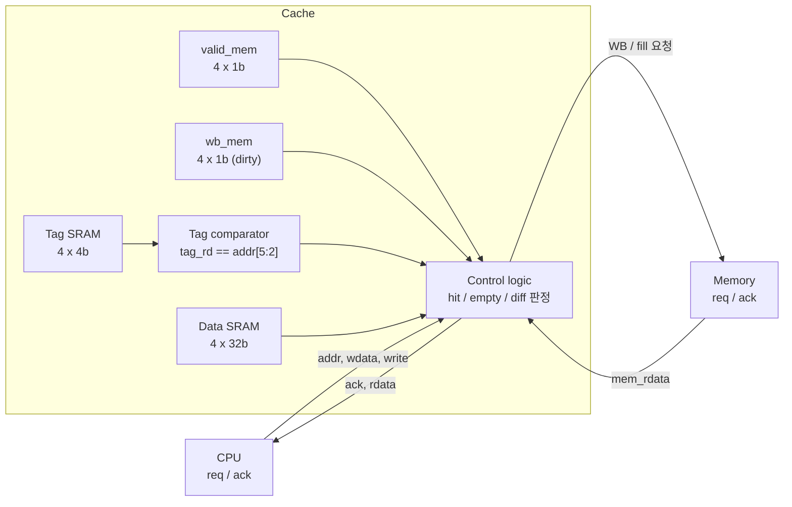
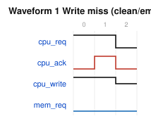
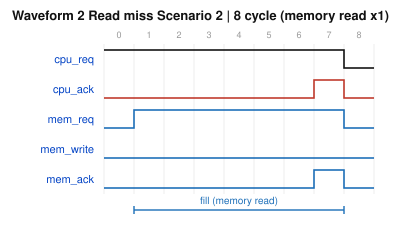
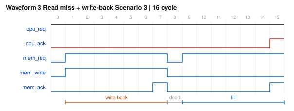
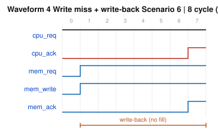

# Direct-Mapped Write-Back Cache

간단한 **direct-mapped, write-back** 캐시 모듈입니다. CPU와 메모리 사이에 위치하며, `req`/`ack` 핸드셰이크로 가변 지연(variable latency)을 처리합니다.

- **구성:** 4 라인 · direct-mapped · 1 word(32-bit) per line
- **쓰기 정책:** write-back + write-allocate
- **주소:** 6-bit = `tag[5:2]` (4b) + `index[1:0]` (2b)
- **저장소:** tag / data는 `tpsram`(1-write, 1-read SRAM), valid / dirty는 내부 레지스터

블록 크기가 1 word이므로 write miss 시 fetch 단계가 없다는 점이 이 설계의 특징입니다.

---

## Block Diagram



CPU 요청이 오면 `index[1:0]`로 4칸 중 한 라인을 골라 tag/data/valid/dirty를 읽고, 한 사이클 뒤 판정 결과에 따라 응답하거나 메모리에 접근합니다.

---

## Ports

### CPU side

| Signal | Dir | Width | 설명 |
|---|---|---|---|
| `clk` | in | 1 | 클럭 |
| `rstn` | in | 1 | 비동기 active-low 리셋 |
| `i_cpu_req` | in | 1 | CPU 요청 |
| `i_cpu_write` | in | 1 | 1 = write(store), 0 = read(load) |
| `o_cpu_ack` | out | 1 | 요청 처리 완료 (0이면 CPU stall) |
| `i_cpu_addr` | in | 6 | 요청 주소 (`tag[5:2]` + `index[1:0]`) |
| `i_cpu_wdata` | in | 32 | 쓰기 데이터 |
| `o_cpu_rdata` | out | 32 | 읽기 데이터 |

### Memory side

| Signal | Dir | Width | 설명 |
|---|---|---|---|
| `o_mem_req` | out | 1 | 메모리 요청 |
| `o_mem_write` | out | 1 | 1 = write-back, 0 = read(fill) |
| `i_mem_ack` | in | 1 | 메모리 처리 완료 |
| `o_mem_addr` | out | 6 | 메모리 주소 |
| `o_mem_wdata` | out | 32 | write-back 데이터 |
| `i_mem_rdata` | in | 32 | 메모리에서 읽은 데이터 |

---

## Cache Line State

각 라인은 세 가지 상태 정보를 가집니다.

| 항목 | 저장소 | 의미 |
|---|---|---|
| **tag** | `u_tag` (SRAM) | 이 라인이 담고 있는 메모리 주소의 상위 비트 |
| **valid** | `valid_mem` | 이 라인에 유효한 데이터가 있는가 (리셋 시 0) |
| **dirty** | `wb_mem` | 이 라인이 메모리와 달라졌는가 (write-back 필요 여부) |

### Dirty / Write-back 개념

write-back 정책에서는 CPU가 쓰기를 해도 **캐시에만 반영하고 메모리는 나중에** 갱신합니다. 이 순간 캐시 복사본과 메모리 원본이 서로 달라지는데, 이 상태를 **dirty**라고 하고 `wb_mem` 비트로 표시합니다.

```
clean (dirty=0) : 캐시 값 == 메모리 값  →  라인을 그냥 버려도 됨
dirty (dirty=1) : 캐시 값 != 메모리 값  →  버리기 전 write-back 필수
```

dirty한 라인을 write-back 없이 evict하면 CPU가 고친 값이 유실되므로, 반드시 메모리에 되돌려쓴 뒤 새 데이터로 교체합니다.

> 코드에서 `wb_rd`는 현재 접근 중인 라인의 dirty 비트를 tag/data와 같은 파이프라인 단계로 정렬해 꺼내온 값입니다.

### valid / dirty를 SRAM이 아닌 레지스터로 두는 이유

tag/data는 SRAM(`tpsram`)에 두면서 valid/dirty는 내부 레지스터로 구현했습니다. 폭이 작은 메타데이터는 레지스터가 유리하기 때문입니다.

1. **리셋 초기화** — valid는 리셋 시 전부 0이어야 합니다(캐시가 비어있는 상태). 레지스터는 async reset(`negedge rstn`)이 걸리면 클럭과 무관하게 **즉시** 전체가 0으로 클리어되지만, SRAM은 셀 일괄 클리어 기능이 없어 주소를 순회하며 한 칸씩 0을 써넣는 clear FSM이 별도로 필요합니다. 이것이 사실상 가장 결정적인 이유입니다.
2. **유연한 포트** — dirty(`wb_mem`)는 한 always 블록에서 여러 조건으로 갱신되면서 동시에 `wb_rd`로 읽힙니다. 레지스터 배열은 다중 읽기/쓰기 포트를 자유롭게 만들 수 있지만, SRAM은 포트 수가 물리적으로 고정(이 `tpsram`은 1R1W)입니다.
3. **면적** — SRAM의 밀도 이점은 비트 수가 클 때 얘기입니다. valid/dirty는 각 4비트뿐이라, sense amp·decoder 같은 SRAM 주변 회로 오버헤드를 감당할 이유가 없습니다.

> 참고로 SRAM에 두면 tag/data와 동시에 읽히므로 판정 타이밍은 저절로 정렬됩니다. 오히려 레지스터로 둔 이 설계에서 `valid_rd`/`wb_rd` 레지스터를 추가해 SRAM 출력 타이밍을 맞추고 있습니다 — 타이밍은 레지스터를 쓰는 장점이 아니라 오히려 추가 비용입니다.

| 저장소 | 총 비트 | 구현 |
|---|---|---|
| data | 4 × 32 = 128b | SRAM |
| tag | 4 × 4 = 16b | SRAM |
| valid | 4 × 1 = 4b | **register** |
| dirty | 4 × 1 = 4b | **register** |

상용 캐시에서도 valid/dirty는 flip-flop, tag/data는 SRAM으로 나누는 것이 표준적인 방식입니다.

---

## Hit / Miss 판정

SRAM 읽기가 1사이클 걸리므로, 요청 다음 사이클(`cc_re_d`)에 판정합니다.

```
hit   = valid && (tag_rd == addr[5:2])   // 원하는 데이터가 캐시에 있음
empty = ~valid                           // 빈 라인 (cold miss)
diff  = valid && (tag_rd != addr[5:2])   // 다른 데이터가 자리 차지 (conflict miss)
miss  = empty | diff
```

판정 결과로부터 세 가지 제어 신호가 나옵니다.

```
mem_no = hit | (~dirty & write)   // 메모리 접근 불필요
mem_wb = diff & dirty             // write-back 필요
mem_rd = miss & read              // 메모리 fetch 필요
```

---

## Operation Scenarios

아래 cycle 수는 이 저장소 TB 기준입니다 (메모리 왕복 1회 = 6 cycle).

| # | 상황 | 메모리 접근 | 소요 cycle | 동작 |
|---|---|---|---|---|
| 1 | **Read hit** | 없음 | 2 | `data_rd`를 즉시 CPU에 전달 |
| 2 | **Read miss (clean/empty)** | fill (read) 1회 | 8 | 메모리에서 읽어 라인 채우고, 같은 사이클에 CPU에도 전달 |
| 3 | **Read miss + dirty** | WB + fill 2회 | 16 | 기존 라인 write-back 후 새 데이터 fetch |
| 4 | **Write hit** | 없음 | 2 | 캐시 데이터 덮어쓰고 dirty=1 |
| 5 | **Write miss (clean/empty)** | 없음 | 2 | fetch 없이 바로 덮어쓰고 dirty=1 (블록=1 word) |
| 6 | **Write miss + dirty** | write-back 1회 | 8 | 기존 라인 write-back 후 새 값 기록, dirty=1 유지 (fill 없음) |

> 핵심 대비: 시나리오 3(read miss + dirty, **16 cycle**)과 시나리오 6(write miss + dirty, **8 cycle**)의 차이. 둘 다 write-back은 하지만, write miss는 블록이 1 word라 fill(fetch)을 생략하므로 메모리 왕복이 한 번 적어 정확히 절반입니다.

**Read miss + dirty (시나리오 3):** `mem_wb`와 `mem_rd`가 동시에 뜨지만 `o_mem_write = wb_rd = 1`이라 write-back이 먼저 나갑니다. write-back 주소는 `{tag_rd, index}`(쫓겨나는 라인의 원래 주소)이고, 완료 후 dirty가 클리어되면 자동으로 read fetch로 이어집니다.

**Write miss (시나리오 5):** 한 라인이 1 word이므로 write-allocate의 fetch 단계가 필요 없습니다. 기존 라인이 clean이면 그냥 tag+data를 덮어쓰고 dirty를 세팅합니다 (`mem_no`의 두 번째 조건).

**Write miss + dirty의 dirty 처리 (시나리오 6):** 이 경우 축출되는 옛 라인의 dirty와 새로 쓰는 라인의 dirty가 같은 비트(`wb_mem[index]`)를 공유하므로 처리 순서가 중요합니다.

1. 옛 라인(예: 0x05)이 dirty이므로 그 데이터를 메모리에 **write-back**합니다. 이로써 옛 라인의 dirty는 해소됩니다.
2. write-back이 끝나는 사이클에 `mem_we`가 뜨는데, 이 캐시에서 write miss의 `o_cpu_ack = mem_we`이므로 **같은 사이클에 `cpu_we`도 함께 활성화**됩니다. CPU가 새 값(예: 0xD00)을 그 라인에 바로 쓰기 때문입니다.
3. 이 순간 `wb_mem` 갱신 로직에서 `cpu_we`와 `mem_we` 조건이 동시에 참이 되는데, `cpu_we`가 **우선순위**(첫 번째 분기)라 `wb_mem[index] <= 1`이 적용됩니다.

```verilog
if      (cpu_we) wb_mem[cc_wa] <= 1;            // ← 우선, 새 라인 dirty=1
else if (mem_re) wb_mem[cc_wa] <= 0;
else if (mem_we) wb_mem[cc_wa] <= i_cpu_write;  // (도달 못 함, i_cpu_write=1이라 결과는 동일)
```

결과적으로 dirty 비트는 값 자체는 `1 → 1`로 유지되지만, 그 **의미가 "옛 라인의 dirty"에서 "새 라인의 dirty"로 넘어갑니다.** 새로 쓴 데이터(0xD00)는 아직 메모리에 반영되지 않았으므로 이 라인은 즉시 dirty가 되는 것이 맞습니다. `cpu_we` 우선순위가 없더라도 `mem_we` 분기가 `i_cpu_write(=1)`로 세팅하므로 최종 값은 같지만, 두 조건이 겹치는 상황을 우선순위로 명확히 정리한 설계입니다.

### 왜 블록 크기 1 word면 write miss 시 fetch가 없는가

일반적으로 캐시 라인은 여러 word로 구성되고, 메모리와는 블록 단위로 데이터를 주고받습니다. 이때 write-allocate 정책은 write miss가 나면 **먼저 블록 전체를 fetch한 뒤** 해당 word를 덮어씁니다. CPU가 라인 안의 word 하나만 쓰더라도, 같은 라인의 나머지 word들은 온전한 값으로 채워져 있어야 나중에 그 word들을 읽을 때 올바른 값이 나오기 때문입니다.

```
블록 = 4 word 인 경우, word2에 write miss:

1. fetch : 메모리에서 블록 전체를 읽어옴   [ 10 | 20 | 30 | 40 ]
2. write : word2만 덮어씀                  [ 10 | 20 | 99 | 40 ]
           → 나머지 word0,1,3이 보존됨
```

그런데 이 설계는 라인이 **1 word**입니다. 라인에 있는 word는 CPU가 쓰려는 바로 그 word 하나뿐이라, 보존해야 할 이웃 word가 애초에 없습니다.

```
블록 = 1 word 인 경우, write miss:

write : 라인에 바로 덮어씀   [ 99 ]
        → fetch 불필요 (지킬 이웃 word가 없음)
```

따라서 fetch를 생략하고 곧바로 캐시에 쓰고 dirty만 세팅합니다.

> 단, 이는 **fetch(읽기)** 를 생략하는 것이지 write-back을 생략하는 것은 아닙니다. 밀려나는 라인이 dirty였다면(시나리오 6) 그 옛날 값은 여전히 write-back으로 메모리에 저장해야 합니다.

---

## `o_cpu_ack` — req/ack 핸드셰이크

`o_cpu_ack`는 "요청 처리 완료" 신호로, 가변 지연을 처리하는 핵심입니다.

```verilog
assign o_cpu_ack = hit || mem_no || (mem_rd ? mem_re : mem_we);
```

- **hit / mem_no** → 즉시 완료 (1사이클)
- **메모리 접근 필요** → 메모리 응답(`i_mem_ack`)이 도착하는 사이클까지 `o_cpu_ack=0`으로 CPU를 stall시키다가, 완료 사이클에 1

CPU 쪽 실제 동작은 모두 `i_cpu_req & o_cpu_ack`로 게이팅되어, ack가 뜬 사이클에만 트랜잭션이 성사됩니다.

> **프로토콜 가정:** CPU는 `o_cpu_ack=1`을 볼 때까지 동일한 요청(`i_cpu_req`, `i_cpu_addr`)을 유지해야 합니다. 캐시는 그 사이 SRAM을 매 사이클 다시 읽으며 판정을 유지합니다.

---

## Design Notes

- **`i_cpu_write`로 read/write miss 통합:** write-back 완료 후 dirty 갱신을 `wb_mem[cc_wa] <= i_cpu_write`로 처리합니다. read miss(=0)면 dirty를 클리어하고, write miss(=1)면 곧 다시 쓸 것이므로 dirty를 유지 — 별도 분기 없이 한 줄로 두 경우를 처리합니다.
- **`mem_we_d` dead cycle:** write-back 직후 1사이클 동안 `o_mem_req`를 막습니다. dirty 클리어가 `wb_rd`로 다시 읽혀 나오기까지 1사이클이 걸리므로, 이 지연이 없으면 방금 write-back한 라인을 stale한 `wb_rd=1` 때문에 한 번 더 write-back하려 시도합니다.
- **`wb_mem` 우선순위:** `cpu_we`(dirty=1) > `mem_re`(fill 시 클리어) > `mem_we`(write-back 후 `i_cpu_write`로 갱신).
- **Unused signals:** `cpu_en`, `cpu_re`, `mem_en`은 선언만 되고 사용되지 않습니다 (합성 시 제거됨).

---

## Testbench (`tb_cache.sv`)

캐시를 6가지 시나리오로 검증하는 self-checking 환경입니다. CPU 드라이버, DUT, 메모리 모델로 구성됩니다.

### Command 시퀀스

CPU는 `cmd[]` 배열의 요청을 순서대로 발행합니다. 각 명령은 `{write, addr[5:0], wdata[31:0]}` 포맷입니다.

| # | 명령 | 주소 | index | 시나리오 |
|---|---|---|---|---|
| 0 | WRITE 0x400 | 0x04 | 0 | write miss (empty) |
| 1 | WRITE 0x500 | 0x05 | 1 | write miss (empty) |
| 2 | READ | 0x06 | 2 | read miss (empty) |
| 3 | READ | 0x07 | 3 | read miss (empty) |
| 4 | READ | 0x08 | 0 | **read miss + write-back** (index 0의 0x04 축출) |
| 5 | WRITE 0x501 | 0x05 | 1 | write hit |
| 6 | READ | 0x06 | 2 | read hit |
| 7 | WRITE 0xB00 | 0x0B | 3 | write miss (index 3의 0x07을 clean 축출) |
| 8 | READ | 0x0C | 0 | read miss |
| 9 | WRITE 0xD00 | 0x0D | 1 | **write miss + write-back** (index 1의 0x05 축출) |

index는 주소의 하위 2비트(`addr[1:0]`)입니다. 4번은 index 0에 dirty 상태로 남아있던 0x04를 축출하므로 write-back이 발생하고, 9번은 index 1의 dirty한 0x05를 축출합니다.

### CPU 드라이버

`req`/`ack` 핸드셰이크를 구현합니다. `cpu_en = cpu_req & cpu_ack`가 뜬 사이클의 posedge에서 `cpu_ptr` 증가(다음 명령으로 이동)와 `cpu_req <= 0`이 **동시에** 일어납니다. 그 다음 사이클에는 `cpu_en=0`이 되어 `else if (cpu_ptr < 10)` 가지로 `cpu_req`가 다시 1로 회복되며, 이때 갱신된 `cpu_ptr`이 가리키는 새 명령을 발행합니다. 결과적으로 매 트랜잭션 사이 `cpu_req`가 1 cycle 내려갔다 올라오지만, 이는 별도 순차 동작이 아니라 한 edge에서 벌어진 갱신이 다음 사이클 로직으로 회복되는 흐름입니다. ack가 올 때까지 같은 요청을 유지하는 프로토콜을 따릅니다.

### 메모리 모델

- **초기화:** `mem[i] = i << 4` — 그래서 주소 `0x06`을 읽으면 `0x60`, `0x08`은 `0x80`이 나옵니다.
- **지연:** `mem_req`를 7단 시프트 레지스터(`mem_req_d`)에 통과시켜, 요청 후 **6 cycle 뒤** `mem_ack`를 1 cycle 펄스로 발생시킵니다. 이 고정 지연이 위 표의 cycle 수를 결정합니다.

---

## Waveforms

각 파형은 iverilog 시뮬레이션 실측값을 렌더링한 타이밍 다이어그램입니다. 메모리 지연 6 cycle 기준, cycle 0 = 요청 발행 시점. 괄호 안은 대응하는 Operation Scenario 번호입니다.

### Waveform 1 — Write miss (clean/empty) : cmd0 (시나리오 5), 2 cycle

메모리 접근 없이 detection 사이클에 바로 ack. 가장 빠른 경로입니다.



### Waveform 2 — Read miss : cmd2 (시나리오 2), 8 cycle

miss 판정 후 `mem_req`를 계속 유지하다가, `mem_ack`가 오는 사이클에 fill과 CPU 응답이 동시에 일어납니다.



### Waveform 3 — Read miss + write-back : cmd4 (시나리오 3), 16 cycle

축출될 라인이 dirty라 **write-back(6 cycle) → dead cycle → fill(6 cycle)** 순으로 메모리를 두 번 왕복합니다. `mem_write`가 앞 구간은 1(write-back), 뒷 구간은 0(fill)으로 바뀌는 것이 포인트입니다.



중간의 dead cycle이 `mem_we_d`의 역할입니다 — write-back 완료 후 dirty 클리어가 반영되기까지 `mem_req`를 막아, 방금 내보낸 라인을 중복 write-back하지 않게 합니다.

### Waveform 4 — Write miss + write-back : cmd9 (시나리오 6), 8 cycle

Waveform 3과 대비되는 핵심 파형. dirty 라인을 축출하므로 write-back은 하지만, **write miss라 fill을 생략**해 메모리 왕복이 한 번뿐입니다. 그래서 16이 아닌 8 cycle입니다. `mem_write`가 끝까지 1로 유지되는 것(fill 구간이 없음)을 Waveform 3과 비교해 보세요.



write-back 완료와 동시에 `o_cpu_ack`가 뜨고 CPU 쓰기가 완료됩니다. Waveform 3의 뒷부분(fill 6 cycle)이 통째로 사라진 것을 볼 수 있습니다.

---

## Possible Optimization — Write Buffer

> 아래는 현재 RTL에 **구현되어 있지 않은** 개선 제안입니다. 최악 지연 경로인 시나리오 3(read miss + dirty, 16 cycle)을 줄이는 방법입니다.

### 문제

현재 설계에서 read miss + dirty는 메모리 포트가 하나뿐이라 write-back과 fill을 **직렬**로 처리합니다.

```
write-back (6 cycle) → dead cycle → fill (6 cycle) → CPU 응답    ≈ 16 cycle
```

캐시 SRAM(`tpsram`)은 1R1W라 "축출 라인 read + 새 라인 write"를 동시에 할 수 있지만, 병목은 캐시가 아니라 **단일 메모리 인터페이스**(`o_mem_req`/`o_mem_write` 하나뿐)입니다. 한 사이클에 메모리 read와 write를 동시에 요청할 수단이 없습니다.

### 아이디어

축출될 dirty 라인을 **write buffer**에 잠시 담아두고, CPU가 기다리는 **fill을 먼저** 처리합니다. write-back은 버퍼에서 백그라운드로 나중에 내보냅니다.

```
              ┌─────────────┐
축출 dirty 라인 →│ write buffer │→ (버스 여유 있을 때 백그라운드 write-back)
              └─────────────┘
새 데이터 fill  → cache (CPU는 여기서 바로 응답)
```

### 효과 (개념 파형)

CPU가 체감하는 지연이 fill(6 cycle)만 남아, 시나리오 3이 일반 read miss와 같은 **8 cycle**로 줄어듭니다. write-back 6 cycle이 CPU 응답 뒤로 숨겨집니다.

```
cyc        :  0  1  2  3  4  5  6  7  8 ...
cpu_req    :  1  1  1  1  1  1  1  1  0
cpu_ack    :  0  0  0  0  0  0  0 [1] 0      ← fill 끝나면 즉시 응답 (8 cycle)
mem_req    :  0  1  1  1  1  1  1  1  ?      ← fill을 먼저
mem_write  :  0  0  0  0  0  0  0  0  ?      ← read(fill)
mem_ack    :  0  0  0  0  0  0  0 [1] -
wbuf_valid :  0  1  1  1  1  1  1  1  1 ...  ← 축출 라인 보관, 이후 백그라운드 WB
```

| | 현재 (직렬) | write buffer 적용 |
|---|---|---|
| read miss + dirty (CPU 체감) | 16 cycle | 8 cycle |
| write-back | CPU 대기에 포함 | 백그라운드로 숨김 |

### 트레이드오프

공짜는 아닙니다. write buffer에 축출 라인이 대기 중일 때, **CPU가 그 주소를 다시 접근하면** 아직 메모리에 없는 최신 값이 버퍼에 있으므로, 버퍼도 함께 조회(또는 forwarding)해야 정합성이 유지됩니다. 이 hazard 처리 로직이 추가 비용입니다. 단순함을 우선한 현재 설계는 이 복잡도를 피하는 대신 직렬 지연을 감수한 것입니다.

---

## Dependencies

- `tpsram` — 1-write / 1-read 포트 SRAM 모델 (`DEPTH`, `WIDTH` 파라미터화). tag SRAM은 `4 x 4b`, data SRAM은 `4 x 32b`로 인스턴스화됩니다.
