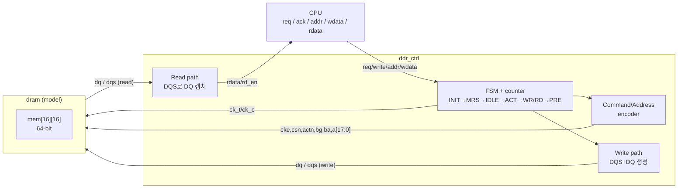
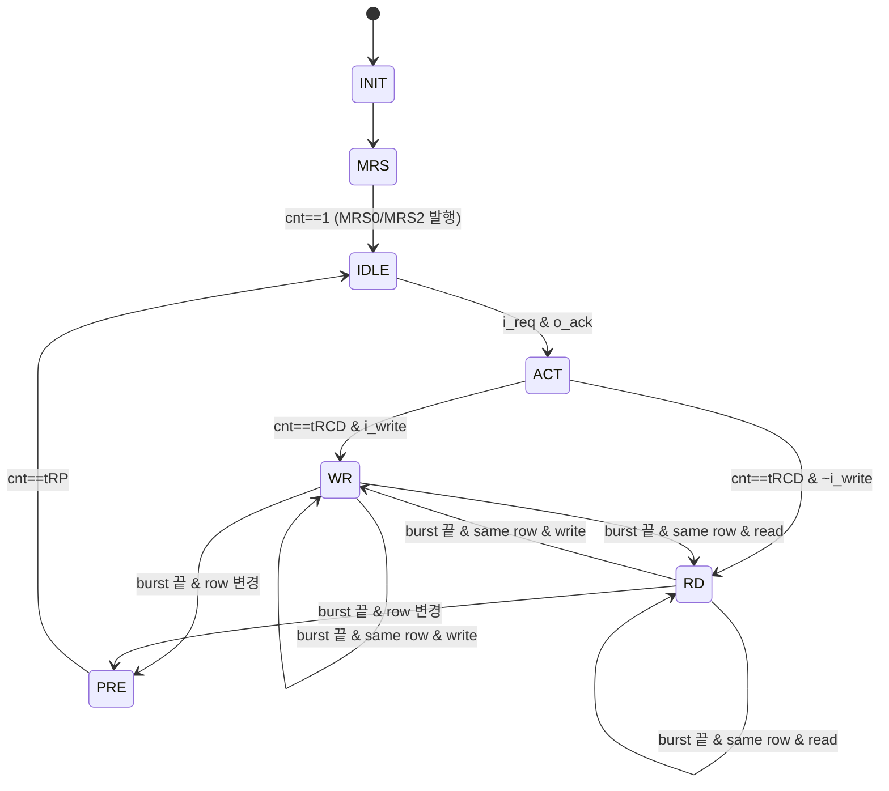
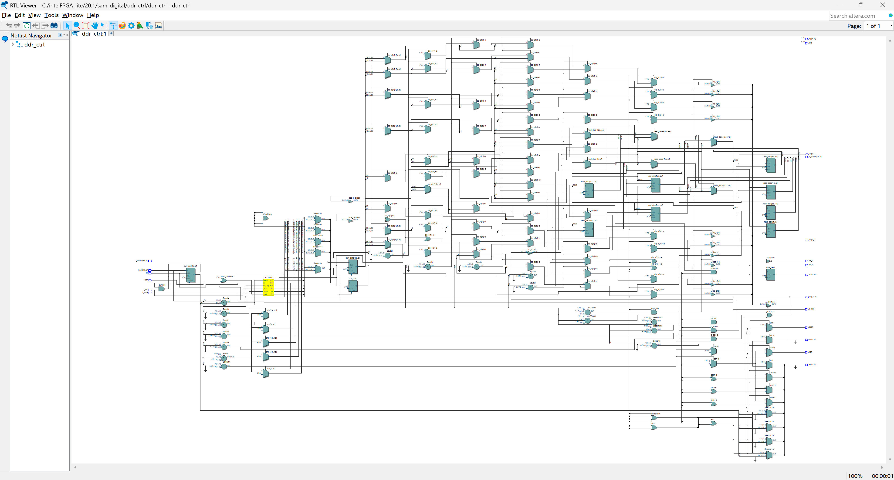
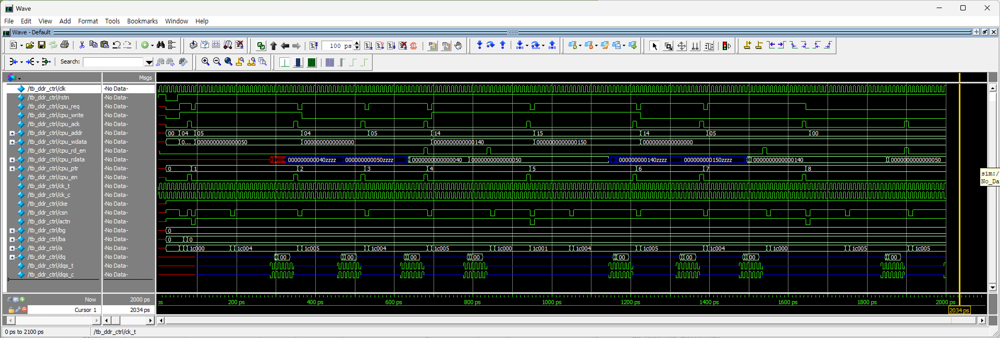
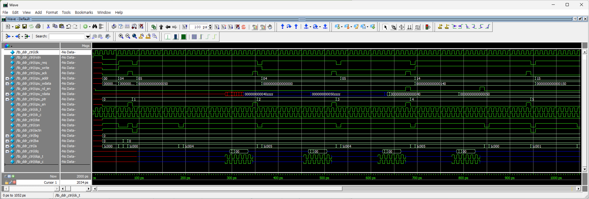
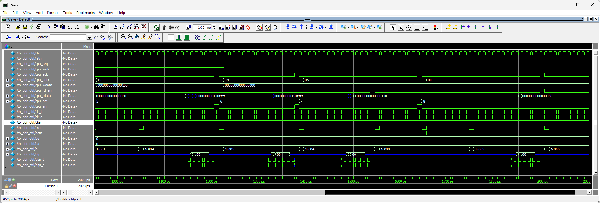

# DDR Memory Controller

DDR4-style DRAM 컨트롤러(`ddr_ctrl`)와 검증용 DRAM behavioral 모델(`dram`)입니다. CPU의 단순 read/write 요청을 받아 실제 DDR 프로토콜(command 인코딩, 타이밍 파라미터, DQS 스트로브, BL8 버스트)로 변환합니다. 교육용으로 핵심 동작에 집중한 간소화 모델입니다.

- **데이터 폭:** DQ 8-bit, **BL8**(burst length 8) → 한 트랜잭션에 64-bit 전송
- **주소:** 8-bit = `row[7:4]` (4b) + `col[3:0]` (4b) → 16 row × 16 col
- **타이밍 파라미터:** `tRCD=9`, `tCWL=11`, `tCL=10`, `tRP=8`
- **정책:** open-page (같은 row 연속 접근 시 ACT/PRE 생략)

---

## Background — DDR 핵심 개념

일반 SRAM 인터페이스와 달리 DDR DRAM은 몇 가지 고유한 규약이 있습니다.

- **DDR (Double Data Rate):** 클럭의 **양 엣지**에서 데이터를 전송합니다. 이 코드에선 `dqs_t`(rising)와 `dqs_c`(falling에 해당하는 상보 스트로브)의 엣지마다 한 beat씩 내보내, 클럭 1주기에 2 beat를 전송합니다.
- **DQS (Data Strobe):** 데이터(`dq`)와 함께 가는 source-synchronous 스트로브. **쓰기 때는 컨트롤러가**, **읽기 때는 DRAM이** DQS를 구동합니다. 수신 측은 이 DQS 엣지로 데이터를 샘플링합니다.
- **Command/Address 멀티플렉싱:** 별도 명령 핀 대신 `{csn, actn, rasn, casn, wen}` 조합으로 명령을 인코딩하고, 주소 버스 `a[]`에 row/col을 시분할로 실어 보냅니다.
- **Bank / Bank Group:** `ba`(bank), `bg`(bank group) — DDR4에서 병렬성을 위한 구조. 이 모델은 단일 bank 흐름에 집중합니다.
- **MRS (Mode Register Set):** 초기화 시 DRAM에 `tCL`/`tCWL` 같은 동작 파라미터를 프로그래밍하는 명령.
- **Row buffer / open-page:** ACT로 한 row를 sense amp(row buffer)에 올려두면, 같은 row 내 다른 column 접근은 ACT 없이 바로 가능합니다. row를 바꾸려면 PRE(precharge)로 닫고 새 row를 ACT해야 합니다.

---

## Block Diagram



컨트롤러는 CPU 요청을 FSM으로 받아, command/address 버스와 DQ/DQS 데이터 버스를 각각 구동합니다. `dq`/`dqs_t`/`dqs_c`는 방향이 바뀌는 **양방향(inout)** 신호로, 쓰기 땐 컨트롤러가, 읽기 땐 DRAM이 구동합니다.

---

## Controller FSM (`ddr_ctrl`)



| State | 역할 | 지속 | 완료 조건 |
|---|---|---|---|
| `INIT` | 리셋 직후 진입점 | 1 cycle | 즉시 MRS로 |
| `MRS` | Mode Register 설정 (MRS0=tCL, MRS2=tCWL) | 2 cycle | `cnt==1` |
| `IDLE` | 요청 대기 (`o_ack=1`) | 가변 | `i_req & o_ack` |
| `ACT` | row 활성화 (row buffer에 올림) | `tRCD+1` | `cnt==tRCD(9)` |
| `WR` | 쓰기 버스트 | `tCWL+4+1+1` | `cnt==tCWL+4+1(16)` |
| `RD` | 읽기 버스트 | `tCL+4+1+1` | `cnt==tCL+4+1(15)` |
| `PRE` | row precharge (닫기) | `tRP+1` | `cnt==tRP(8)` |

각 state는 전용 카운터 `cnt`로 DDR 타이밍 파라미터만큼 시간을 셉니다. `cnt`는 state 진입 시 0에서 시작해 완료 값에 도달하면 리셋됩니다.

### 타이밍 파라미터

| 파라미터 | 값 | 의미 |
|---|---|---|
| `tRCD` | 9 | RAS-to-CAS delay — ACT 후 RD/WR까지 대기 |
| `tCWL` | 11 | CAS Write Latency — WR 명령 후 첫 쓰기 데이터까지 |
| `tCL` | 10 | CAS Latency — RD 명령 후 첫 읽기 데이터까지 |
| `tRP` | 8 | Row Precharge — PRE 후 다음 ACT까지 |

`tCL`/`tCWL`은 초기화 시 MRS 명령으로 DRAM에 프로그래밍됩니다 (MRS0 → tCL, MRS2 → tCWL).

---

## Open-Page 정책 (핵심)

이 컨트롤러의 가장 중요한 최적화입니다. WR/RD 버스트가 끝날 때 **다음 요청의 row가 현재 열린 row와 같은지**(`curr_row == next_row`) 확인합니다.

- **같은 row (row buffer hit):** PRE/ACT를 건너뛰고 곧바로 다음 WR/RD로 전이. 이미 열린 row에서 column만 바꿉니다. → 빠름
- **다른 row (row buffer miss):** `PRE`(현재 row 닫기) → `IDLE` → `ACT`(새 row 열기). → tRP + tRCD 추가 비용

```verilog
if (curr_row == next_row) curr_state <= i_write ? WR : RD;  // 페이지 유지
else                      curr_state <= PRE;                // 페이지 교체
```

`o_ack`도 이 조건에서 함께 뜨므로, row가 같으면 CPU는 버스트 종료 사이클에 바로 다음 요청을 넣을 수 있습니다.

```verilog
assign o_ack = (curr_state == IDLE) ||
    (curr_state == WR && cnt == tCWL+4+1 && curr_row == next_row) ||
    (curr_state == RD && cnt == tCL +4+1 && curr_row == next_row);
```

> 주소 매핑: `curr_row = curr_addr[7:4]`, `col = curr_addr[3:0]`. 8-bit 주소가 4-bit row + 4-bit col로 나뉩니다.

---

## Command & Address 인코딩

명령은 `{csn, actn, rasn, casn, wen}` 5비트 조합으로 표현됩니다. 기본값은 `6'b111111`(NOP/DES)이고, `cnt==0`(또는 MRS의 `cnt==1`)에 해당 명령 비트를 0으로 떨어뜨려 발행합니다.

| 명령 | csn | actn | rasn | casn | wen |
|---|---|---|---|---|---|
| ACT | 0 | 0 | — | — | — |
| WR | 0 | — | — | 0 | 0 |
| RD | 0 | — | — | 0 | — |
| PRE | 0 | — | 0 | 0 | — |
| MRS | 0 | — | 0 | 0 | 0 |

주소 버스 `a[]`는 state에 따라 다른 내용을 실어 멀티플렉싱합니다.

- `a[16:14]` = `{rasn, casn, wen}` (일부 명령에서 주소 핀 재사용)
- **ACT:** `a[3:0] = row` (활성화할 row 주소)
- **WR/RD:** `a[3:0] = col` (접근할 column 주소)
- **MRS:** mode register 필드 (MRS0에서 tCL, MRS2에서 tCWL 설정)

---

## Write Path — DQS/DQ 생성

컨트롤러가 데이터와 스트로브를 **직접 구동**합니다.

- **DQS:** `cnt`가 `tCWL-1 ~ tCWL+4` 구간일 때 `dqs_t`/`dqs_c`를 `ck_t`/`ck_c`로 구동(그 외엔 `'bZ`). 첫 엣지 전 preamble(`tCWL-1`)을 포함합니다.
- **DQ:** `cnt`가 `tCWL ~ tCWL+3`(4 cycle) 동안 출력 활성화(`dq_oe`). 각 cycle마다 `dqs_t` 엣지에 하위 바이트, `dqs_c` 엣지에 상위 바이트를 실어 **cycle당 16-bit**, 총 4 cycle × 16 = **64-bit(BL8)** 를 전송합니다.

```verilog
if (cnt == tCWL + 0) dq_o = dqs_t ? curr_data[7:0]  : (dqs_c ? curr_data[15:8]  : 'bZ);
// tCWL+1: [23:16]/[31:24], tCWL+2: [39:32]/[47:40], tCWL+3: [55:48]/[63:56]
```

---

## Read Path — DQS로 DQ 캡처

읽기 때는 **DRAM이 DQS를 구동**하고, 컨트롤러는 그 스트로브 엣지로 데이터를 받습니다.

- `dqs_c` 엣지(`posedge dqs_c`)에서 `read_data`의 하위 절반 바이트들을, `dqs_t` 엣지에서 상위 절반 바이트들을 캡처합니다.
- `cnt==tCL ~ tCL+3` 구간에 8 beat를 모아 64-bit를 완성합니다.
- 버스트 종료 후 `cnt==tCL+4`에 `data_read`(=`o_rd_en`)를 1로 올려 CPU에 "읽기 데이터 유효"를 알립니다.

```verilog
always @(posedge dqs_c) if (cnt == tCL) read_data[7:0] <= dq_i; ...
always @(posedge dqs_t) if (cnt == tCL) read_data[15:8] <= dq_i; ...
```

source-synchronous 캡처(데이터와 함께 온 스트로브로 샘플링)라, 컨트롤러 클럭과 무관하게 DRAM이 보낸 타이밍에 맞춰 안전하게 받는 구조입니다.

---

## DRAM 모델 (`dram`)

컨트롤러를 검증하기 위한 behavioral DRAM입니다. 실제 칩의 핵심 동작을 흉내 냅니다.

- **명령 해석:** `opcode = {csn, actn, rasn, casn, wen}`로 ACT/WR/RD/MRS를 구분.
- **저장소:** `mem[16][16]` (row × col, 각 64-bit).
- **ACT:** `row <= a[3:0]`로 활성 row 래치. **WR/RD:** `col <= a[3:0]`.
- **MRS:** 컨트롤러가 보낸 값에서 `tCL`/`tCWL`을 역으로 디코딩해 자신의 내부 타이밍으로 설정.
- **쓰기 수신:** 컨트롤러가 구동한 DQS 엣지로 `dq`를 받아 `curr_data`에 모으고, 버스트 끝(`cnt==tCWL+4`)에 `mem[row][col]`에 기록.
- **읽기 구동:** RD 명령을 받으면 `mem[row][col]`을 꺼내 DQS와 함께 컨트롤러로 되돌려 보냄.

컨트롤러와 DRAM은 서로 대칭입니다 — 한쪽이 쓰기로 DQ/DQS를 구동하면 다른 쪽이 받고, 읽기에선 역할이 반대가 됩니다.

---

## Testbench (`tb_ddr_ctrl.sv`)

CPU 요청 시퀀스를 발행하고 DDR 컨트롤러 + DRAM을 함께 시뮬레이션합니다. `req`/`ack` 핸드셰이크는 캐시 TB와 동일한 방식입니다.

### Command 시퀀스

| # | 명령 | addr | row/col | wdata | 의도 |
|---|---|---|---|---|---|
| 0 | WRITE | 0x04 | 0 / 4 | 0x040 | row 0 열기 + 쓰기 |
| 1 | WRITE | 0x05 | 0 / 5 | 0x050 | **같은 row** — page hit |
| 2 | READ | 0x04 | 0 / 4 | — | 같은 row, 방향 전환 (WR→RD) |
| 3 | READ | 0x05 | 0 / 5 | — | 같은 row |
| 4 | WRITE | 0x14 | 1 / 4 | 0x140 | **row 변경** — PRE→ACT |
| 5 | WRITE | 0x15 | 1 / 5 | 0x150 | 같은 row (row 1) |
| 6 | READ | 0x14 | 1 / 4 | — | 같은 row |
| 7 | READ | 0x05 | 0 / 5 | — | **row 변경** — PRE→ACT (row 0 재활성화) |

이 시퀀스는 (a) 같은 row 연속 접근(page hit), (b) WR↔RD 방향 전환, (c) row 변경 시 PRE/ACT 재실행을 모두 커버합니다.

### 시뮬레이션 결과 (검증됨)

```
WR addr=04 wdata=040
WR addr=05 wdata=050
RD addr=04        -> READ DATA = 040   ✓
RD addr=05        -> READ DATA = 050   ✓
WR addr=14 wdata=140
WR addr=15 wdata=150
RD addr=14        -> READ DATA = 140   ✓
RD addr=05        -> READ DATA = 050   ✓ (row 0 재활성화 후에도 이전 값 유지)
```

특히 마지막 읽기(cmd7)는 row를 1→0으로 되돌린 뒤에도 앞서 쓴 `0x050`이 그대로 나와, PRE/ACT를 거친 row 재활성화와 데이터 보존이 정상임을 보여줍니다.

---

## Files

- `ddr_ctrl.v` — DDR 컨트롤러(`ddr_ctrl`)와 검증용 DRAM 모델(`dram`) 모듈이 함께 들어 있습니다.
- `tb_ddr_ctrl.sv` — 테스트벤치

---

## Reference Images

- `ddr_ctrl-netlist_schematic.png` — 합성 네트리스트 schematic
- `tb_ddr_ctrl-RTL_sim-1.png` ~ `3.png` — TB RTL 시뮬레이션 파형 (초기화·write·read 구간)

### Netlist Schematic



### RTL Simulation Waveforms






