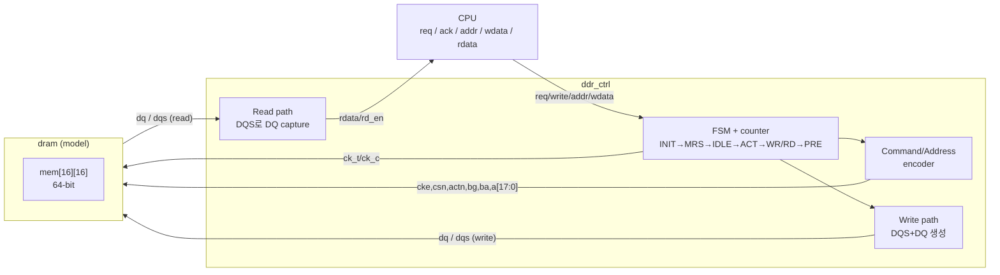
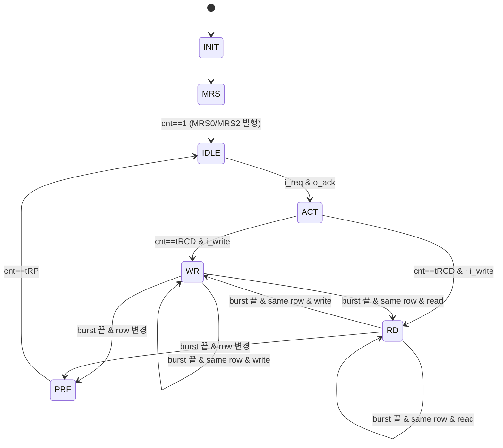

# DDR Memory Controller

DDR4-style DRAM controller(`ddr_ctrl`)와 검증용 DRAM behavioral model(`dram`)입니다. CPU의 단순 read/write request를 받아 실제 DDR protocol(command encoding, timing parameter, DQS strobe, BL8 burst)로 변환합니다. 교육용으로 핵심 동작에 집중한 간소화 model입니다.

- **Data width:** DQ 8-bit, **BL8**(burst length 8) → 한 transaction에 64-bit 전송
- **Address:** 8-bit = `row[7:4]` (4b) + `col[3:0]` (4b) → 16 row × 16 col
- **Timing parameter:** `tRCD=9`, `tCWL=11`, `tCL=10`, `tRP=8`
- **Policy:** open-page (같은 row 연속 access 시 ACT/PRE 생략)

---

## Background — DDR 핵심 개념

일반 SRAM interface와 달리 DDR DRAM은 몇 가지 고유한 규약이 있습니다.

- **DDR (Double Data Rate):** Clock의 **양 edge**에서 data를 전송합니다. 이 코드에선 `dqs_t`(rising)와 `dqs_c`(falling에 해당하는 상보 strobe)의 edge마다 한 beat씩 내보내, clock 1주기에 2 beat를 전송합니다.
- **DQS (Data Strobe):** Data(`dq`)와 함께 가는 source-synchronous strobe. **Write 때는 controller가**, **read 때는 DRAM이** DQS를 구동합니다. 수신 측은 이 DQS edge로 data를 sampling합니다.
- **Command/Address multiplexing:** 별도 command pin 대신 `{csn, actn, rasn, casn, wen}` 조합으로 command를 encoding하고, address bus `a[]`에 row/col을 시분할로 실어 보냅니다.
- **Bank / Bank Group:** `ba`(bank), `bg`(bank group) — DDR4에서 병렬성을 위한 구조. 이 model은 단일 bank 흐름에 집중합니다.
- **MRS (Mode Register Set):** 초기화 시 DRAM에 `tCL`/`tCWL` 같은 동작 parameter를 programming하는 command.
- **Row buffer / open-page:** ACT로 한 row를 sense amp(row buffer)에 올려두면, 같은 row 내 다른 column access는 ACT 없이 바로 가능합니다. Row를 바꾸려면 PRE(precharge)로 닫고 새 row를 ACT해야 합니다.

---

## Block Diagram



Controller는 CPU request를 FSM으로 받아, command/address bus와 DQ/DQS data bus를 각각 구동합니다. `dq`/`dqs_t`/`dqs_c`는 방향이 바뀌는 **bidirectional(inout)** 신호로, write 땐 controller가, read 땐 DRAM이 구동합니다.

---

## Controller FSM (`ddr_ctrl`)



| State | 역할 | 지속 | 완료 조건 |
|---|---|---|---|
| `INIT` | Reset 직후 진입점 | 1 cycle | 즉시 MRS로 |
| `MRS` | Mode Register 설정 (MRS0=tCL, MRS2=tCWL) | 2 cycle | `cnt==1` |
| `IDLE` | Request 대기 (`o_ack=1`) | 가변 | `i_req & o_ack` |
| `ACT` | Row activate (row buffer에 올림) | `tRCD+1` | `cnt==tRCD(9)` |
| `WR` | Write burst | `tCWL+4+1+1` | `cnt==tCWL+4+1(16)` |
| `RD` | Read burst | `tCL+4+1+1` | `cnt==tCL+4+1(15)` |
| `PRE` | Row precharge (닫기) | `tRP+1` | `cnt==tRP(8)` |

각 state는 전용 counter `cnt`로 DDR timing parameter만큼 시간을 셉니다. `cnt`는 state 진입 시 0에서 시작해 완료 값에 도달하면 reset됩니다.

### Timing Parameter

| Parameter | 값 | 의미 |
|---|---|---|
| `tRCD` | 9 | RAS-to-CAS delay — ACT 후 RD/WR까지 대기 |
| `tCWL` | 11 | CAS Write Latency — WR command 후 첫 write data까지 |
| `tCL` | 10 | CAS Latency — RD command 후 첫 read data까지 |
| `tRP` | 8 | Row Precharge — PRE 후 다음 ACT까지 |

`tCL`/`tCWL`은 초기화 시 MRS command로 DRAM에 programming됩니다 (MRS0 → tCL, MRS2 → tCWL).

---

## Open-Page Policy (핵심)

이 controller의 가장 중요한 최적화입니다. WR/RD burst가 끝날 때 **다음 request의 row가 현재 열린 row와 같은지**(`curr_row == next_row`) 확인합니다.

- **같은 row (row buffer hit):** PRE/ACT를 건너뛰고 곧바로 다음 WR/RD로 transition. 이미 열린 row에서 column만 바꿉니다. → 빠름
- **다른 row (row buffer miss):** `PRE`(현재 row 닫기) → `IDLE` → `ACT`(새 row 열기). → tRP + tRCD 추가 비용

```verilog
if (curr_row == next_row) curr_state <= i_write ? WR : RD;  // 페이지 유지
else                      curr_state <= PRE;                // 페이지 교체
```

`o_ack`도 이 조건에서 함께 뜨므로, row가 같으면 CPU는 burst 종료 cycle에 바로 다음 request를 넣을 수 있습니다.

```verilog
assign o_ack = (curr_state == IDLE) ||
    (curr_state == WR && cnt == tCWL+4+1 && curr_row == next_row) ||
    (curr_state == RD && cnt == tCL +4+1 && curr_row == next_row);
```

> Address mapping: `curr_row = curr_addr[7:4]`, `col = curr_addr[3:0]`. 8-bit address가 4-bit row + 4-bit col로 나뉩니다.

---

## Command & Address Encoding

Command는 `{csn, actn, rasn, casn, wen}` 5비트 조합으로 표현됩니다. 기본값은 `6'b111111`(NOP/DES)이고, `cnt==0`(또는 MRS의 `cnt==1`)에 해당 command 비트를 0으로 떨어뜨려 발행합니다.

| Command | csn | actn | rasn | casn | wen |
|---|---|---|---|---|---|
| ACT | 0 | 0 | — | — | — |
| WR | 0 | — | — | 0 | 0 |
| RD | 0 | — | — | 0 | — |
| PRE | 0 | — | 0 | 0 | — |
| MRS | 0 | — | 0 | 0 | 0 |

Address bus `a[]`는 state에 따라 다른 내용을 실어 multiplexing합니다.

- `a[16:14]` = `{rasn, casn, wen}` (일부 command에서 address pin 재사용)
- **ACT:** `a[3:0] = row` (activate할 row address)
- **WR/RD:** `a[3:0] = col` (access할 column address)
- **MRS:** Mode register field (MRS0에서 tCL, MRS2에서 tCWL 설정)

---

## Write Path — DQS/DQ 생성

Controller가 data와 strobe를 **직접 구동**합니다.

- **DQS:** `cnt`가 `tCWL-1` – `tCWL+4` 구간일 때 `dqs_t`/`dqs_c`를 `ck_t`/`ck_c`로 구동(그 외엔 `'bZ`). 첫 edge 전 preamble(`tCWL-1`)을 포함합니다.
- **DQ:** `cnt`가 `tCWL` – `tCWL+3`(4 cycle) 동안 출력 활성화(`dq_oe`). 각 cycle마다 `dqs_t` edge에 하위 byte, `dqs_c` edge에 상위 byte를 실어 **cycle당 16-bit**, 총 4 cycle × 16 = **64-bit(BL8)** 를 전송합니다.

```verilog
if (cnt == tCWL + 0) dq_o = dqs_t ? curr_data[7:0]  : (dqs_c ? curr_data[15:8]  : 'bZ);
// tCWL+1: [23:16]/[31:24], tCWL+2: [39:32]/[47:40], tCWL+3: [55:48]/[63:56]
```

---

## Read Path — DQS로 DQ Capture

Read 때는 **DRAM이 DQS를 구동**하고, controller는 그 strobe edge로 data를 받습니다.

- `dqs_c` edge(`posedge dqs_c`)에서 `read_data`의 하위 절반 byte들을, `dqs_t` edge에서 상위 절반 byte들을 capture합니다.
- `cnt==tCL` – `tCL+3` 구간에 8 beat를 모아 64-bit를 완성합니다.
- Burst 종료 후 `cnt==tCL+4`에 `data_read`(=`o_rd_en`)를 1로 올려 CPU에 "read data valid"를 알립니다.

```verilog
always @(posedge dqs_c) if (cnt == tCL) read_data[7:0] <= dq_i; ...
always @(posedge dqs_t) if (cnt == tCL) read_data[15:8] <= dq_i; ...
```

Source-synchronous capture(data와 함께 온 strobe로 sampling)라, controller clock과 무관하게 DRAM이 보낸 timing에 맞춰 안전하게 받는 구조입니다.

---

## DRAM Model (`dram`)

Controller를 검증하기 위한 behavioral DRAM입니다. 실제 chip의 핵심 동작을 모사합니다.

- **Command 해석:** `opcode = {csn, actn, rasn, casn, wen}`로 ACT/WR/RD/MRS를 구분.
- **Storage:** `mem[16][16]` (row × col, 각 64-bit).
- **ACT:** `row <= a[3:0]`로 active row latch. **WR/RD:** `col <= a[3:0]`.
- **MRS:** Controller가 보낸 값에서 `tCL`/`tCWL`을 역으로 decoding해 자신의 내부 timing으로 설정.
- **Write 수신:** Controller가 구동한 DQS edge로 `dq`를 받아 `curr_data`에 모으고, burst 끝(`cnt==tCWL+4`)에 `mem[row][col]`에 기록.
- **Read 구동:** RD command를 받으면 `mem[row][col]`을 꺼내 DQS와 함께 controller로 되돌려 보냄.

Controller와 DRAM은 서로 대칭입니다 — 한쪽이 write로 DQ/DQS를 구동하면 다른 쪽이 받고, read에선 역할이 반대가 됩니다.

---

## Testbench (`tb_ddr_ctrl.sv`)

CPU request sequence를 발행하고 DDR controller + DRAM을 함께 simulation합니다. `req`/`ack` handshake는 cache TB와 동일한 방식입니다.

### Command Sequence

| # | Command | addr | row/col | wdata | 의도 |
|---|---|---|---|---|---|
| 0 | WRITE | 0x04 | 0 / 4 | 0x040 | row 0 열기 + write |
| 1 | WRITE | 0x05 | 0 / 5 | 0x050 | **같은 row** — page hit |
| 2 | READ | 0x04 | 0 / 4 | — | 같은 row, 방향 전환 (WR→RD) |
| 3 | READ | 0x05 | 0 / 5 | — | 같은 row |
| 4 | WRITE | 0x14 | 1 / 4 | 0x140 | **Row 변경** — PRE→ACT |
| 5 | WRITE | 0x15 | 1 / 5 | 0x150 | 같은 row (row 1) |
| 6 | READ | 0x14 | 1 / 4 | — | 같은 row |
| 7 | READ | 0x05 | 0 / 5 | — | **Row 변경** — PRE→ACT (row 0 재activate) |

이 sequence는 (a) 같은 row 연속 access(page hit), (b) WR↔RD 방향 전환, (c) row 변경 시 PRE/ACT 재실행을 모두 커버합니다.

### Simulation 결과 (검증됨)

```
WR addr=04 wdata=040
WR addr=05 wdata=050
RD addr=04        -> READ DATA = 040   ✓
RD addr=05        -> READ DATA = 050   ✓
WR addr=14 wdata=140
WR addr=15 wdata=150
RD addr=14        -> READ DATA = 140   ✓
RD addr=05        -> READ DATA = 050   ✓ (row 0 재activate 후에도 이전 값 유지)
```

특히 마지막 read(cmd7)는 row를 1→0으로 되돌린 뒤에도 앞서 쓴 `0x050`이 그대로 나와, PRE/ACT를 거친 row 재activate와 data 보존이 정상임을 보여줍니다.

---

## Files

- `ddr_ctrl.v` — DDR controller(`ddr_ctrl`)와 검증용 DRAM model(`dram`) module이 함께 들어 있습니다.
- `tb_ddr_ctrl.sv` — Testbench

---

## Reference Images

- `ddr_ctrl-netlist_schematic.png` — 합성 netlist schematic
- `tb_ddr_ctrl-RTL_sim-1.png` / `-2.png` / `-3.png` — TB RTL simulation waveform (초기화·write·read 구간)

### Netlist Schematic


### RTL Simulation Waveforms


