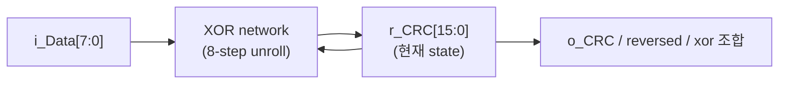
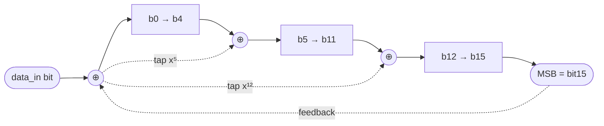
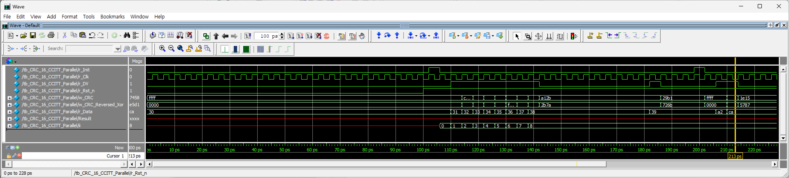
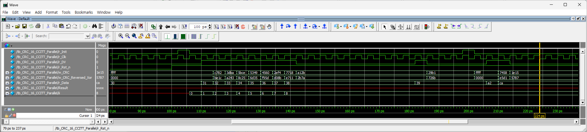

# CRC-16-CCITT (Byte-Parallel)

한 clock에 **1 byte(8-bit)씩** 처리하는 CRC-16-CCITT generator입니다. Serial LFSR을 8번 펼친(unroll) combinational logic으로 구현해, byte당 1 clock의 throughput을 냅니다. Data 무결성 검사(error detection)에 쓰이며, NAND flash를 포함한 여러 interface에서 전송·저장 중 bit error를 잡아내는 데 사용됩니다.

- **Polynomial:** CRC-16-CCITT = x¹⁶ + x¹² + x⁵ + 1 (`0x1021`)
- **Init:** `0xFFFF`
- **Input width:** 8-bit/clock (byte-parallel)
- **Output:** raw / bit-reversed / final-XOR 조합의 4가지 variant

---

## Background — CRC란?

**CRC(Cyclic Redundancy Check)** 는 data를 특정 polynomial로 나눈 remainder를 check 값으로 붙여, 수신 측에서 같은 계산을 반복해 **error를 detect**하는 기법입니다.

- Data bit열을 polynomial로 보고, generator polynomial로 modulo-2 나눗셈한 **remainder**가 CRC입니다.
- 하드웨어로는 **LFSR(Linear Feedback Shift Register)** 형태로 구현됩니다 — shift하면서 특정 tap에서 XOR feedback.
- CRC는 error를 **detect**만 합니다. Correction은 못 합니다. (NAND flash에서 data correction은 별도의 **ECC**가 담당하고, CRC는 command·parameter·전송 경로의 무결성 확인처럼 "틀렸는지 아닌지"만 빠르게 판별하는 역할입니다.)

### Serial vs Parallel

같은 CRC라도 구현 방식은 여러 가지입니다 — 손 계산, C bit loop, C LUT, serial LFSR, parallel unroll combinational logic. 이 코드는 그중 **parallel unroll(byte/clock)** 방식입니다. 다섯 방식의 원리와 trade-off는 아래 [구현 방식 비교](#구현-방식-비교--5가지) 섹션에서 다룹니다.

---

## Ports

| Signal | Dir | Width | 설명 |
|---|---|---|---|
| `i_Clk` | in | 1 | Clock |
| `i_Rst_n` | in | 1 | Asynchronous active-low reset (→ `0xFFFF`) |
| `i_Init` | in | 1 | CRC register를 `0xFFFF`로 초기화 (새 message 시작 전) |
| `i_DV` | in | 1 | Data Valid — 1이면 이번 clock에 `i_Data` byte를 CRC에 반영 |
| `i_Data` | in | 8 | 입력 data byte |
| `o_CRC` | out | 16 | 현재 CRC register 값 (raw) |
| `o_CRC_Reversed` | out | 16 | Bit 순서를 뒤집은 CRC |
| `o_CRC_Xor` | out | 16 | `o_CRC ^ 0xFFFF` (final XOR) |
| `o_CRC_Reversed_Xor` | out | 16 | `o_CRC_Reversed ^ 0xFFFF` |

---

## 동작



1. **초기화:** Reset 또는 `i_Init`이 1이면 `r_CRC <= 0xFFFF`. 새 message를 시작하기 전에 반드시 초기화합니다.
2. **Byte 반영:** `i_DV`가 1인 clock마다, 16개 CRC bit가 각각 **현재 `r_CRC` bit들과 `i_Data` bit들의 XOR 조합**으로 동시에 갱신됩니다. 예를 들어:

```verilog
r_CRC[0] <= i_Data[4] ^ i_Data[0] ^ r_CRC[8] ^ r_CRC[12];
r_CRC[4] <= i_Data[4] ^ r_CRC[12];
// ... 16개 비트 각각의 조합식 (직렬 LFSR 8-shift를 전개한 결과)
```

이 16개 식은 CRC-16-CCITT serial LFSR을 한 byte(8 shift)만큼 미리 펼쳐 얻은 것으로, 손으로 유도하거나 script로 생성합니다. 각 식의 tap 위치가 polynomial `0x1021`을 반영합니다.

3. **누적:** 여러 byte를 연속으로 `i_DV=1`과 함께 넣으면 CRC가 message 전체에 대해 누적됩니다.

---

## 출력 4가지 Variant

CRC standard마다 **bit reflection**과 **final XOR** 규약이 달라서, 네 가지 형태를 모두 제공합니다.

| Output | 계산 | 용도 |
|---|---|---|
| `o_CRC` | `r_CRC` | Reflection·XOR 없는 raw 값 (MSB-first 계열) |
| `o_CRC_Reversed` | `r_CRC`의 bit 역순 | 입출력을 reflect하는 standard(LSB-first)용 |
| `o_CRC_Xor` | `o_CRC ^ 0xFFFF` | final XOR = 0xFFFF인 standard |
| `o_CRC_Reversed_Xor` | `o_CRC_Reversed ^ 0xFFFF` | reflect + final XOR 조합 |

어떤 standard(CCITT-FALSE, X-25, KERMIT 등)를 따르느냐에 따라 맞는 output을 골라 쓰면 됩니다. 같은 core로 여러 규약을 커버하려는 설계입니다.

---

## 구현 방식 비교 — 5가지

같은 CRC-16-CCITT를 구현하는 다섯 가지 방법입니다. 아래 모든 방식은 **동일한 CRC 값**을 냅니다 (simulation·C 코드로 상호 검증 완료).

### 1. 손 계산 (modulo-2 polynomial 나눗셈)

CRC의 정의 그 자체입니다. Message 뒤에 polynomial 차수만큼 0을 붙이고, generator polynomial로 **XOR 기반(modulo-2) 나눗셈**을 한 remainder가 CRC입니다. Carry가 없는 나눗셈이라 뺄셈이 곧 XOR입니다.

작은 예 (generator `1011` = x³+x+1, message `1101`):

```
1101000        message 1101 + 0 3개
1011           XOR generator
-------
0110000
 1011          다음 최상위 1에 맞춰 정렬
-------
0011100
  1011
-------
0001010
   1011
-------
0000001        나머지 = 001 = CRC
```

전송 codeword = `1101 001` (generator로 나누면 remainder 0 → 무결). 결과 행은 왼쪽에 고정하고 generator만 최상위 1 위치로 밀어 XOR합니다.

실제 CRC-16-CCITT은 같은 방법을 generator `0x11021`(x¹⁶+x¹²+x⁵+1), message를 16비트 좌shift(×x¹⁶)한 state에 적용하고, init `0xFFFF` preset과 필요 시 reflection/XOR 규약을 얹습니다. 개념 이해엔 최고지만 사람이 byte마다 하긴 비현실적입니다.

### 2. C Bit Loop (bitwise, 8 iterations/byte)

Serial LFSR을 software로 모사합니다. Byte를 상위에 XOR한 뒤 8번 shift하며 최상위 bit가 1이면 polynomial을 XOR합니다.

```c
uint16_t crc_bitwise(uint16_t crc, uint8_t data) {
    crc ^= (uint16_t)data << 8;
    for (int i = 0; i < 8; i++)
        crc = (crc & 0x8000) ? (crc << 1) ^ 0x1021 : (crc << 1);
    return crc;
}
```

작고 이해하기 쉽지만 byte당 8번 loop라 느립니다. Table memory가 아까운 초소형 MCU에 적합합니다.

### 3. C LUT (table-driven, 1 lookup/byte)

Byte당 8번 반복하는 대신, 256개 항목의 미리 계산된 table을 한 번 참조합니다. 방식 2의 8-step을 256가지 입력에 대해 **미리 계산해 저장**한 것입니다.

```c
uint16_t crc_table[256];        // build_table()로 1회 생성
uint16_t crc_lut(uint16_t crc, uint8_t data) {
    uint8_t idx = (crc >> 8) ^ data;
    return (crc << 8) ^ crc_table[idx];
}
```

Byte당 lookup 1번이라 bit loop보다 훨씬 빠릅니다(대략 8배). 대신 512 byte table memory를 씁니다. 범용 CPU에서 CRC를 SW로 돌릴 때 표준적인 방식입니다.

### 4. Serial LFSR (serial hardware)

하드웨어로 CRC를 만드는 가장 기본형. 16비트 shift register에 polynomial tap 위치(`x¹²`, `x⁵`, `x⁰`)마다 feedback XOR를 두고, **1 clock에 1 bit**씩 밀어 넣습니다. `0x1021`은 x¹⁶ + x¹² + x⁵ + 1이므로, MSB(bit15) 출력을 feedback으로 삼아 bit 0·5·12 위치에 XOR를 삽입합니다 (Galois 형태).



Logic이 아주 작지만(FF 16개 + XOR 몇 개), 한 byte에 8 clock이 필요해 느립니다. 저속 serial link에 어울립니다.

### 5. Parallel Unroll 조합 논리 (이 코드)

방식 4의 serial LFSR을 **8번 펼쳐(unroll)** 한 clock에 byte 하나를 처리합니다. 8번의 shift+feedback을 미리 전개하면, 각 CRC bit는 "현재 CRC bit들 + 입력 byte bit들"의 XOR 조합식이 됩니다.

```verilog
r_CRC[0] <= i_Data[4] ^ i_Data[0] ^ r_CRC[8] ^ r_CRC[12];
r_CRC[4] <= i_Data[4] ^ r_CRC[12];
// ... 16비트 각각 (방식 4를 8-shift 전개한 결과)
```

Clock당 throughput이 serial의 8배지만, combinational XOR network가 커집니다. NAND flash 같은 고속 datapath에서 line 속도로 CRC를 계산할 때 쓰는 방식이며, **이 repository의 구현**입니다.

### 비교

| 방식 | 영역 | Byte당 비용 | Resource | 대표 상황 |
|---|---|---|---|---|
| 1. 손 계산 | 개념 | — | — | 원리 이해·검증 |
| 2. C bit loop | SW | 8 iterations | 코드 몇 줄 | 초소형 MCU, memory 부족 |
| 3. C LUT | SW | 1 lookup | 512B table | 범용 CPU SW CRC |
| 4. Serial LFSR | HW | 8 clock | FF 16 + XOR 소수 | 저속 serial link |
| 5. Parallel unroll | HW | **1 clock** | XOR network (큼) | **고속 datapath (이 코드)** |

핵심 흐름: **정의(손 계산)** → software로 옮기면 **bit loop**, 이를 미리 계산해 빠르게 하면 **LUT**. 하드웨어로 옮기면 **serial LFSR**, 이를 펼쳐 고속화하면 **parallel unroll**. LUT과 parallel unroll은 각각 SW·HW에서 "8-step을 미리 전개한다"는 같은 아이디어의 양쪽 구현입니다.

---

## Testbench (`tb_CRC_16_CCITT_Parallel.sv`)

두 부분으로 나뉩니다.

1. **연속 stream:** `i_Init`으로 초기화한 뒤 `0x31, 0x32, ... 0x38` 8 byte를 연속 입력하며 CRC 누적을 관찰하고, 중간에 `i_DV`를 끊었다가 재개했을 때의 동작도 확인합니다.
2. **Known-answer 확인:** `i_Init` 후 `ReverseBits(0x45)`, `ReverseBits(0x53)`(입력 bit reflection) 두 byte를 넣고, `o_CRC_Reversed_Xor`를 `$display`로 출력합니다. `"Be 0x5787 Please:"`라는 기대값 힌트와 함께 실제값을 찍어, **사람이 눈으로 `0x5787`과 대조**하는 방식입니다 (`assert` 같은 자동 pass/fail 판정은 없는 visual check). `0x45 0x53`("ES")과 `0x5787`은 알려진 reference vector입니다.

### Simulation 결과 (검증됨)

```
Value of CRC is ffff
Value of CRC is ffff
Value of CRC is c782
Value of CRC is 3dba
Value of CRC is 5bce
Value of CRC is 5349
Value of CRC is 4560
Value of CRC is 2ef4
Value of CRC is a12b
Final value of CRC is 29b1
Be 0x5787 Please: 5787   ✓
```

마지막 줄에서 기대값 `0x5787`이 그대로 나와, 입력 reflection + 출력 reflection + final XOR 경로가 standard와 일치함을 확인합니다.

> 참고: 원본 TB의 `ReverseBits` function은 `automatic` variable 문법을 사용합니다. Simulator에 따라 지원되지 않을 수 있으며, 그럴 경우 function 내 variable 선언만 도구에 맞게 바꾸면 됩니다(logic은 동일).

---

## Files

- `CRC_16_CCITT_Parallel.v` — byte-parallel CRC-16-CCITT generator
- `tb_CRC_16_CCITT_Parallel.sv` — Testbench (연속 stream + `0x5787` reference 검증)

---

## Reference Images

- `CRC_16_CCITT_Parallel-netlist_schematic.png` — 합성 netlist schematic
- `CRC_16_CCITT_Parallel-RTL_sim-1.png` / `-2.png` — TB RTL simulation waveform

### Netlist Schematic


### RTL Simulation Waveforms




