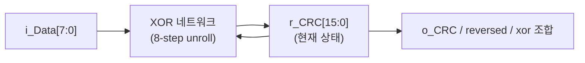
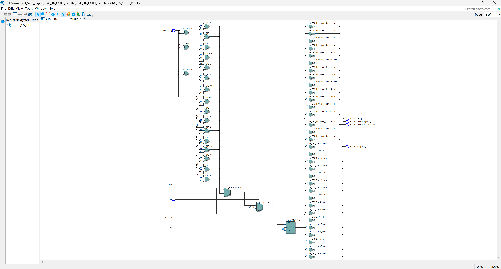

# CRC-16-CCITT (Byte-Parallel)

한 클럭에 **1 바이트(8-bit)씩** 처리하는 CRC-16-CCITT 생성기입니다. 직렬 LFSR을 8번 펼친(unroll) 조합 논리로 구현해, 바이트당 1 클럭의 처리량을 냅니다. 데이터 무결성 검사(error detection)에 쓰이며, NAND flash를 포함한 여러 인터페이스에서 전송·저장 중 비트 오류를 잡아내는 데 사용됩니다.

- **다항식(polynomial):** CRC-16-CCITT = x¹⁶ + x¹² + x⁵ + 1 (`0x1021`)
- **초기값(init):** `0xFFFF`
- **입력 폭:** 8-bit/clock (byte-parallel)
- **출력:** raw / bit-reversed / final-XOR 조합의 4가지 변형

---

## Background — CRC란?

**CRC(Cyclic Redundancy Check)** 는 데이터를 특정 다항식으로 나눈 나머지를 체크값으로 붙여, 수신 측에서 같은 계산을 반복해 **오류를 검출**하는 기법입니다.

- 데이터 비트열을 다항식으로 보고, 생성 다항식(generator polynomial)으로 modulo-2 나눗셈한 **나머지**가 CRC입니다.
- 하드웨어로는 **LFSR(Linear Feedback Shift Register)** 형태로 구현됩니다 — 시프트하면서 특정 탭에서 XOR 피드백.
- CRC는 오류를 **검출**만 합니다. 정정(correction)은 못 합니다. (NAND flash에서 데이터 정정은 별도의 **ECC**가 담당하고, CRC는 명령·파라미터·전송 경로의 무결성 확인처럼 "틀렸는지 아닌지"만 빠르게 판별하는 역할입니다.)

### Serial vs Parallel

같은 CRC라도 구현 방식은 여러 가지입니다 — 손 계산, C 비트 루프, C LUT, 직렬 LFSR, 병렬 unroll 조합 논리. 이 코드는 그중 **병렬 unroll(byte/clock)** 방식입니다. 다섯 방식의 원리와 트레이드오프는 아래 [구현 방식 비교](#구현-방식-비교--5가지) 섹션에서 다룹니다.

---

## Ports

| Signal | Dir | Width | 설명 |
|---|---|---|---|
| `i_Clk` | in | 1 | 클럭 |
| `i_Rst_n` | in | 1 | 비동기 active-low 리셋 (→ `0xFFFF`) |
| `i_Init` | in | 1 | CRC 레지스터를 `0xFFFF`로 초기화 (새 메시지 시작 전) |
| `i_DV` | in | 1 | Data Valid — 1이면 이번 클럭에 `i_Data` 바이트를 CRC에 반영 |
| `i_Data` | in | 8 | 입력 데이터 바이트 |
| `o_CRC` | out | 16 | 현재 CRC 레지스터 값 (raw) |
| `o_CRC_Reversed` | out | 16 | 비트 순서를 뒤집은 CRC |
| `o_CRC_Xor` | out | 16 | `o_CRC ^ 0xFFFF` (final XOR) |
| `o_CRC_Reversed_Xor` | out | 16 | `o_CRC_Reversed ^ 0xFFFF` |

---

## 동작



1. **초기화:** 리셋 또는 `i_Init`이 1이면 `r_CRC <= 0xFFFF`. 새 메시지를 시작하기 전에 반드시 초기화합니다.
2. **바이트 반영:** `i_DV`가 1인 클럭마다, 16개 CRC 비트가 각각 **현재 `r_CRC` 비트들과 `i_Data` 비트들의 XOR 조합**으로 동시에 갱신됩니다. 예를 들어:

```verilog
r_CRC[0] <= i_Data[4] ^ i_Data[0] ^ r_CRC[8] ^ r_CRC[12];
r_CRC[4] <= i_Data[4] ^ r_CRC[12];
// ... 16개 비트 각각의 조합식 (직렬 LFSR 8-shift를 전개한 결과)
```

이 16개 식은 CRC-16-CCITT 직렬 LFSR을 한 바이트(8 shift)만큼 미리 펼쳐 얻은 것으로, 손으로 유도하거나 스크립트로 생성합니다. 각 식의 탭 위치가 다항식 `0x1021`을 반영합니다.

3. **누적:** 여러 바이트를 연속으로 `i_DV=1`과 함께 넣으면 CRC가 메시지 전체에 대해 누적됩니다.

---

## 출력 4가지 변형

CRC 표준마다 **비트 반사(reflection)** 와 **final XOR** 규약이 달라서, 네 가지 형태를 모두 제공합니다.

| 출력 | 계산 | 용도 |
|---|---|---|
| `o_CRC` | `r_CRC` | 반사·XOR 없는 raw 값 (MSB-first 계열) |
| `o_CRC_Reversed` | `r_CRC`의 비트 역순 | 입출력을 reflect하는 표준(LSB-first)용 |
| `o_CRC_Xor` | `o_CRC ^ 0xFFFF` | final XOR = 0xFFFF인 표준 |
| `o_CRC_Reversed_Xor` | `o_CRC_Reversed ^ 0xFFFF` | reflect + final XOR 조합 |

어떤 표준(CCITT-FALSE, X-25, KERMIT 등)을 따르느냐에 따라 맞는 출력을 골라 쓰면 됩니다. 같은 코어로 여러 규약을 커버하려는 설계입니다.

---

## 구현 방식 비교 — 5가지

같은 CRC-16-CCITT를 구현하는 다섯 가지 방법입니다. 아래 모든 방식은 **동일한 CRC 값**을 냅니다 (시뮬레이션·C 코드로 상호 검증 완료).

### 1. 손 계산 (modulo-2 다항식 나눗셈)

CRC의 정의 그 자체입니다. 메시지 뒤에 다항식 차수만큼 0을 붙이고, 생성 다항식으로 **XOR 기반(modulo-2) 나눗셈**을 한 나머지가 CRC입니다. 캐리가 없는 나눗셈이라 뺄셈이 곧 XOR입니다.

작은 예 (generator `1011` = x³+x+1, 메시지 `1101`):

```
1101000        message 1101 + 0 3개
1011           XOR generator
-------
0110000
 1011          다음 최상위 1에 맞춰 정렬
-------
0011100
  1011
-------
0001010
   1011
-------
0000001        나머지 = 001 = CRC
```

전송 코드워드 = `1101 001` (generator로 나누면 나머지 0 → 무결). 결과 행은 왼쪽에 고정하고 generator만 최상위 1 위치로 밀어 XOR합니다.

실제 CRC-16-CCITT은 같은 방법을 generator `0x11021`(x¹⁶+x¹²+x⁵+1), 메시지를 16비트 좌시프트(×x¹⁶)한 상태에 적용하고, 초기값 `0xFFFF` 프리셋과 필요 시 반사/XOR 규약을 얹습니다. 개념 이해엔 최고지만 사람이 바이트마다 하긴 비현실적입니다.

### 2. C 비트 루프 (bitwise, 8 iterations/byte)

직렬 LFSR을 소프트웨어로 흉내 냅니다. 바이트를 상위에 XOR한 뒤 8번 시프트하며 최상위 비트가 1이면 다항식을 XOR합니다.

```c
uint16_t crc_bitwise(uint16_t crc, uint8_t data) {
    crc ^= (uint16_t)data << 8;
    for (int i = 0; i < 8; i++)
        crc = (crc & 0x8000) ? (crc << 1) ^ 0x1021 : (crc << 1);
    return crc;
}
```

작고 이해하기 쉽지만 바이트당 8번 루프라 느립니다. 테이블 메모리가 아까운 초소형 MCU에 적합합니다.

### 3. C LUT (table-driven, 1 lookup/byte)

바이트당 8번 반복하는 대신, 256개 항목의 미리 계산된 표를 한 번 참조합니다. 방식 2의 8-step을 256가지 입력에 대해 **미리 계산해 저장**한 것입니다.

```c
uint16_t crc_table[256];        // build_table()로 1회 생성
uint16_t crc_lut(uint16_t crc, uint8_t data) {
    uint8_t idx = (crc >> 8) ^ data;
    return (crc << 8) ^ crc_table[idx];
}
```

바이트당 조회 1번이라 비트 루프보다 훨씬 빠릅니다(대략 8배). 대신 512바이트 테이블 메모리를 씁니다. 범용 CPU에서 CRC를 SW로 돌릴 때 표준적인 방식입니다.

### 4. 직렬 LFSR (serial hardware)

하드웨어로 CRC를 만드는 가장 기본형. 16비트 시프트 레지스터에 다항식 탭 위치(`x¹²`, `x⁵`, `x⁰`)마다 피드백 XOR를 두고, **1 클럭에 1비트**씩 밀어 넣습니다. `0x1021`은 x¹⁶ + x¹² + x⁵ + 1이므로, MSB(bit15) 출력을 피드백으로 삼아 bit 0·5·12 위치에 XOR를 삽입합니다 (Galois 형태).


로직이 아주 작지만(FF 16개 + XOR 몇 개), 한 바이트에 8클럭이 필요해 느립니다. 저속 직렬 링크에 어울립니다.

### 5. 병렬 unroll 조합 논리 (이 코드)

방식 4의 직렬 LFSR을 **8번 펼쳐(unroll)** 한 클럭에 바이트 하나를 처리합니다. 8번의 시프트+피드백을 미리 전개하면, 각 CRC 비트는 "현재 CRC 비트들 + 입력 바이트 비트들"의 XOR 조합식이 됩니다.

```verilog
r_CRC[0] <= i_Data[4] ^ i_Data[0] ^ r_CRC[8] ^ r_CRC[12];
r_CRC[4] <= i_Data[4] ^ r_CRC[12];
// ... 16비트 각각 (방식 4를 8-shift 전개한 결과)
```

클럭당 처리량이 직렬의 8배지만, 조합 XOR 네트워크가 커집니다. NAND flash 같은 고속 데이터패스에서 라인 속도로 CRC를 계산할 때 쓰는 방식이며, **이 저장소의 구현**입니다.

### 비교

| 방식 | 영역 | 바이트당 비용 | 자원 | 대표 상황 |
|---|---|---|---|---|
| 1. 손 계산 | 개념 | — | — | 원리 이해·검증 |
| 2. C 비트 루프 | SW | 8 iterations | 코드 몇 줄 | 초소형 MCU, 메모리 부족 |
| 3. C LUT | SW | 1 lookup | 512B 테이블 | 범용 CPU SW CRC |
| 4. 직렬 LFSR | HW | 8 clock | FF 16 + XOR 소수 | 저속 직렬 링크 |
| 5. 병렬 unroll | HW | **1 clock** | XOR 네트워크 (큼) | **고속 데이터패스 (이 코드)** |

핵심 흐름: **정의(손 계산)** → 소프트웨어로 옮기면 **비트 루프**, 이를 미리 계산해 빠르게 하면 **LUT**. 하드웨어로 옮기면 **직렬 LFSR**, 이를 펼쳐 고속화하면 **병렬 unroll**. LUT과 병렬 unroll은 각각 SW·HW에서 "8-step을 미리 전개한다"는 같은 아이디어의 양쪽 구현입니다.

---

## Testbench (`tb_CRC_16_CCITT_Parallel.sv`)

두 부분으로 나뉩니다.

1. **연속 스트림:** `i_Init`으로 초기화한 뒤 `0x31, 0x32, ... 0x38` 8바이트를 연속 입력하며 CRC 누적을 관찰하고, 중간에 `i_DV`를 끊었다가 재개했을 때의 동작도 확인합니다.
2. **참조값(known-answer) 확인:** `i_Init` 후 `ReverseBits(0x45)`, `ReverseBits(0x53)`(입력 비트 반사) 두 바이트를 넣고, `o_CRC_Reversed_Xor`를 `$display`로 출력합니다. `"Be 0x5787 Please:"`라는 기대값 힌트와 함께 실제값을 찍어, **사람이 눈으로 `0x5787`과 대조**하는 방식입니다 (`assert` 같은 자동 pass/fail 판정은 없는 visual check). `0x45 0x53`("ES")과 `0x5787`은 알려진 참조 벡터입니다.

### 시뮬레이션 결과 (검증됨)

```
Value of CRC is ffff
Value of CRC is ffff
Value of CRC is c782
Value of CRC is 3dba
Value of CRC is 5bce
Value of CRC is 5349
Value of CRC is 4560
Value of CRC is 2ef4
Value of CRC is a12b
Final value of CRC is 29b1
Be 0x5787 Please: 5787   ✓
```

마지막 줄에서 기대값 `0x5787`이 그대로 나와, 입력 반사 + 출력 반사 + final XOR 경로가 표준과 일치함을 확인합니다.

> 참고: 원본 TB의 `ReverseBits` 함수는 `automatic` 변수 문법을 사용합니다. 시뮬레이터에 따라 지원되지 않을 수 있으며, 그럴 경우 함수 내 변수 선언만 도구에 맞게 바꾸면 됩니다(로직은 동일).

---

## Files

- `CRC_16_CCITT_Parallel.v` — byte-parallel CRC-16-CCITT 생성기
- `tb_CRC_16_CCITT_Parallel.sv` — 테스트벤치 (연속 스트림 + `0x5787` 참조값 검증)

---

## Reference Images

- `CRC_16_CCITT_Parallel-netlist_schematic.png` — 합성 네트리스트 schematic
- `CRC_16_CCITT_Parallel-RTL_sim-1.png` ~ `2.png` — TB RTL 시뮬레이션 파형

### Netlist Schematic



### RTL Simulation Waveforms


