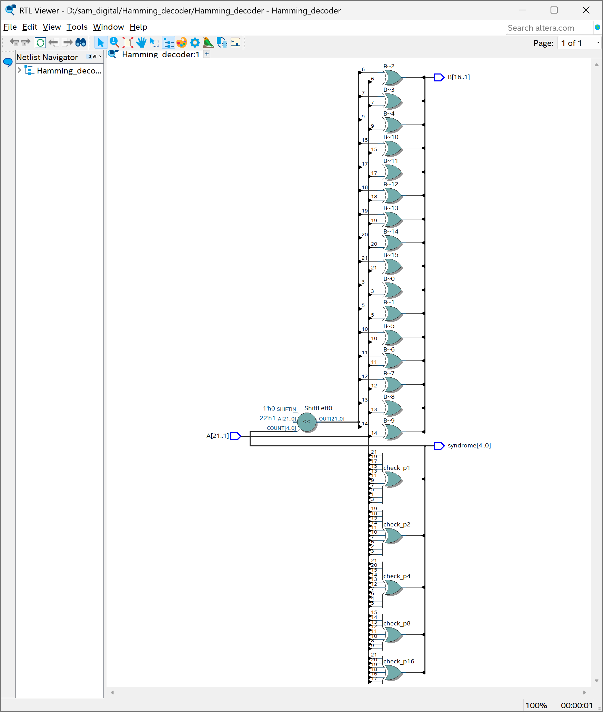
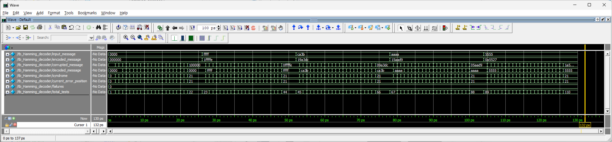
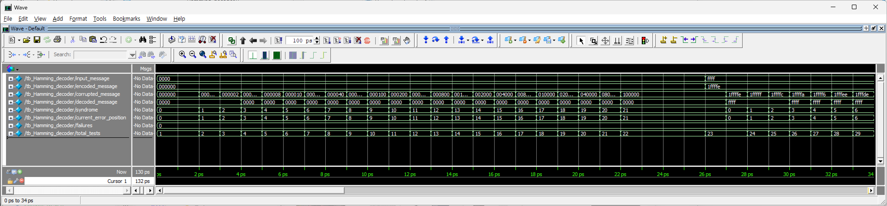
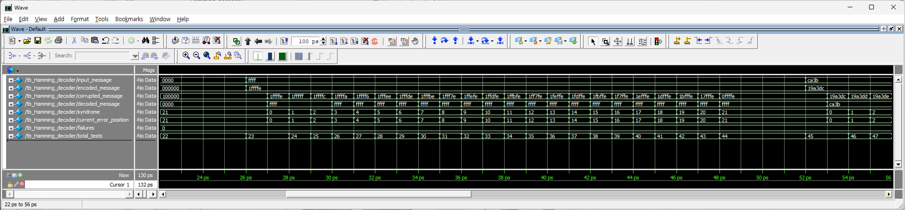
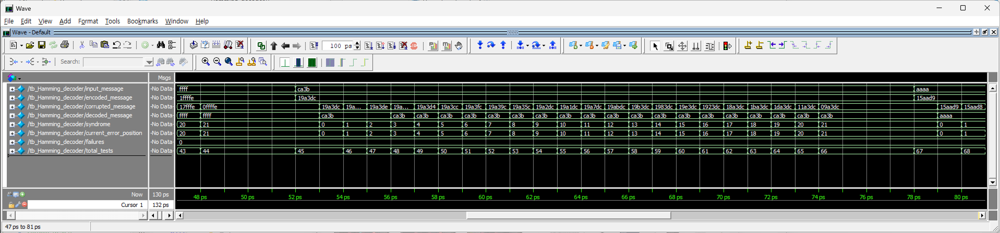
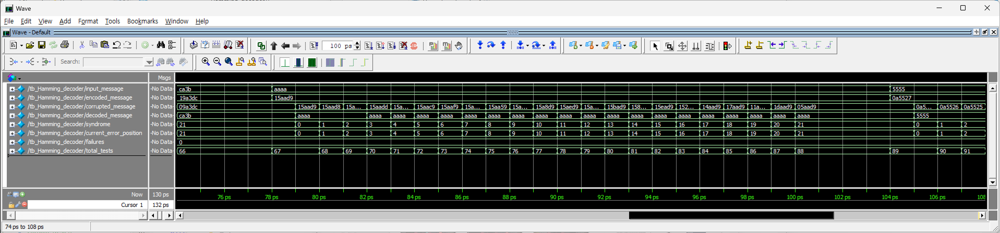
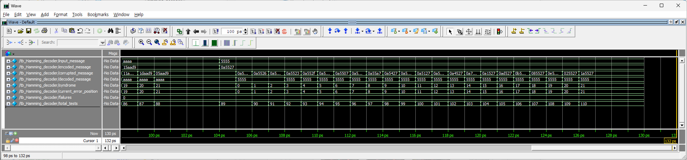

# Hamming Code (21,16) — SEC Encoder/Decoder

**단일 비트 오류를 정정(SEC, Single Error Correction)** 하는 (21,16) Hamming 코드입니다. 16비트 메시지에 5비트 패리티를 붙여 21비트 코드워드를 만들고, 수신 측에서 **어느 비트가 틀렸는지 위치를 찾아 정정**합니다. NAND flash의 ECC(오류 정정 부호) 계열에서 가장 기본이 되는 부호입니다.

- **구성:** 데이터 16b + 패리티 5b = 코드워드 21b
- **패리티 위치:** 1, 2, 4, 8, 16 (2의 거듭제곱 자리)
- **능력:** 1비트 오류 **정정** (SEC)
- **패리티:** even parity

---

## Background — ECC와 Hamming code

CRC가 오류를 **검출만** 한다면, ECC(Error Correcting Code)는 한발 더 나아가 **오류를 정정**합니다. NAND flash는 셀 마모·디스터브로 비트가 뒤집히는데, 이를 읽는 쪽에서 되살리는 것이 ECC의 역할입니다.

**Hamming code**는 ECC의 고전적 출발점으로, 핵심 아이디어는 다음과 같습니다.

- 패리티 비트를 **2의 거듭제곱 위치**(1, 2, 4, 8, 16)에 둡니다.
- 각 패리티 비트는 "자기 위치 번호의 해당 비트가 켜진 모든 위치"를 커버합니다. 예를 들어 패리티 p1(위치 1)은 이진수로 bit0이 켜진 위치(1,3,5,7,…)를 모두 XOR합니다.
- 그 결과, 어떤 한 비트가 뒤집히면 **그 위치의 이진 표현에 해당하는 패리티 검사들만 정확히 실패**합니다. 실패한 검사들의 가중치를 더하면 곧 **에러 위치의 번호**가 됩니다.

이 "syndrome이 곧 에러 위치"라는 성질이 Hamming code의 우아함입니다. 별도의 위치 탐색 없이, 패리티 재계산 결과 자체가 몇 번 비트가 틀렸는지를 이진수로 알려줍니다.

> 이 구현은 **SEC(1비트 정정)** 전용입니다. 오버올 패리티 비트가 없어 2비트 오류는 검출·정정하지 못합니다(오히려 엉뚱한 위치를 고쳐버립니다). 실제 NAND는 다비트 정정을 위해 BCH·LDPC 같은 더 강한 부호를 쓰지만, 원리 이해엔 Hamming이 기본입니다.

---

## 코드 구조

21개 위치 중 2의 거듭제곱 자리는 패리티, 나머지는 데이터입니다.

```
위치:  1  2  3  4  5  6  7  8  9 10 11 12 13 14 15 16 17 18 19 20 21
역할:  P  P  D  P  D  D  D  P  D  D  D  D  D  D  D  P  D  D  D  D  D
       p1 p2    p4          p8                      p16
```

`P`(패리티) = 위치 1,2,4,8,16 / `D`(데이터) = 나머지 16자리.

### 패리티 커버리지

각 패리티 비트가 XOR로 묶는 위치들입니다 (even parity).

| 패리티 | 위치 | 커버하는 위치 (해당 이진 비트가 켜진 자리) |
|---|---|---|
| `p1` | 1 | 1, 3, 5, 7, 9, 11, 13, 15, 17, 19, 21 |
| `p2` | 2 | 2, 3, 6, 7, 10, 11, 14, 15, 18, 19 |
| `p4` | 4 | 4, 5, 6, 7, 12, 13, 14, 15, 20, 21 |
| `p8` | 8 | 8, 9, 10, 11, 12, 13, 14, 15 |
| `p16` | 16 | 16, 17, 18, 19, 20, 21 |

---

## Encoder (`Hamming_encoder`)

두 단계로 21비트 코드워드 `B`를 만듭니다.

1. **데이터 배치:** 16비트 메시지 `A[1..16]`를 패리티가 아닌 위치(3,5,6,7,9,…,21)에 그대로 채웁니다.
2. **패리티 생성:** 각 패리티 위치에 자신이 커버하는 데이터 비트들의 XOR(even parity)를 넣습니다.

```verilog
assign B[1] = B[3]^B[5]^B[7]^B[9]^B[11]^B[13]^B[15]^B[17]^B[19]^B[21];  // p1
// p2, p4, p8, p16 도 각자의 커버리지대로
```

---

## Decoder (`Hamming_decoder`)

세 단계로 오류를 찾아 정정합니다.

### 1. Syndrome 계산

수신 코드워드 `A`에 대해 **패리티 비트까지 포함**해 각 패리티 검사를 다시 계산합니다. 오류가 없으면 각 검사는 0(even parity 유지), 오류가 있으면 해당 검사가 1이 됩니다.

```verilog
assign check_p1 = A[1]^A[3]^A[5]^...^A[21];   // 위치 1 커버 집합
// ... p2, p4, p8, p16
assign syndrome = {check_p16, check_p8, check_p4, check_p2, check_p1};
```

`syndrome`은 `{p16,p8,p4,p2,p1}` 순의 5비트 숫자로, **값이 곧 오류 위치**입니다. `0`이면 오류 없음, `N`이면 위치 N의 비트가 뒤집힘.

### 2. One-hot 정정 벡터

숫자 syndrome을 one-hot으로 펼칩니다.

```verilog
assign error_pos = 22'b1 << syndrome;   // syndrome=N → error_pos[N]=1
```

`syndrome=0`이면 `error_pos[0]=1`(어떤 데이터 위치도 안 건드림), `syndrome=N`이면 `error_pos[N]=1`.

### 3. 데이터 추출 + 정정

16개 데이터 위치를 뽑으면서, 그 위치의 `error_pos` 비트와 XOR해 틀린 비트를 뒤집습니다.

```verilog
assign B[9] = A[13] ^ error_pos[13];   // 위치 13이 틀렸으면 여기서 정정
// ... 16개 데이터 위치 각각
```

오류가 패리티 위치(1,2,4,8,16)에서 났다면 데이터에는 영향이 없으므로, 데이터는 자동으로 올바르게 나옵니다.

---

## Worked Example

메시지 `1100101000111011`을 인코딩하면 코드워드는 `110011010001111011100`(21비트)입니다.

| 상황 | syndrome | 결과 |
|---|---|---|
| 오류 없음 | `0` | 디코드 = 원본 ✓ |
| 위치 13 비트 반전 (데이터) | `13` | error_pos[13]로 정정 → 원본 복원 ✓ |
| 위치 4 비트 반전 (패리티) | `4` | 데이터 무관, 원본 그대로 ✓ |

syndrome이 뒤집힌 비트의 위치 번호를 정확히 가리키고, 해당 비트를 XOR로 되돌려 원본을 복원합니다.

---

## Testbench (`tb_Hamming_decoder.sv`)

**자동 self-checking** 테스트벤치입니다. (CRC TB가 육안 확인이었던 것과 달리, 여기서는 기대값과 자동 비교해 PASS/FAIL을 판정합니다.)

각 테스트 메시지에 대해:

1. **오류 없음:** 인코딩→디코딩 후 `syndrome==0`이고 디코드 결과가 원본과 같은지 확인.
2. **모든 위치 단일 오류:** 코드워드의 위치 1~21에 하나씩 비트를 뒤집어가며, 매번 `syndrome == error_position`이고 디코드 결과가 원본으로 정정되는지 확인.

5개 메시지(`0000...`, `1111...`, 임의 패턴 등) × (1 + 21)케이스 = **110 케이스**를 검사하고, 실패가 0이면 PASS를 출력합니다.

### 시뮬레이션 결과 (검증됨)

```
PASS: 110 Hamming-code cases completed successfully.
```

모든 단일 비트 오류 위치에서 syndrome이 정확히 그 위치를 가리키고 데이터가 복원됨을 확인합니다.

---

## Limitations

- **SEC 전용:** 단일 비트 오류만 정정합니다. 2비트 오류는 syndrome이 엉뚱한 단일 위치를 가리켜 **오정정(miscorrection)** 이 발생합니다.
- **SEC-DED로 확장:** 오버올 패리티 비트를 하나 더 두면 "1비트 정정 + 2비트 검출(SEC-DED)"이 됩니다. 이 구현에는 없습니다.
- 실제 NAND의 다비트 오류에는 BCH·LDPC 등 더 강력한 ECC가 사용됩니다.

---

## Files

- `Hamming_decoder.v` — `Hamming_encoder`와 `Hamming_decoder` 모듈
- `tb_Hamming_decoder.sv` — self-checking 테스트벤치 (110 케이스)

---

## Reference Images

- `Hamming_decoder-netlist_schematic.png` — 합성 네트리스트 schematic
- `Hamming_decoder-RTL_sim-0.png` ~ `5.png` — TB RTL 시뮬레이션 파형 (테스트 메시지별)

### Netlist Schematic



### RTL Simulation Waveforms












