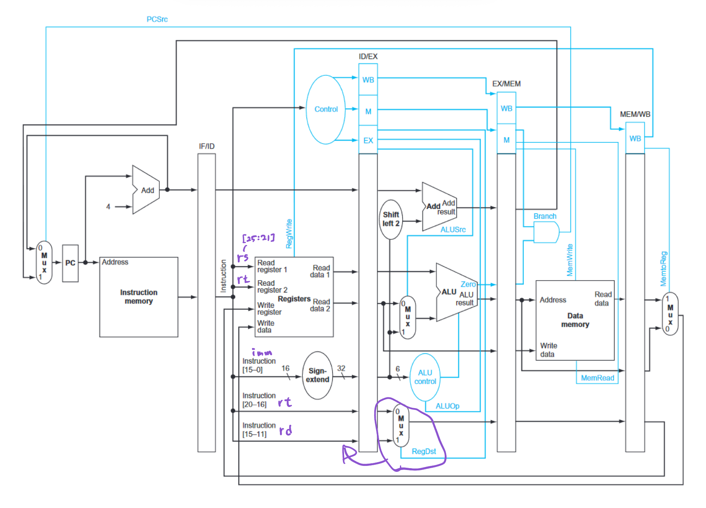
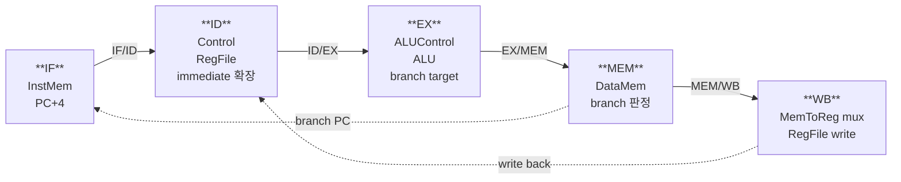
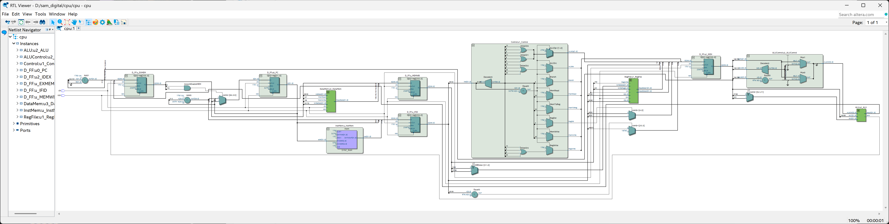
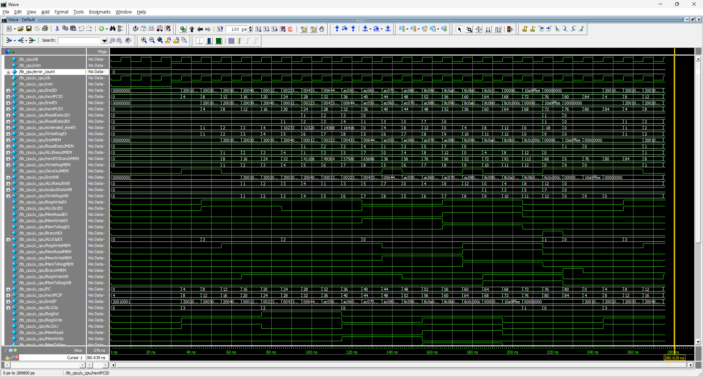
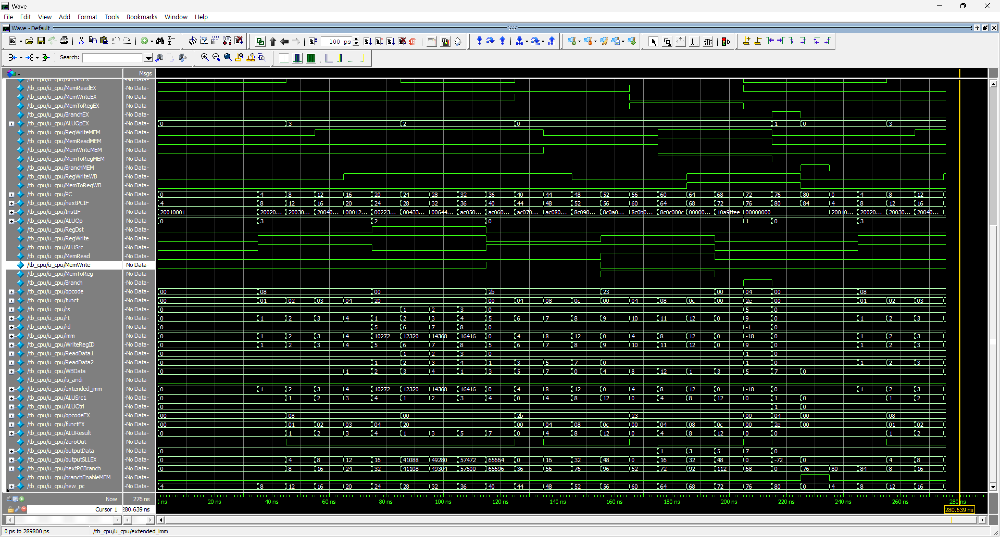

# 5-Stage Pipelined MIPS CPU (No Hazard Handling)

MIPS 서브셋을 실행하는 **5단계 파이프라인 CPU**입니다. IF → ID → EX → MEM → WB 각 단계를 파이프라인 레지스터로 분리해 매 사이클 새 명령을 발행합니다.

> **이 버전은 hazard 처리가 없습니다.** Forwarding·stall·flush 로직이 구현되어 있지 않아, 의존 명령 간격과 분기 뒤 NOP을 **프로그램에서 수동으로 확보**해야 합니다. 자세한 내용은 [Hazard — 미처리 버전](#hazard--미처리-버전) 참고. 다음 프로젝트에서 hazard 처리를 추가한 버전을 다룹니다.

- **ISA:** MIPS 서브셋 — R-type(add/sub/and), `lw`, `sw`, `beq`, `addi`, `andi`
- **데이터 폭:** 32-bit
- **분기 해결:** MEM 단계 (분기 페널티 3)
- **레지스터:** 32 × 32-bit, `r0`는 하드와이어 0
- **주소 체계:** byte address (메모리 내부는 word 단위로 변환)

---

## Pipeline Overview



전체 데이터패스입니다. 5개 단계가 파이프라인 레지스터(IF/ID, ID/EX, EX/MEM, MEM/WB)로 나뉘고, 제어 신호가 각 단계로 흘러가며, WB의 결과가 ID의 레지스터 파일로, MEM의 분기 결과가 IF의 PC로 되돌아가는 경로를 볼 수 있습니다.

단계 흐름만 간단히 보면 다음과 같습니다.



각 단계 사이에 `D_FF` 기반 파이프라인 레지스터를 두고, 제어 신호와 데이터를 함께 흘려보냅니다.

---

## Modules

| 파일 | 모듈 | 역할 |
|---|---|---|
| `cpu.v` | `cpu` | 최상위 — 5단계 데이터패스와 파이프라인 레지스터 연결 |
| `InstMem.v` | `InstMem` | 명령어 메모리 (24 word, 조합 읽기). 테스트 프로그램이 `initial`에 하드코딩 |
| `Control.v` | `Control` | opcode를 해석해 주 제어 신호 생성 |
| `ALUControl.v` | `ALUControl` | `ALUOp` + funct/opcode → `ALUCtrl` 4비트 |
| `ALU.v` | `ALU` | ADD / SUB / AND, `zero` 플래그 출력 |
| `Regfile.sv` | `RegFile` | 32×32b. 쓰기는 posedge 동기, 읽기는 조합. `r0` 하드와이어 0 |
| `DataMem.sv` | `DataMem` | 데이터 메모리 128 word. byte address를 word index로 변환 |
| `D_FF.v` | `D_FF` | 파라미터화 D 플립플롭 — PC와 모든 파이프라인 레지스터에 사용 |

---

## Stages

### IF (Instruction Fetch)

```verilog
InstMem u_InstMem (.addr(PC), .inst(InstIF));
assign nextPCIF = PC + 4;
```

`PC`로 명령어를 읽고 `PC+4`를 계산합니다. 다음 PC는 MEM 단계의 분기 결과에 따라 선택됩니다.

```verilog
wire [31:0] new_pc = branchEnableMEM ? nextPCBranchMEM : nextPCIF;
```

### ID (Instruction Decode)

명령어 필드를 분해하고, `Control`로 제어 신호를 생성하며, `RegFile`에서 두 소스를 읽습니다.

- `opcode = Inst[31:26]`, `rs = [25:21]`, `rt = [20:16]`, `rd = [15:11]`, `imm = [15:0]`, `funct = [5:0]`
- 목적지 레지스터: `WriteRegID = RegDst ? rd : rt`

**Immediate 확장**은 명령에 따라 방식이 다릅니다.

```verilog
wire is_andi = (opcode == 6'h0C);
wire [31:0] extended_imm = is_andi ? {16'd0, imm}         // andi: zero extension
                                   : {{16{imm[15]}}, imm}; // 나머지: sign extension
```

논리 연산인 `andi`는 상위 비트를 0으로 채워야 마스크로 동작하고, `addi`/`lw`/`sw`/`beq`는 음수 오프셋을 표현해야 하므로 부호 확장을 씁니다.

`Control`은 `inst != 0`일 때만 신호를 세우므로, **`0x00000000` 명령은 자동으로 NOP**이 됩니다 (모든 제어 신호 0).

### EX (Execute)

`ALUControl`이 `ALUOp`와 funct/opcode로 연산을 결정하고, `ALU`가 계산합니다.

```verilog
wire [31:0] ALUSrc1 = ALUSrcEX ? extended_immEX : ReadData2EX;  // ALU 2번째 피연산자
ALU u2_ALU (.src1(ReadData1EX), .src2(ALUSrc1), ...);
```

분기 목표 주소도 이 단계에서 계산합니다.

```verilog
wire [31:0] nextPCBranch = nextPCEX + (extended_immEX << 2);
```

### MEM (Memory)

`DataMem` 접근과 **분기 성립 판정**이 이뤄집니다.

```verilog
wire branchEnableMEM = ZeroOutMEM & BranchMEM;
```

`DataMem`은 ALU가 계산한 **byte address를 word index로 변환**해서 접근합니다.

```verilog
wire [6:0] word_addr = Address[8:2];   // byte → word (÷4)
```

분기가 MEM에서 해결되므로, 분기 명령 뒤에 이미 IF된 **3개 명령이 낭비**됩니다 (아래 제어 hazard 참고).

### WB (Write Back)

ALU 결과와 메모리 읽기 값 중 하나를 골라 레지스터 파일에 씁니다.

```verilog
assign WBData = MemToRegWB ? outputDataWB : ALUResultWB;
```

---

## Control Signals

`Control` 모듈이 opcode로부터 생성하는 신호입니다.

| 명령 | opcode | ALUOp | RegDst | RegWrite | ALUSrc | MemRead | MemWrite | MemToReg | Branch |
|---|---|---|---|---|---|---|---|---|---|
| R-type | `0x00` | `10` | 1 | 1 | 0 | 0 | 0 | 0 | 0 |
| `lw` | `0x23` | `00` | 0 | 1 | 1 | 1 | 0 | 1 | 0 |
| `sw` | `0x2B` | `00` | 0 | 0 | 1 | 0 | 1 | 0 | 0 |
| `beq` | `0x04` | `01` | 0 | 0 | 0 | 0 | 0 | 0 | 1 |
| `addi` / `andi` | `0x08`/`0x0C` | `11` | 0 | 1 | 1 | 0 | 0 | 0 | 0 |
| NOP (`inst==0`) | — | `00` | 0 | 0 | 0 | 0 | 0 | 0 | 0 |

### ALUControl

`ALUOp`로 어느 필드를 볼지 정하고, 최종 `ALUCtrl`을 만듭니다.

| ALUOp | 의미 | 참조 필드 | 결과 |
|---|---|---|---|
| `00` | `lw`/`sw` — 주소 계산 | — | ADD |
| `01` | `beq` — 비교 | — | SUB (zero 플래그로 판정) |
| `10` | R-type | `funct` | `0x20`→ADD, `0x22`→SUB, `0x24`→AND |
| `11` | I-type 연산 | `opcode` | `0x08`→ADD, `0x0C`→AND |

`ALUCtrl`은 ADD(`0000`) / SUB(`0001`) / AND(`0010`) 세 가지이며, 기본값은 ADD입니다.

---

## Pipeline Registers

4개 경계 모두 `D_FF`를 사용하며, 제어 신호와 데이터를 하나의 벡터로 묶어 전달합니다.

| 레지스터 | 폭 | 전달 내용 |
|---|---|---|
| `u_IFID` | 64b | `InstIF`, `nextPCIF` |
| `u2_IDEX` | 173b | 제어 6종(`RegWrite`, `ALUSrc`, `MemRead`, `MemWrite`, `MemToReg`, `Branch`) + `ALUOp`, `InstID`, `nextPCID`, `ReadData1`, `ReadData2`, `WriteRegID`, `extended_imm` |
| `u_EXMEM` | 139b | 제어 5종(`RegWrite`, `MemRead`, `MemWrite`, `MemToReg`, `Branch`) + `InstEX`, `ReadData2EX`, `ALUResult`, `WriteRegEX`, `nextPCBranch`, `ZeroOut` |
| `u_MEMWB` | 103b | 제어 2종(`RegWrite`, `MemToReg`) + `InstMEM`, `outputData`, `ALUResultMEM`, `WriteRegMEM` |

### 제어 신호 전달 범위

각 제어 신호는 **소비되는 단계까지만** 전달합니다. 그 이후로 끌고 가면 아무 데도 연결되지 않는 dead 신호가 되므로 파이프라인 레지스터에서 제외했습니다.

| 신호 | 소비 단계 | 소비 위치 | 전달 범위 |
|---|---|---|---|
| `RegDst` | **ID** | `WriteRegID = RegDst ? rd : rt` | ID에서 사용 후 종료 (파이프라인에 안 실림) |
| `ALUOp` | **EX** | `ALUControl` | ID/EX까지 |
| `ALUSrc` | **EX** | ALU 2번째 피연산자 mux | ID/EX까지 |
| `MemRead` | **MEM** | `DataMem` 읽기 | EX/MEM까지 |
| `MemWrite` | **MEM** | `DataMem` 쓰기 | EX/MEM까지 |
| `Branch` | **MEM** | `branchEnableMEM = ZeroOutMEM & BranchMEM` | EX/MEM까지 |
| `RegWrite` | **WB** | `RegFile` write enable | MEM/WB까지 (EX·MEM 단계는 경유) |
| `MemToReg` | **WB** | `WBData` mux | MEM/WB까지 (EX·MEM 단계는 경유) |

> **주의:** `RegWriteEX`/`RegWriteMEM`, `MemToRegEX`/`MemToRegMEM`, `MemReadEX`, `MemWriteEX`, `BranchEX`는 해당 단계에서 직접 쓰이지 않지만 **뒤 단계로 가기 위한 경유 신호**이므로 제거하면 안 됩니다.

데이터 신호도 같은 원칙을 따릅니다. `nextPC`는 EX에서 분기 목표 주소 계산에 쓰이므로 ID/EX까지만, `ReadData1`은 EX(ALU)까지만, `ReadData2`는 MEM(store 데이터)까지 전달합니다.

### `InstMEM` / `InstWB` — 디버깅 목적 유지

명령어 자체는 ID(필드 분해)와 EX(`opcode`/`funct` → ALUControl)에서만 소비되므로, 기능상 MEM·WB로 보낼 필요가 없습니다. 그럼에도 **파형에서 각 단계에 어떤 명령이 있는지 추적하기 위해** `InstMEM`, `InstWB`를 의도적으로 유지했습니다. 다음 hazard 처리 버전에서 forwarding·stall 동작을 파형으로 확인할 때 유용합니다.

> 폭을 `WIDTH(256)`으로 넉넉히 잡고 실제 필요한 비트만 채우는 방식이라, 컴파일 시 상위 비트 패딩 경고가 발생합니다. 동작에는 영향이 없지만, 각 경계의 실제 폭(64 / 173 / 139 / 103)에 맞추면 경고가 사라집니다.

---

## Hazard — 미처리 버전

이 CPU에는 **forwarding·hazard detection·flush 로직이 없습니다.** 그래서 두 종류의 hazard가 그대로 노출됩니다.

### 1. 데이터 hazard (RAW) — 의존 명령은 4칸 이상 떨어져야 함

`RegFile`은 **posedge에 쓰고 조합으로 읽습니다.** 명령 `i`가 WB에서 쓴 값은 그 다음 사이클부터 보이므로, 이를 읽는 명령은 최소 4칸 뒤에 있어야 합니다.

| 사이클 | 1 | 2 | 3 | 4 | 5 | 6 |
|---|---|---|---|---|---|---|
| 명령 `i` | IF | ID | EX | MEM | **WB** | |
| 명령 `i+4` | | | | | IF | **ID** |

명령 `i`는 사이클 5(WB)의 posedge에 레지스터 파일에 기록하고, 명령 `i+4`는 사이클 6(ID)에서 읽으므로 갱신된 값을 봅니다. 거리가 3 이하이면 ID가 사이클 5 이전에 오므로 옛 값을 읽게 됩니다.

실제로 `addi r1,r0,7` 뒤에 `add rN,r1,r0`을 거리별로 배치해 실험한 결과입니다.

| 의존 거리 | 읽은 값 | 기대값 | 결과 |
|---|---|---|---|
| 1 | 0 | 7 | ✗ 실패 |
| 2 | 0 | 7 | ✗ 실패 |
| 3 | 0 | 7 | ✗ 실패 |
| 4 | 7 | 7 | ✓ 정상 |
| 5 | 7 | 7 | ✓ 정상 |

거리 1~3에서는 아직 갱신되지 않은 옛 값(0)을 읽습니다. **RAW hazard 윈도우 = 3**.

> 참고: 교과서의 "WB는 사이클 전반부에 쓰고 ID는 후반부에 읽는다" 기법을 쓰면 거리 3에서도 동작하지만, 이 구현은 posedge 쓰기라 **거리 4**가 필요합니다.

### 2. 제어 hazard — 분기 뒤 3개 명령 낭비

분기는 MEM에서 판정되므로, 분기 명령이 IF된 뒤 **3개 명령이 이미 파이프라인에 들어옵니다.** flush가 없으므로 이들은 그대로 실행됩니다.

| 사이클 | 1 | 2 | 3 | 4 | 5 |
|---|---|---|---|---|---|
| `beq` | IF | ID | EX | **MEM** (분기 판정) | |
| 다음 명령 1 | | IF | ID | EX | … |
| 다음 명령 2 | | | IF | ID | … |
| 다음 명령 3 | | | | IF | … |
| 분기 목표 | | | | | IF |

`beq`가 사이클 4에서 분기를 확정하고 PC를 갱신하는 동안, 사이클 2·3·4에 이미 세 명령이 fetch됩니다.

따라서 분기 뒤에는 **NOP 3개**를 두어야 안전합니다.

### 테스트 프로그램의 대응

`InstMem.v`의 프로그램은 위 두 제약을 **의도적으로 회피**하도록 작성되어 있습니다.

- 같은 종류 명령을 4개씩 묶어 배치 → 의존 거리가 자연히 4 이상 확보
- 분기 명령(`mem[17]`) 뒤 `mem[18]`~`mem[23]`을 모두 NOP으로 채움

즉 hazard 로직이 없는 대신 **소프트웨어가 hazard를 피하도록 짜여 있습니다.** 다음 프로젝트에서 forwarding과 stall/flush를 추가하면 이런 수동 배치 없이도 동작하게 됩니다.

---

## Test Program

`InstMem.v`에 하드코딩된 프로그램입니다.

| 주소 | 명령 | 설명 |
|---|---|---|
| 0–3 | `addi r1..r4, r0, 1..4` | 상수 로드 → r1=1, r2=2, r3=3, r4=4 |
| 4–7 | `add r5..r8` (funct `0x20`) | r5=r0+r1, r6=r1+r2, r7=r2+r3, r8=r3+r4 |
| 8–11 | `sw r5..r8, 0/4/8/12(r0)` | byte address 0,4,8,12 → `DataMem[0..3]`에 저장 |
| 12–15 | `lw r9..r12, 0/4/8/12(r0)` | 같은 주소에서 다시 읽기 |
| 16 | NOP | |
| 17 | `beq r5, r9, -18` | r5==r9면 주소 0으로 분기 (target = 72 + (−18<<2) = 0) |
| 18–23 | NOP | 분기 지연 슬롯 확보 |

모든 메모리 접근이 **base `r0` + 4의 배수 오프셋**이라 word 정렬이 보장되고, R-type(4–7)·메모리(8–15)가 4개씩 묶여 있어 의존 거리 4가 자연스럽게 지켜집니다.

### 시뮬레이션 결과 (검증됨)

```
cyc 9  r1=1 r2=2 r3=3 r4=4                       ← addi 4개 완료
cyc13  r5=1 r6=3 r7=5 r8=7,  DataMem[0]=1        ← add 완료 / sw 시작
cyc16  DataMem[0..3] = 1, 3, 5, 7                ← sw 4개 완료
cyc21  r9=1 r10=3 r11=5 r12=7,  branchEnable=1   ← lw 4개 완료 + 분기 성립
cyc22  PC=0                                       ← 주소 0으로 점프 (루프)
```

`r0`가 0으로 고정되어 있어 루프를 반복해도 값이 그대로 유지됩니다(멱등 루프).

---

## Testbench (`tb_cpu.sv`)

**자동 self-checking** 테스트벤치입니다. SystemVerilog `assert`로 기대값과 비교해 PASS/FAIL을 판정합니다.

### 검증 항목

1. **레지스터 값** — `check_reg()`로 `r0~r12`를 기대값과 대조 (`r0 = 0`, `r1~r4 = 1, 2, 3, 4`, `r5~r8 = 1, 3, 5, 7`, `r9~r12 = 1, 3, 5, 7`)
2. **데이터 메모리** — `check_mem()`으로 `mem[0..3]` = 1, 3, 5, 7 확인
3. **`r0` 불변 검사 (상시)** — 매 posedge마다 `r0 === 0`을 확인. 아키텍처 불변식 위반을 즉시 잡아냅니다.
4. **메모리 정렬 검사 (상시)** — `MemRead`/`MemWrite` 시 `ALUResultMEM[1:0] == 2'b00`인지 확인 (word 정렬)
5. **주소 범위 검사 (상시)** — 데이터 메모리 접근 주소가 508 이하인지 확인

### 구조적 특징

- **리셋 해제를 negedge에 맞춤** — `repeat(3) @(negedge clk)` 후 해제해 active edge와의 race를 회피
- **타임아웃** — `#2000`까지 끝나지 않으면 `$fatal`로 무한 시뮬레이션 방지
- 오류가 하나도 없으면 `PASS` 출력 후 `$finish`, 있으면 개수와 함께 `$fatal`

### 실행 결과 (검증됨)

```
PASS: CPU register and data-memory results are correct.
```

---

## Notes

- **파이프라인 레지스터 폭:** `WIDTH(256)` 고정이라 실제 사용 비트(64 / 173 / 139 / 103)보다 크게 잡혀 패딩 경고가 납니다. 현재 유일하게 남은 컴파일 경고이며, 동작에는 영향이 없습니다.

---

## Next — Hazard 처리 버전

이 프로젝트의 후속으로 hazard를 하드웨어에서 처리하는 버전을 진행합니다. 추가될 요소는 다음과 같습니다.

- **Forwarding unit** — EX/MEM·MEM/WB 결과를 EX 입력으로 우회시켜 RAW 거리 제약 제거
- **Hazard detection unit** — `lw` 직후 의존(load-use)처럼 forwarding으로 못 푸는 경우 1사이클 stall
- **Flush** — 분기 성립 시 잘못 fetch된 명령 무효화 (또는 분기를 ID로 앞당겨 페널티 축소)

그러면 테스트 프로그램에서 4칸 간격 배치와 NOP 패딩 없이도 정상 동작하게 됩니다.

---

## Files

- `cpu.v` — 최상위 파이프라인 데이터패스
- `Control.v`, `ALUControl.v`, `ALU.v` — 제어 및 연산
- `InstMem.v`, `Regfile.sv`, `DataMem.sv` — 메모리와 레지스터 파일
- `D_FF.v` — 파이프라인 레지스터용 D 플립플롭
- `tb_cpu.sv` — self-checking 테스트벤치 (assertion 기반)

---

## Reference Images

- `5-Stage_Pipelined_MIPS_CPU_Datapath.png` — 전체 데이터패스 (위 [Pipeline Overview](#pipeline-overview) 참고)
- `cpu-netlist_schematic.png` — 합성 네트리스트 schematic
- `tb_cpu-RTL_sim-1.png` ~ `2.png` — TB RTL 시뮬레이션 파형

### Netlist Schematic



### RTL Simulation Waveforms




