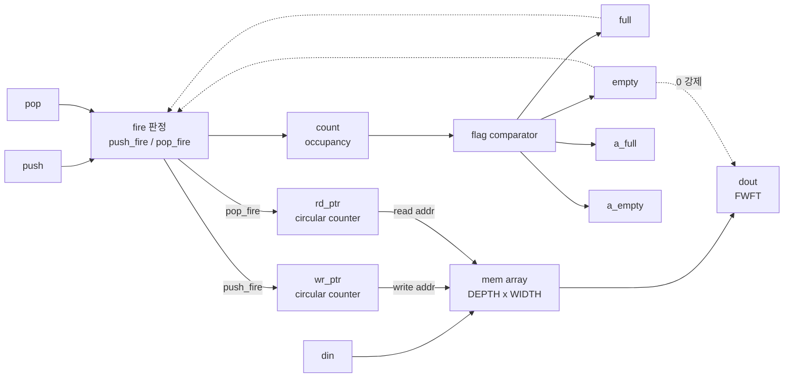
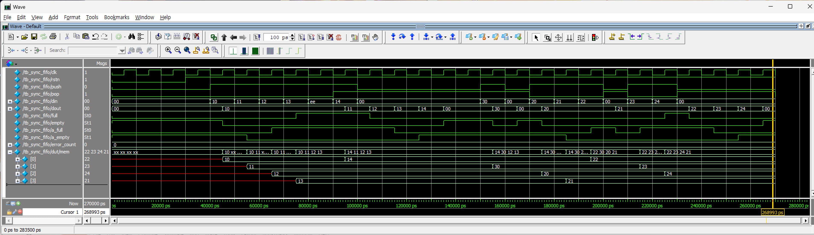

# Synchronous FIFO

단일 clock 동기식 FIFO(First-In First-Out) buffer입니다. 하나의 `clk`로 push(write)와 pop(read)을 처리하며, parameter로 depth·width·almost-full/almost-empty threshold를 조정할 수 있습니다. First-word fall-through(FWFT) 방식이라 읽을 data가 있으면 pop을 기다리지 않고 `dout`에 미리 나와 있습니다.

- Counter 기반 occupancy 추적 + circular pointer 구조

---

## Interface

### Parameters

| Parameter | Default | 설명 |
|---|---|---|
| `DEPTH` | 8 | FIFO entry 개수 |
| `WIDTH` | 32 | Data word 비트 width |
| `AF_LEVEL` | 1 | almost-full threshold. `count >= DEPTH - AF_LEVEL`일 때 `a_full` assert |
| `AE_LEVEL` | 1 | almost-empty threshold. `count <= AE_LEVEL`일 때 `a_empty` assert |

### Ports

| Port | Direction | 설명 |
|---|---|---|
| `clk` | in | Clock |
| `rstn` | in | Asynchronous active-low reset |
| `push` | in | Write 요청 |
| `pop` | in | Read 요청 |
| `din[WIDTH-1:0]` | in | Write data |
| `dout[WIDTH-1:0]` | out | Read data (FWFT, `empty=0`일 때만 valid) |
| `full` | out | Full |
| `empty` | out | Empty |
| `a_full` | out | almost-full |
| `a_empty` | out | almost-empty |

---

## Block Diagram



실선은 data, 점선은 되먹임되는 state 신호입니다. Flag가 전부 `count` 하나에서 나오고, 그 flag가 다시 fire 판정으로 되돌아가는 고리가 이 설계의 뼈대입니다.

---

## Design

### State 추적

Pointer 두 개와 counter 하나로 state를 관리합니다.

- `wr_ptr` — 다음에 쓸 위치. push가 실제로 일어날 때(`push_fire`) 증가하고, `DEPTH-1`에서 0으로 되돌아갑니다(circular).
- `rd_ptr` — 다음에 읽을 위치. pop이 실제로 일어날 때(`pop_fire`) 같은 방식으로 순환합니다.
- `count` — 현재 저장된 word 수. full/empty/almost flag가 전부 이 값 하나에서 파생됩니다.

`wr_ptr == rd_ptr`은 empty와 full에서 모두 성립하기 때문에 pointer만으로는 둘을 구분할 수 없습니다. 그래서 별도의 `count`를 두어 두 state를 명확히 구분합니다.

Flag는 모두 combinational logic입니다.

```
full    = (count == DEPTH)
empty   = (count == 0)
a_full  = (count >= DEPTH - AF_LEVEL)
a_empty = (count <= AE_LEVEL)
```

### push_fire / pop_fire

요청 신호(`push`/`pop`)가 실제 동작으로 이어지는지는 별도로 판단합니다.

- `pop_fire = pop && !empty` — empty면 pop 요청은 무시됩니다.
- `push_fire = push && (!full || pop_fire)` — full이면 push는 무시되지만, **같은 cycle에 valid한 pop이 일어나면** 한 칸이 비므로 push도 받아들입니다.

이 "full state에서 push+pop 동시 처리" 덕분에 full state에서도 매 cycle 한 word를 replace(pop 후 push)하며 throughput을 유지할 수 있습니다.

요청 조합과 FIFO state에 따른 동작을 정리하면 다음과 같습니다.

| `push` | `pop` | State | `push_fire` | `pop_fire` | `count` |
|:---:|:---:|---|:---:|:---:|:---:|
| 0 | 0 | — | 0 | 0 | 유지 |
| 1 | 0 | 여유 있음 | 1 | 0 | +1 |
| 1 | 0 | **full** | 0 | 0 | 유지 (push 무시) |
| 0 | 1 | Data 있음 | 0 | 1 | −1 |
| 0 | 1 | **empty** | 0 | 0 | 유지 (pop 무시) |
| 1 | 1 | 중간 state | 1 | 1 | 유지 (동시 통과) |
| 1 | 1 | **full** | 1 | 1 | 유지 (**replace**) |
| 1 | 1 | **empty** | 1 | 0 | +1 (push만 수용) |

굵게 표시한 세 행이 boundary condition이고, testbench가 집중적으로 검증하는 지점이기도 합니다.

### First-word fall-through

`dout = empty ? '0 : mem[rd_ptr]`로, 읽을 data가 있으면 pop assert를 기다리지 않고 항상 선두 word가 출력에 나와 있습니다. 소비자는 `empty=0`을 확인하고 `dout`을 곧바로 읽은 뒤 pop으로 pointer를 넘기면 됩니다(표준 FIFO의 "pop 후 다음 cycle에 data 등장"과 다른 점).

### Parameter 검증

`initial` block에서 `DEPTH >= 1`, `WIDTH >= 1`, `AF_LEVEL <= DEPTH`, `AE_LEVEL <= DEPTH`를 확인하고, 위반 시 `$fatal`로 정지시켜 잘못된 parameter 조합을 조기에 잡습니다.

---

## Verification

`tb_sync_fifo.sv`는 `DEPTH=4`, `WIDTH=8`, `AF_LEVEL=1`, `AE_LEVEL=1` 구성에서 reference model과 DUT를 매 transaction 비교하는 self-checking testbench입니다.

### 검증 방식

**Reference model** — SystemVerilog queue `model_q[$]`가 golden model입니다. DUT와 무관하게 같은 자극을 받아 독립적으로 갱신되고, 매 cycle DUT와 대조됩니다.

**`cycle(push, pop, din)` task** — transaction 하나를 처리하는 단위이며, 순서는 다음과 같습니다.

1. `@(negedge clk)`에서 입력을 인가 (setup 여유 확보, clock edge와 분리)
2. 인가 직전 state로 `push_fire`/`pop_fire`를 reference model 쪽에서도 계산 — RTL과 같은 식(`pop && count!=0`, `push && (count!=DEPTH || pop_fire)`)을 TB에 독립 구현해 둠
3. `@(posedge clk)`에서 `dout`을 sampling. `pop_fire`가 예상되면 `model_q.pop_front()` 값과 비교 → 불일치 시 `data mismatch` error
4. `push_fire`가 예상되면 model queue에 `push_back`
5. `#1` 후 `check_flags()` — `full`/`empty`/`a_full`/`a_empty` 네 flag를 model queue 크기 기준 기댓값과 각각 대조

**Timeout guard** — 별도 `initial`에서 `#5000` 경과 시 `$fatal("TIMEOUT")`으로 hang을 방지합니다.

**종료 판정** — `error_count == 0`이면 `PASS: sync_fifo completed all checks`, 아니면 error 수와 함께 `$fatal`로 실패 처리합니다.

### 검증 Scenario (실행 순서)

Reset은 `rstn=0`으로 3 clock 유지 후 negedge에서 해제하고, 곧바로 `check_flags()`로 초기 state(`count=0` → `empty=1`, `a_empty=1`)를 확인합니다. 이후 24개 transaction이 순서대로 진행됩니다.

#### 1단계 — Fill: Flag 전이 경계 확인

Empty state에서 full이 될 때까지 연속 push하며, 각 flag가 정확한 occupancy에서 바뀌는지 확인합니다.

| # | 호출 | 동작 | count | 확인 포인트 |
|:---:|---|---|:---:|---|
| 1 | `cycle(1,0,8'h10)` | push 10 | 1 | `empty` 해제 |
| 2 | `cycle(1,0,8'h11)` | push 11 | 2 | `a_empty` 해제 (2 > `AE_LEVEL`) |
| 3 | `cycle(1,0,8'h12)` | push 12 | 3 | `a_full` assert (3 >= `DEPTH-AF_LEVEL`) |
| 4 | `cycle(1,0,8'h13)` | push 13 | 4 | `full` assert |

#### 2단계 — Full 경계: push 무시 / 동시 요청 replace

| # | 호출 | 동작 | count | 확인 포인트 |
|:---:|---|---|:---:|---|
| 5 | `cycle(1,0,8'hEE)` | **무시** | 4 | full에서 `push_fire=0`. 0xEE는 유실되어야 하며, 이후 pop 순서에 나타나지 않음으로 검증 |
| 6 | `cycle(1,1,8'h14)` | pop 10 **＋** push 14 | 4 | full에서 동시 요청 → `push_fire=1`, `pop_fire=1`. Occupancy 유지하며 **replace** |

6번은 이 설계의 핵심 case입니다. 일반적인 FIFO라면 full일 때 push를 거부하지만, 여기서는 같은 cycle의 pop이 자리를 비우므로 받아들입니다.

#### 3단계 — Drain: 순서 보존 및 Flag 역방향 전이

| # | 호출 | 동작 | count | 확인 포인트 |
|:---:|---|---|:---:|---|
| 7 | `cycle(0,1,'0)` | pop 11 | 3 | |
| 8 | `cycle(0,1,'0)` | pop 12 | 2 | `a_full` 해제 |
| 9 | `cycle(0,1,'0)` | pop 13 | 1 | `a_empty` assert |
| 10 | `cycle(0,1,'0)` | pop 14 | 0 | `empty` assert |

10번에서 마지막으로 나오는 값이 6번에 넣은 `0x14`라는 점이 중요합니다. 5번의 `0xEE`가 실제로 버려졌고, 6번의 push는 queue 맨 뒤에 제대로 들어갔음을 함께 증명합니다.

#### 4단계 — Empty 경계: pop 무시 / 동시 요청 push 우선

| # | 호출 | 동작 | count | 확인 포인트 |
|:---:|---|---|:---:|---|
| 11 | `cycle(0,1,'0)` | **무시** | 0 | empty에서 `pop_fire=0`. `rd_ptr` 불변 |
| 12 | `cycle(1,1,8'h30)` | push 30만 | 1 | empty에서 동시 요청 → `push_fire=1`, `pop_fire=0`. 쓴 값을 같은 cycle에 그대로 빼내지 않음 |
| 13 | `cycle(0,1,'0)` | pop 30 | 0 | 12번의 data가 정상 저장됐는지 확인 |

#### 5단계 — Wraparound: Pointer 순환

`DEPTH=4`이므로 pointer는 3에서 0으로 되돌아갑니다. push와 pop을 섞어 진행해 `wr_ptr`과 `rd_ptr`이 **서로 다른 시점에 독립적으로** wrap하도록 만든 구간입니다.

| # | 호출 | 동작 | count | Pointer |
|:---:|---|---|:---:|---|
| 14 | `cycle(1,0,8'h20)` | push 20 → `mem[2]` | 1 | `wr_ptr` 2→3 |
| 15 | `cycle(1,0,8'h21)` | push 21 → `mem[3]` | 2 | `wr_ptr` 3→0 **wrap** |
| 16 | `cycle(1,0,8'h22)` | push 22 → `mem[0]` | 3 | `a_full` assert |
| 17 | `cycle(0,1,'0)` | pop 20 | 2 | `rd_ptr` 2→3 |
| 18 | `cycle(1,0,8'h23)` | push 23 → `mem[1]` | 3 | |
| 19 | `cycle(1,0,8'h24)` | push 24 → `mem[2]` | 4 | `full` assert |
| 20 | `cycle(0,1,'0)` | pop 21 | 3 | `rd_ptr` 3→0 **wrap** |
| 21 | `cycle(0,1,'0)` | pop 22 | 2 | |
| 22 | `cycle(0,1,'0)` | pop 23 | 1 | |
| 23 | `cycle(0,1,'0)` | pop 24 | 0 | `empty` assert |

Wraparound가 두 번(15번 write, 20번 read) 일어나는 동안에도 `0x20 → 0x24` 순서가 그대로 유지되는지가 이 단계의 판정 기준입니다. 물리적 address는 뒤섞이지만 논리적 FIFO 순서는 보존되어야 합니다.

### Coverage 요약

| 검증 항목 | 해당 Transaction |
|---|---|
| Reset 후 초기 flag | Reset 직후 |
| 네 flag의 상승/하강 경계 | 1–4, 7–10 |
| full에서 push 무시 | 5 |
| full에서 동시 push+pop (replace) | 6 |
| empty에서 pop 무시 | 11 |
| empty에서 동시 push+pop (push 우선) | 12 |
| Data 순서 보존 (FIFO 성질) | 7–10, 20–23 |
| `wr_ptr` wraparound | 15 |
| `rd_ptr` wraparound | 20 |
| Hang 방지 | Timeout guard |

---

## Files

- `sync_fifo.sv` — FIFO RTL (parameterized, FWFT)
- `tb_sync_fifo.sv` — self-checking testbench (reference model + boundary condition + timeout)
- `sync_fifo-netlist_schematic.png` — 합성 netlist schematic
- `tb_sync_fifo-RTL_sim.png` — TB RTL simulation waveform

---

## Reference Images

### Netlist Schematic


### RTL Simulation Waveform


