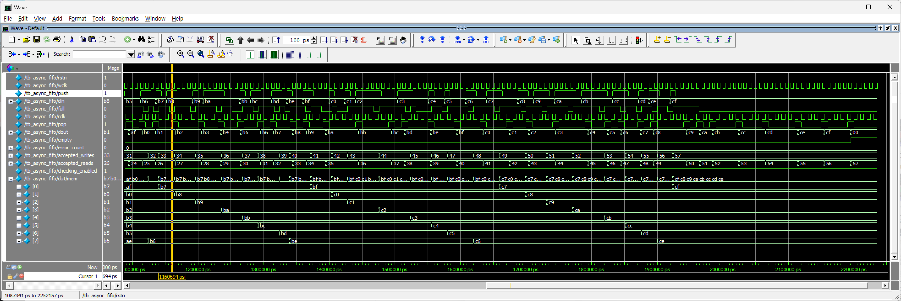

# Asynchronous FIFO

서로 독립적인 두 클럭(`wclk`, `rclk`) 사이에서 데이터를 전달하는 비동기 FIFO입니다. 쓰기와 읽기가 각자의 클럭 도메인에서 동작하며, 두 도메인을 잇는 포인터 교환은 **Gray 코드 + 2단 플립플롭 동기화**로 처리합니다. 클럭 주파수·위상 관계가 전혀 없어도 데이터 무결성이 보장되는 것이 목표입니다.

- Gray 코드 포인터 + 2-flop synchronizer 기반 CDC
- 비동기 인가 / 동기 해제(async-assert, sync-deassert) 리셋을 각 도메인에 독립 적용
- First-word fall-through(FWFT) 출력

---

## Interface

### Parameters

| 파라미터 | 기본값 | 설명 |
|---|---|---|
| `DEPTH` | 8 | FIFO 엔트리 개수. **2의 거듭제곱이어야 함** |
| `WIDTH` | 8 | 데이터 워드 비트 폭 |

내부 파생 상수는 다음과 같습니다.

| 상수 | 값 | 설명 |
|---|---|---|
| `ADDR_W` | `$clog2(DEPTH)` | 메모리 주소 폭 (`DEPTH=8` → 3) |
| `PTR_W` | `ADDR_W + 1` | 포인터 폭. **주소보다 1비트 넓음** (`DEPTH=8` → 4) |
| `FULL_COMPARE_MASK` | `{2'b11, 0...}` | full 판정용 마스크 (`PTR_W=4` → `4'b1100`) |

### Ports

| 포트 | 방향 | 도메인 | 설명 |
|---|---|---|---|
| `rstn` | in | 공통 | 비동기 active-low 리셋 |
| `wclk` | in | write | 쓰기 클럭 |
| `push` | in | write | 쓰기 요청 |
| `din[WIDTH-1:0]` | in | write | 쓰기 데이터 |
| `full` | out | write | 가득 참 (write 도메인 등록 출력) |
| `rclk` | in | read | 읽기 클럭 |
| `pop` | in | read | 읽기 요청 |
| `dout[WIDTH-1:0]` | out | read | 읽기 데이터 (FWFT, `empty=0`일 때 유효) |
| `empty` | out | read | 비어 있음 (read 도메인 등록 출력) |

`full`은 write 도메인에서만, `empty`는 read 도메인에서만 의미를 가집니다. 각 도메인의 소비자는 자기 쪽 플래그만 보면 됩니다.

---

## Block Diagram


동기화기는 **받는 쪽 도메인 안에** 있습니다. `wgray`를 받는 2-flop sync는 `rclk`으로, `rgray`를 받는 쪽은 `wclk`으로 동작하기 때문입니다. 그래서 도메인 경계를 실제로 건너는 것은 **굵은 화살표 두 개, 즉 Gray 포인터 두 개뿐**이고, 그 화살표는 곧바로 동기화기의 입력 플롭에 도착합니다. metastability가 발생할 수 있는 지점이 이 두 곳으로 한정된다는 뜻입니다.

데이터(`mem`)는 도메인을 건너지 않습니다. 쓰기 도메인이 쓴 자리를 읽기 도메인이 나중에 읽을 뿐입니다. 포인터 교환이 안전하면 데이터도 안전하다는 것이 이 구조의 논리입니다.

---

## Design

### 왜 Gray 코드인가

두 클럭이 비동기이므로, 한 도메인의 포인터를 다른 도메인에서 샘플링하는 순간 값이 바뀌고 있을 수 있습니다. **이진 카운터는 한 번 증가할 때 여러 비트가 동시에 바뀝니다.** 예를 들어 `0111 → 1000`은 4비트가 전부 뒤집히는데, 이 순간 샘플링하면 각 비트가 제각각 옛값/새값으로 잡혀 `1111`이나 `0000` 같은 **존재한 적 없는 값**이 나올 수 있습니다. 포인터가 엉뚱한 값으로 읽히면 full/empty 판정이 무너집니다.

Gray 코드는 인접한 두 값이 **정확히 한 비트만** 다릅니다.

```
bin2gray(bin) = (bin >> 1) ^ bin
```

한 비트만 바뀌므로, 전이 중에 샘플링해도 결과는 **옛값 아니면 새값** 둘 중 하나입니다. 어느 쪽이 잡히든 실제로 존재했던 유효한 포인터 값이고, 최악의 경우 한 사이클 뒤처진 값일 뿐입니다. 뒤처진 값은 뒤에서 설명할 "보수적 판정" 덕분에 안전합니다.

`DEPTH`가 2의 거듭제곱이어야 하는 이유도 여기 있습니다. Gray 코드의 순환은 2의 거듭제곱 주기에서만 "마지막 값 → 첫 값"도 한 비트 차이가 되기 때문입니다.

### 포인터가 주소보다 1비트 넓은 이유

`PTR_W = ADDR_W + 1`로, 실제 메모리 주소(`ADDR_W`)보다 한 비트를 더 씁니다. 이 여분의 최상위 비트는 **몇 바퀴 돌았는지**를 기록합니다.

- 메모리 접근에는 하위 `ADDR_W`비트만 사용: `mem[wbin[ADDR_W-1:0]]`
- 판정에는 `PTR_W`비트 전체 사용

이 비트가 없으면 "비어 있음"과 "가득 참"이 구분되지 않습니다. 두 경우 모두 주소가 같기 때문입니다. 여분 비트가 있으면 같은 주소라도 write가 read보다 한 바퀴 앞섰는지(가득 참) 같은 바퀴인지(비어 있음)를 구분할 수 있습니다. 동기 FIFO에서 `count` 레지스터가 하던 역할을, 비동기 FIFO에서는 이 한 비트가 대신합니다.

### empty 판정 — read 도메인

```systemverilog
empty_next = (rgray_next == wgray_sync_rclk);
```

읽기 포인터가 동기화된 쓰기 포인터를 따라잡으면 비어 있습니다. Gray 코드에서도 **전체 비트가 같다 = 두 포인터가 같다**이므로 단순 동등 비교로 충분합니다.

### full 판정 — write 도메인

```systemverilog
localparam logic [PTR_W-1:0] FULL_COMPARE_MASK = {2'b11, {(PTR_W-2){1'b0}}};
full_next = (wgray_next == (rgray_sync_wclk ^ FULL_COMPARE_MASK));
```

이진 포인터 기준으로 가득 참은 "**주소는 같고 여분 MSB만 다르다**", 즉 `wbin = rbin + 2^(PTR_W-1)`입니다. 이것을 Gray 영역으로 옮기면 왜 **상위 두 비트**를 뒤집는지 나옵니다.

XOR은 선형이므로,

```
gray_w ^ gray_r = (bin_w ^ bin_r) ^ ((bin_w ^ bin_r) >> 1)
                = 2^(PTR_W-1) ^ 2^(PTR_W-2)
                = {2'b11, 0...}          ← FULL_COMPARE_MASK
```

즉 두 Gray 포인터가 상위 두 비트만 다르고 나머지가 같으면 가득 찬 상태입니다. 코드에서는 동기화된 읽기 포인터에 마스크를 XOR해 "가득 찬 상태라면 나와야 할 쓰기 포인터 값"을 만들고, 그것과 실제 다음 쓰기 포인터를 비교합니다.

`DEPTH=8`(`PTR_W=4`, 마스크 `4'b1100`) 기준 실제 값으로 확인하면 다음과 같습니다.

| `wbin` | `wgray` | `rbin` | `rgray` | `rgray ^ 1100` | full |
|---|---|---|---|---|:---:|
| `1000` (8) | `1100` | `0000` (0) | `0000` | `1100` | ✅ |
| `1001` (9) | `1101` | `0001` (1) | `0001` | `1101` | ✅ |
| `1100` (12) | `1010` | `0100` (4) | `0110` | `1010` | ✅ |
| `0100` (4) | `0110` | `0000` (0) | `0000` | `1100` | ❌ (4칸만 참) |

### 2단 플립플롭 동기화

```systemverilog
(* async_reg = "true" *) logic [PTR_W-1:0] rgray_meta_wclk, rgray_sync_wclk;
```

각 Gray 포인터는 상대 도메인에서 플립플롭 두 개를 거쳐 받습니다. 첫 번째 플롭(`_meta`)은 셋업/홀드를 위반해 metastable 상태에 빠질 수 있지만, 한 클럭 주기 동안 안정화될 시간을 준 뒤 두 번째 플롭(`_sync`)이 다시 잡아 안정된 값을 만듭니다. metastability를 완전히 없앨 수는 없고 **MTBF를 실용적인 수준까지 높이는** 것이 목적입니다.

`(* async_reg = "true" *)` 속성은 합성·배치 도구에 "이 플롭들은 동기화 체인이니 물리적으로 가깝게 붙여라"라고 지시합니다. 두 플롭 사이 배선이 길면 안정화 시간이 줄어 MTBF가 나빠지기 때문입니다.

### 플래그의 보수성 (안전한 방향으로만 틀림)

동기화에 2클럭이 걸리므로 각 도메인이 보는 상대 포인터는 항상 **과거의 값**입니다. 그 결과 두 플래그는 다음과 같이 한쪽으로만 틀립니다.

| 플래그 | 사용하는 정보 | 오차 방향 | 결과 |
|---|---|---|---|
| `full` | 뒤처진 읽기 포인터 | 실제보다 **여유를 적게** 봄 | 읽기가 방금 일어났는데도 잠시 full 유지 |
| `empty` | 뒤처진 쓰기 포인터 | 실제보다 **데이터를 적게** 봄 | 쓰기가 방금 일어났는데도 잠시 empty 유지 |

두 오차 모두 **성능만 조금 손해 보고 정확성은 해치지 않는 방향**입니다. 가득 차지 않았는데 full이라고 하는 건 쓰기를 잠시 늦출 뿐이고, 데이터가 있는데 empty라고 하는 건 읽기를 잠시 늦출 뿐입니다. 반대 방향(가득 찼는데 full이 안 뜨는 것, 비었는데 empty가 안 뜨는 것)은 데이터 손상·유실로 이어지는데, 이 구조에서는 원리적으로 발생하지 않습니다.

플래그는 조합 결과(`full_next`/`empty_next`)를 포인터와 **같은 사이클에 함께 등록**하므로, 플래그와 포인터 사이에 추가 지연은 없습니다.

### 리셋 — 비동기 인가, 동기 해제

```systemverilog
always_ff @(posedge wclk or negedge rstn)
    if (!rstn) wrst_pipe <= '0;
    else       wrst_pipe <= {wrst_pipe[0], 1'b1};
assign wrstn = wrst_pipe[1];
```

외부 `rstn`은 클럭과 무관하게 즉시 인가되지만, **해제 시점은 각 도메인의 클럭에 맞춰 정렬**됩니다. `rstn`이 풀리면 시프트 레지스터에 1이 두 클럭에 걸쳐 밀려 들어가고, 그 출력(`wrstn`/`rrstn`)이 실제 로직의 리셋으로 쓰입니다.

해제를 동기화하지 않으면 리셋이 풀리는 순간이 클럭 에지와 겹쳐 recovery/removal 타이밍을 위반하고, 일부 플롭만 리셋에서 빠져나오는 상태가 생길 수 있습니다. 비동기 FIFO에서는 이것이 두 포인터의 불일치로 직결되므로 특히 중요합니다. 두 도메인이 각자 독립된 동기화기를 갖는 것도 같은 이유입니다.

### FWFT 출력

```systemverilog
assign dout = empty ? '0 : mem[rbin[ADDR_W-1:0]];
```

읽을 데이터가 있으면 `pop` 없이도 선두 워드가 `dout`에 나와 있습니다. 소비자는 `empty=0`을 확인하고 `dout`을 읽은 뒤 `pop`으로 포인터를 넘기면 됩니다.

메모리는 `wclk`에 동기로 쓰고 조합 논리로 읽으므로, 합성 시 block RAM이 아니라 **distributed RAM(LUT RAM)** 으로 추론되는 것이 일반적입니다. 깊이가 큰 FIFO에서 block RAM을 쓰려면 등록 출력 방식으로 바꿔야 합니다.

### fire 조건

```systemverilog
assign write_fire = push && !full;
assign read_fire  = pop  && !empty;
```

동기 FIFO의 "full 상태에서 push+pop 동시 처리" 같은 예외는 없습니다. 두 도메인이 독립적이라 같은 사이클이라는 개념 자체가 성립하지 않고, 각자 자기 플래그만 보고 판단합니다.

### 파라미터 검증

`initial` 블록에서 `DEPTH >= 2`, **`DEPTH`가 2의 거듭제곱**(`DEPTH & (DEPTH-1) == 0`), `WIDTH >= 1`을 확인하고 위반 시 `$fatal`로 정지시킵니다. Gray 포인터 구조가 2의 거듭제곱을 전제하므로, 잘못된 깊이를 조용히 넘기지 않는 것이 중요합니다.

---

## Verification

`tb_async_fifo.sv`는 `DEPTH=8`, `WIDTH=8` 구성에서 두 클럭을 서로소에 가까운 주기로 돌리며 검증하는 self-checking 테스트벤치입니다.

### 클럭 설정

| 클럭 | 반주기 | 주기 |
|---|---|---|
| `wclk` | 4 ns | 8 ns |
| `rclk` | 5 ns | 10 ns |

`4 + 8n = 5 + 10m`을 만족하는 정수 해가 없으므로 **두 상승 에지는 시뮬레이션 내내 절대 겹치지 않습니다.** 에지가 겹치면 시뮬레이터의 이벤트 처리 순서에 따라 결과가 달라져 검증이 모호해지는데, 이를 원천 차단한 설정입니다. 동시에 두 도메인의 위상 관계가 계속 미끄러지므로 CDC 타이밍이 다양한 조합으로 자연스럽게 커버됩니다.

### 검증 방식

**도메인별 독립 모니터** — 자극을 주는 태스크와 검사하는 로직이 분리되어 있습니다.

- `always @(posedge wclk)` — DUT가 실제로 수락한 쓰기(`push && !full`)를 감지해 `model_q`에 `push_back`하고 `accepted_writes` 증가
- `always @(posedge rclk)` — 실제로 수락된 읽기(`pop && !empty`)에서 `dout`을 `model_q.pop_front()`와 비교, `accepted_reads` 증가

두 모니터가 각자의 클럭에서 독립적으로 동작하기 때문에, "요청했는데 수락되지 않은" 경우와 "수락된" 경우가 자동으로 구분됩니다. 참조 큐가 비었는데 읽기가 수락되면 그 자체로 에러 처리됩니다.

**`checking_enabled` 게이트** — 리셋 구간에서는 모니터를 꺼 두어, 리셋 동기화가 끝나기 전의 과도 상태가 오검출로 이어지지 않게 합니다.

**백프레셔 인지 드라이버** — `write_word()`/`read_word()`는 요청을 걸어 놓고 **수락될 때까지 기다립니다.**

```systemverilog
while (!accepted) begin
    @(posedge wclk);
    accepted = !full;
end
```

이 구조 덕분에 FIFO가 가득 차거나 비었을 때 자동으로 정체(stall)했다가 재개하며, CDC 지연으로 플래그가 늦게 풀리는 상황도 자연스럽게 견딥니다.

**타임아웃 가드** — `#20000` 경과 시 `$fatal("TIMEOUT")`. 백프레셔 대기가 영원히 풀리지 않는 버그(예: full이 영영 안 내려감)를 행 대신 명시적 실패로 잡아냅니다.

### 검증 시나리오 (실행 순서)

#### 1단계 — 리셋 해제와 초기 상태

`rstn`을 `#37`에 해제합니다. 37 ns는 두 클럭 어느 쪽의 상승 에지와도 겹치지 않는 시점이라, **비동기 해제가 실제로 비동기적으로** 들어갑니다. 이후 각 도메인에서 4클럭씩 기다려 내부 리셋 동기화기가 정착하게 한 뒤 검사를 활성화합니다.

| 검사 | 기대값 |
|---|---|
| `expect_full(0)` | 리셋 후 가득 차지 않음 |
| `expect_empty(1)` | 리셋 후 비어 있음 |

#### 2단계 — Fill: 용량까지 채우기

`0x10`부터 `0x17`까지 `DEPTH`개(8개)를 씁니다. 각 쓰기는 수락될 때까지 대기하므로 실제로 8개가 모두 들어갑니다.

| 검사 | 기대값 |
|---|---|
| `expect_full(1)` | 정확히 `DEPTH`개에서 full 어서트 |

#### 3단계 — full 상태에서 쓰기 거부

`0xEE`를 실은 `push`를 3클럭 동안 유지한 뒤, `accepted_writes`가 **변하지 않았는지** 확인합니다. 값 자체를 검사하는 대신 모니터의 카운터로 판정하므로, "요청은 갔지만 수락되지 않았다"를 정확히 검증합니다. `0xEE`가 실제로 버려졌다는 것은 이후 드레인 순서에 나타나지 않음으로도 재확인됩니다.

#### 4단계 — CDC 지연을 통과하는 읽기·쓰기 교환

```systemverilog
fork
    read_word();
    write_word(8'h80);
join
```

이 단계가 이 테스트벤치의 핵심입니다. 가득 찬 상태에서 read 도메인이 한 워드를 빼내지만, **write 도메인의 `full`은 즉시 내려가지 않습니다.** 읽기 포인터가 Gray 코드로 인코딩되고 2단 동기화기를 통과해 write 도메인에 도달해야 비로소 `full`이 해제됩니다.

`write_word(8'h80)`은 그동안 요청을 유지한 채 대기하다가, `full`이 풀리는 순간 수락됩니다. 즉 **CDC 왕복 지연이 실제로 존재하고, 그것이 끝나면 정상 복구된다**는 것을 동시에 확인합니다. 교환이 끝나면 점유량은 다시 `DEPTH`입니다.

#### 5단계 — Drain: 순서 보존 확인

`DEPTH`개를 읽어 비웁니다. 나오는 순서는 `0x11` … `0x17` 다음 4단계에서 넣은 `0x80`이어야 하며, 모니터가 매 읽기마다 참조 큐와 대조합니다.

| 검사 | 기대값 |
|---|---|
| `expect_empty(1)` | 전부 빠져나온 뒤 empty |

#### 6단계 — empty 상태에서 읽기 거부

`pop`을 3클럭 유지한 뒤 `accepted_reads`가 변하지 않았는지 확인합니다. 3단계의 대칭 케이스입니다.

#### 7단계 — 랜덤 동시 트래픽

```systemverilog
fork
    writer_thread : 48회 write, 매회 0–2 wclk 간격
    reader_thread : 48회 read,  매회 0–3 rclk 간격
join
```

두 스레드가 서로 다른 랜덤 간격으로 동시에 동작합니다. 읽기 쪽 평균 간격이 더 길고 `rclk`이 더 느리므로 FIFO는 자주 가득 차고, 쓰기 쪽이 백프레셔로 정체했다 재개하는 상황이 반복됩니다. 이 구간에서 자연히 커버되는 것들은 다음과 같습니다.

- 포인터 랩어라운드 (48회 > `DEPTH`=8, 여러 바퀴 순환)
- 양방향 CDC 동기화의 반복 발생
- full/empty 경계를 오가는 다양한 위상 조합
- 백프레셔 하에서의 데이터 순서 보존

#### 8단계 — 종료 정합성 검사

트래픽 종료 후 4 `rclk` 대기하고 세 가지를 확인합니다.

| 검사 | 의미 |
|---|---|
| `model_q.size() == 0` | 쓴 데이터가 하나도 남김없이 읽혔는가 |
| `accepted_writes == accepted_reads` | 수락된 트랜잭션 수가 양쪽에서 일치하는가 |
| `expect_empty(1)` | 최종 상태가 empty인가 |

세 검사가 함께 통과해야 데이터 유실도 중복도 없었음이 확정됩니다. 모두 통과하면 `PASS: async_fifo completed all checks`, 하나라도 실패하면 에러 수와 함께 `$fatal`입니다.

### 커버리지 요약

| 검증 항목 | 해당 단계 |
|---|---|
| 리셋 해제 후 초기 플래그 | 1 |
| full 어서트 경계 | 2 |
| full 상태에서 쓰기 거부 | 3 |
| CDC 지연 후 full 해제 및 쓰기 재개 | 4 |
| empty 어서트 경계 | 5 |
| empty 상태에서 읽기 거부 | 6 |
| 포인터 랩어라운드 | 7 |
| 양방향 CDC 반복 동기화 | 4, 7 |
| 백프레셔 하 데이터 순서 보존 | 5, 7 |
| 데이터 유실·중복 없음 | 8 |
| 행(hang) 방지 | 타임아웃 가드 |

---

## Files

- `async_fifo.sv` — 비동기 FIFO RTL (Gray 포인터, 2-flop 동기화, FWFT)
- `tb_async_fifo.sv` — self-checking 테스트벤치 (도메인별 모니터 + 백프레셔 드라이버 + 랜덤 트래픽)
- `async_fifo-block_diagram.png` — 위 블록 다이어그램
- `async_fifo-netlist_schematic.png` — 합성 네트리스트 schematic
- `tb_async_fifo-RTL_sim-1.png` / `-2.png` / `-3.png` — TB RTL 시뮬레이션 파형

---

## Reference Images

### Netlist Schematic


### RTL Simulation Waveforms



