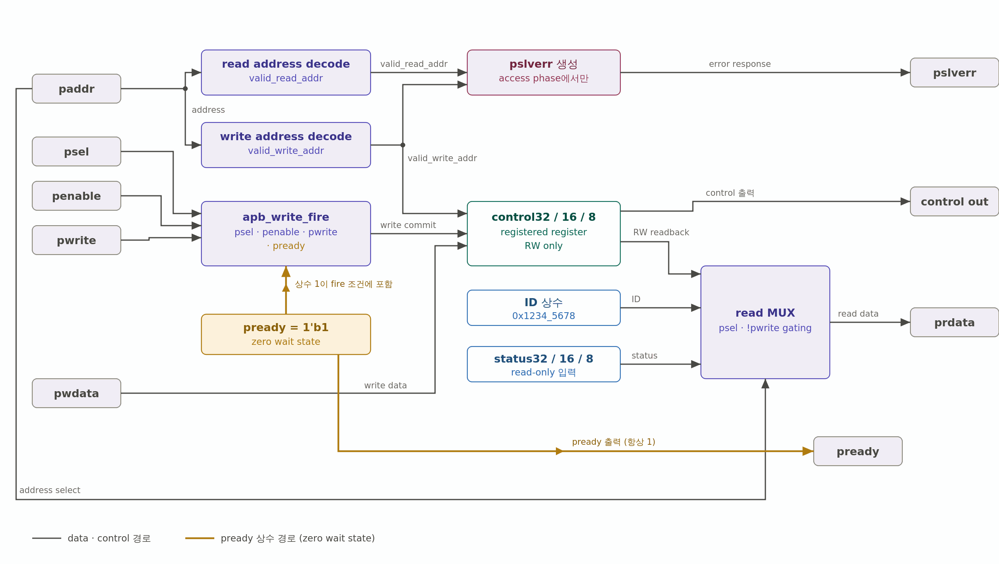

# APB Register Block

AMBA APB slave로 동작하는 register block입니다. 버스 master가 표준 APB 3-phase transfer로 control register를 읽고 쓸 수 있고, status 신호는 read-only로 노출합니다. `PREADY`를 항상 1로 고정한 **zero-wait-state** slave이며, 잘못된 access는 `PSLVERR`로 보고합니다.

- Combinational address decode + registered control register
- read address와 write address를 **분리 decode**하여 read-only register 보호
- reserved·unaligned·read-only write를 모두 `PSLVERR`로 응답하며, 실패한 access는 side effect 없음

---

## Interface

### Parameters

| 파라미터 | 기본값 | 설명 |
|---|---|---|
| `DW` | 32 | data bus 폭. **현재 register map은 32만 지원** |
| `AW` | 5 | address 폭. 32 byte(8 word) 영역. **최소 5** |

### APB Ports

| 포트 | 방향 | 설명 |
|---|---|---|
| `pclk` | in | bus clock |
| `presetn` | in | asynchronous active-low reset |
| `paddr[AW-1:0]` | in | byte address |
| `psel` | in | slave select (interconnect의 address decode 결과) |
| `penable` | in | access phase 표시 |
| `pwrite` | in | 1=write, 0=read |
| `pwdata[DW-1:0]` | in | write data |
| `prdata[DW-1:0]` | out | read data |
| `pready` | out | transfer 완료 (**상수 1**) |
| `pslverr` | out | error response |

### User Logic Ports

| 포트 | 방향 | 폭 | 설명 |
|---|---|---|---|
| `status32` / `status16` / `status8` | in | 32 / 16 / 8 | 하드웨어가 올려주는 status. read-only로 노출 |
| `control32` / `control16` / `control8` | out | 32 / 16 / 8 | 소프트웨어가 쓴 control. registered output |

---

## Register Map

`AW=5`이므로 32 byte 영역이고, 모든 register는 word aligned(4 byte 간격)입니다.

| Offset | Name | Access | Width | Reset | 설명 |
|---|---|---|---|---|---|
| `0x00` | `ID` | RO | 32 | `0x1234_5678` | 고정 ID |
| `0x04` | `CONTROL32` | RW | 32 | `0x0000_0000` | 32비트 control |
| `0x08` | `CONTROL16` | RW | 16 | `0x0000` | 하위 16비트만 저장 |
| `0x0C` | `CONTROL8` | RW | 8 | `0x00` | 하위 8비트만 저장 |
| `0x10` | — | — | — | — | **Reserved (unmapped)**. read·write 모두 error |
| `0x14` | `STATUS32` | RO | 32 | — | `status32` 입력 반영 |
| `0x18` | `STATUS16` | RO | 16 | — | `status16` 입력 반영 |
| `0x1C` | `STATUS8` | RO | 8 | — | `status8` 입력 반영 |

`0x10`은 의도적으로 비워 둔 hole입니다. unmapped address access가 제대로 error를 내는지 검증하는 데 쓰입니다.

**폭이 좁은 register**는 write 시 상위 비트가 truncate되고, read 시 zero-extend됩니다. 예를 들어 `CONTROL16`에 `0xFFFF_1234`를 쓰면 저장되는 값은 `0x1234`이고, readback하면 `0x0000_1234`가 나옵니다. truncate된 상위 비트가 다른 register로 새지 않는다는 점이 중요하며, testbench가 이를 직접 확인합니다.

---

## Block Diagram



address decode가 **read용·write용 두 갈래**로 갈라지는 것이 이 block의 뼈대입니다. read decoder는 7개 address를 모두 valid로 보고, write decoder는 `CONTROL*` 3개만 valid로 봅니다. 이 비대칭이 곧 read-only 보호 장치입니다.

`pready`는 output port이면서 동시에 `apb_write_fire`의 조건으로 되돌아옵니다. 상수 1로 고정되어 있어 실질적인 제약은 아니지만, wait state를 갖는 slave로 확장할 때 **write commit이 자동으로 `pready`를 따르도록** 자리를 잡아 둔 형태입니다.

---

## Design

### APB 3-phase transfer와 zero wait state

APB transfer는 IDLE → SETUP → ACCESS 세 phase로 진행됩니다.

| 신호 | IDLE | SETUP | ACCESS | IDLE |
|---|:---:|:---:|:---:|:---:|
| `PSEL` | 0 | 1 | 1 | 0 |
| `PENABLE` | 0 | 0 | 1 | 0 |
| `PADDR` / `PWRITE` / `PWDATA` | — | 유효 | 유효 (변화 없음) | — |
| `PREADY` | 1 | 1 | 1 | 1 |
| transfer 완료 | | | **이 rising edge** | |

```
assign pready = 1'b1;
```

`PREADY`가 상수 1이므로 ACCESS phase는 **항상 정확히 한 클럭**입니다. wait state가 없으니 FSM도 필요 없고, 조합 decode와 한 단의 register만으로 slave가 완성됩니다.

SETUP phase가 따로 있는 이유는 slave에게 **address를 decode할 한 클럭의 여유**를 주기 위함입니다. master는 SETUP에서 address·방향·data를 세우고, ACCESS에서 `PENABLE`을 올려 "이제 확정"이라고 알립니다. 그래서 실제 commit은 반드시 `PENABLE`이 선 뒤에 일어나야 합니다.

### Write commit 조건

```systemverilog
assign apb_write_fire = psel && penable && pwrite && pready;

always_ff @(posedge pclk or negedge presetn)
    if (!presetn) ...
    else if (apb_write_fire && valid_write_addr) ...
```

write는 `psel`·`penable`·`pwrite`·`pready`가 모두 성립한 rising edge에서만 일어납니다. **`penable`을 조건에 넣는 것이 핵심**입니다. SETUP phase에서 써버리면 master가 아직 확정하지 않은 값을 반영하게 되고, 한 transfer가 두 번 commit될 수도 있습니다.

여기에 `valid_write_addr`까지 더해 **address가 writable할 때만** register를 갱신합니다. `case`문의 `default`가 비어 있어 사실상 중복 조건이지만, 의도를 코드에 드러내고 나중에 address를 추가할 때 실수를 막아 줍니다.

### Read·Write address decode 분리

```systemverilog
// read: mapped된 7개 address 전부 valid
unique case (paddr)
    ADDR_ID, ADDR_CONTROL32, ADDR_CONTROL16, ADDR_CONTROL8,
    ADDR_STATUS32, ADDR_STATUS16, ADDR_STATUS8: ;
    default: valid_read_addr = 1'b0;
endcase

// write: CONTROL 3개만 valid
unique case (paddr)
    ADDR_CONTROL32, ADDR_CONTROL16, ADDR_CONTROL8: ;
    default: valid_write_addr = 1'b0;
endcase
```

두 decoder를 따로 두면 access 권한이 address별로 자연스럽게 표현됩니다. `ID`와 `STATUS*`는 read 목록에만 있으므로 **읽으면 정상, 쓰면 error**가 됩니다. 권한 검사를 별도 로직으로 얹지 않고 decode 단계에서 끝내는 방식입니다.

address 비교가 5비트 전체에 대한 exact match라서, `0x05`처럼 word align을 벗어난 unaligned address는 어느 목록에도 없어 자동으로 error가 됩니다. `paddr[1:0]`을 무시하는 설계보다 엄격하며, 소프트웨어의 address 계산 실수를 조용히 넘기지 않습니다.

`unique case`는 시뮬레이션 중 **분기가 겹치거나 하나도 맞지 않는 상황을 잡아 주는 assertion** 역할을 합니다. address 목록에 오타로 중복이 생기면 즉시 경고가 나옵니다. `default`가 있으므로 latch inference 걱정은 없습니다.

### PSLVERR 정책

```systemverilog
always_comb begin
    pslverr = 1'b0;
    if (psel && penable) begin
        if (pwrite) pslverr = !valid_write_addr;
        else        pslverr = !valid_read_addr;
    end
end
```

`PSLVERR`은 `psel && penable`, 즉 **ACCESS phase에서만** 의미를 갖습니다. AMBA 규격에서 `PSLVERR`은 `PREADY`가 높은 마지막 cycle에만 valid하다고 정의되는데, 이 설계는 `PREADY`가 항상 1이라 ACCESS phase가 곧 마지막 cycle입니다. 그 외 구간에서는 0으로 눌러 두어 master가 오해할 여지를 없앱니다.

error를 내는 경우는 세 가지입니다.

| 상황 | 예 | 결과 |
|---|---|---|
| read-only register에 write | `0x00`(ID), `0x14`(STATUS32)에 write | `PSLVERR=1`, register 변화 없음 |
| unmapped address access | `0x10` read·write | `PSLVERR=1`, `prdata=0` |
| unaligned address access | `0x05` read | `PSLVERR=1`, `prdata=0` |

**error response는 side effect가 없어야 합니다.** write가 거부되면 대상 register는 물론 다른 register도 건드리지 않습니다. 이 성질은 testbench가 실패한 write 뒤에 정상 register를 다시 읽어 확인합니다.

### Read data MUX

```systemverilog
always_comb begin
    prdata = '0;
    if (psel && !pwrite) begin
        unique case (paddr)
            ADDR_ID: prdata = 32'h1234_5678;
            ...
        endcase
    end
end
```

read는 combinational MUX입니다. gating 조건이 `psel && !pwrite`로 **`penable`을 포함하지 않는다는 점**이 눈에 띕니다. 덕분에 `prdata`는 SETUP phase부터 미리 valid한 값을 내보내지만, master는 완료된 ACCESS phase의 끝에서 sampling하므로 문제가 없습니다. 오히려 timing 여유가 늘어납니다.

선택되지 않았거나 write 중일 때 `prdata`를 **0으로 구동**하는 것도 의도적입니다. 여러 slave가 붙은 시스템에서 선택되지 않은 slave가 0을 내보내면, interconnect는 단순 OR나 MUX로 read data를 모을 수 있습니다. X가 propagate되지 않아 waveform 보기도 편해집니다.

### Reset

```systemverilog
always_ff @(posedge pclk or negedge presetn)
    if (!presetn) begin
        control32 <= 32'h0000_0000;
        control16 <= 16'h0000;
        control8  <= 8'h00;
    end
```

`presetn`은 asynchronous active-low로, APB 규격의 `PRESETn` 관례를 따릅니다. reset되는 것은 control register뿐입니다. `STATUS*`는 외부 입력을 그대로 통과시키므로 state를 갖지 않고, `prdata`·`pslverr`·`pready`는 combinational 출력이라 reset 대상이 아닙니다.

### Parameter 검증

```systemverilog
initial begin
    if (AW < 5)   $fatal(1, "AW must be at least 5");
    if (DW != 32) $fatal(1, "This register map currently requires DW=32");
end
```

address map이 `0x1C`까지 쓰므로 최소 5비트 address가 필요하고, register 폭과 read MUX가 32비트를 전제합니다. parameter를 바꿔 쓰다가 조용히 잘못된 회로가 만들어지는 것을 막습니다.

---

## Verification

`tb_apb_regs.sv`는 **slave 두 개를 붙인 bus 구성**에서 APB protocol을 준수하며 access하는 self-checking testbench입니다.

### 2-slave 구성 (interconnect 모사)

```systemverilog
apb_regs u_apb_regs_0 (... .psel(psel_0), .paddr(paddr[AW-1:0]) ...);
apb_regs u_apb_regs_1 (... .psel(psel_1), .paddr(paddr[AW-1:0]) ...);
```

두 instance가 `pclk`·`presetn`·`paddr[4:0]`·`penable`·`pwrite`·`pwdata`를 **공유**하고, 구분되는 것은 `psel`뿐입니다. 이것이 실제 APB bus의 모습입니다. slave select는 testbench가 상위 address로 계산합니다.

| Slave | 선택 조건 | Address 범위 |
|---|---|---|
| `u_apb_regs_0` | `paddr[31:5] == 0` | `0x00`–`0x1F` |
| `u_apb_regs_1` | `paddr[31:5] == 1` | `0x20`–`0x3F` |

응답 신호는 interconnect의 read data MUX를 모사한 combinational 논리로 모읍니다.

```systemverilog
wire selected_pready  = psel_0 ? pready_0  : psel_1 ? pready_1  : 1'b0;
wire selected_pslverr = psel_0 ? pslverr_0 : psel_1 ? pslverr_1 : 1'b0;
wire [DW-1:0] selected_prdata = psel_0 ? prdata_0 : psel_1 ? prdata_1 : '0;
```

같은 RTL을 두 번 instance화했으므로, slave 0에 쓴 값이 slave 1에 새지 않는지가 함께 검증됩니다. 두 slave에 **서로 다른 status와 control 값**을 넣는 이유가 이것입니다.

### `apb_transfer` task

protocol 준수를 task 하나에 캡슐화해 두어, 모든 access가 동일한 waveform으로 나갑니다.

1. **SETUP** — `@(negedge pclk)`에서 `paddr`·`pwdata`·`pwrite`를 세우고 `penable=0`, 상위 address로 `psel_0`/`psel_1`을 계산해 인가합니다. falling edge에 구동해 setup 여유를 확보합니다.
2. **자체 decode 검사** — `psel_0 ^ psel_1`이 참이 아니면 error로 기록합니다. slave가 하나도 안 뽑혔거나 둘이 동시에 뽑히는 상황, 즉 **testbench 자신의 address decode 버그**를 잡는 장치입니다.
3. **ACCESS** — 다음 falling edge에서 `penable=1`.
4. **완료 대기** — `@(posedge pclk)` 후 `#1`에 `selected_pready`를 확인하고, 낮으면 반복합니다. 이 slave는 항상 1이라 첫 edge에 끝나지만, **wait state가 있는 slave에도 그대로 재사용할 수 있는 구조**입니다. `wait_cycles`가 16을 넘으면 `$fatal`로 중단해 무한 대기를 막습니다.
5. **Sampling** — 완료된 edge에서 `prdata`와 `pslverr`을 포착합니다.
6. **IDLE** — 다음 falling edge에서 모든 신호를 해제합니다. transfer 사이에 IDLE을 두어 phase 경계를 뚜렷하게 만듭니다.

`apb_write_check`는 기대 `PSLVERR`을, `apb_read_check`는 기대 `PSLVERR`과 data를 함께 대조합니다. **error가 예상되는 read에서는 data를 검사하지 않습니다** — error response 시 `prdata`는 규격상 의미가 없기 때문입니다.

### 검증 Scenario (실행 순서)

#### 1단계 — Reset 값 확인

`presetn`을 3클럭 유지한 뒤 falling edge에서 해제하고, 2클럭 기다려 **두 slave의 control register 6개가 모두 0**인지 확인합니다.

#### 2단계 — Slave 0: ID read와 control register write

| Access | Address | Data | 기대 |
|---|---|---|---|
| read | `0x00` | — | `0x1234_5678` (ID 상수) |
| write | `0x04` | `0xA5A5_5A5A` | 정상 |
| write | `0x08` | `0xFFFF_1234` | 정상 (상위 16비트 truncate) |
| write | `0x0C` | `0xFFFF_FF56` | 정상 (상위 24비트 truncate) |

#### 3단계 — Slave 0: readback과 truncation 확인

| Access | Address | 기대 Data | 확인 내용 |
|---|---|---|---|
| read | `0x04` | `0xA5A5_5A5A` | 32비트 전체 보존 |
| read | `0x08` | `0x0000_1234` | **하위 16비트만 저장 + zero-extend** |
| read | `0x0C` | `0x0000_0056` | **하위 8비트만 저장 + zero-extend** |
| read | `0x14` | `status32` 입력값 | status 입력이 그대로 보임 |
| read | `0x18` | `0x0000_1601` | 16비트 status zero-extend |
| read | `0x1C` | `0x0000_0080` | 8비트 status zero-extend |

truncate된 상위 비트가 인접 register를 오염시키지 않았는지가 여기서 드러납니다.

#### 4단계 — Slave 1: 같은 map, 다른 값

base address `0x20`에서 2·3단계와 동일한 순서를 **다른 data**로 반복합니다.

| Access | Address | Data |
|---|---|---|
| read | `0x20` | `0x1234_5678` (ID는 instance 공통) |
| write / read | `0x24` | `0x1122_3344` |
| write / read | `0x28` | `0x0000_7788` |
| write / read | `0x2C` | `0x0000_0099` |
| read | `0x34` / `0x38` / `0x3C` | `status32_1` / `status16_1` / `status8_1` |

slave 0과 값이 전부 다르므로, readback이 모두 통과하면 **두 instance가 완전히 독립**이고 `psel` 기반 select가 정확하다는 뜻입니다.

#### 5단계 — Error response

| Access | Address | 분류 | 기대 |
|---|---|---|---|
| write | `0x00` | read-only(ID)에 write | `PSLVERR=1` |
| write | `0x14` | read-only(STATUS32)에 write | `PSLVERR=1` |
| read | `0x10` | unmapped address | `PSLVERR=1` |
| read | `0x05` | unaligned address | `PSLVERR=1` |

네 경우 모두 `0xDEAD_BEEF` 같은 눈에 띄는 data를 실어 보내, 혹시라도 반영되면 즉시 드러나게 했습니다.

#### 6단계 — Side effect 없음 확인

```systemverilog
apb_read_check(32'h0000_0004, 32'hA5A5_5A5A, 1'b0);
```

마지막으로 `0x04`를 다시 읽어 **2단계에서 쓴 값이 그대로 남아 있는지** 확인합니다. 5단계의 거부된 write들이 엉뚱한 register를 건드렸다면 이 검사에서 잡힙니다. error response의 핵심 요건인 "side effect 없음"을 직접 검증하는 지점입니다.

모든 검사를 통과하면 `PASS: APB register block completed all checks`, 하나라도 실패하면 error 수와 함께 `$fatal`입니다. 별도 `initial`의 `#10_000` timeout이 hang을 막습니다.

### Coverage 요약

| 검증 항목 | 해당 단계 |
|---|---|
| Reset 값 | 1 |
| ID 상수 read | 2, 4 |
| RW register write·readback | 2, 3, 4 |
| 좁은 register truncation 및 zero-extend | 3, 4 |
| Status 입력 통과 read | 3, 4 |
| 다중 slave select·독립성 | 4 |
| read-only write error | 5 |
| unmapped address error | 5 |
| unaligned address error | 5 |
| error access의 side effect 없음 | 6 |
| APB 3-phase waveform 준수 | 모든 access (`apb_transfer`) |
| Slave select 유일성 | 모든 access (`psel_0 ^ psel_1`) |
| Transfer 완료 대기 / hang 방지 | `wait_cycles > 16`, `#10_000` |

---

## Files

- `apb_regs.sv` — APB slave register block RTL
- `tb_apb_regs.sv` — self-checking testbench (2-slave 구성, protocol task, error case)
- `apb_regs-block_diagram.png` — 위 block diagram
